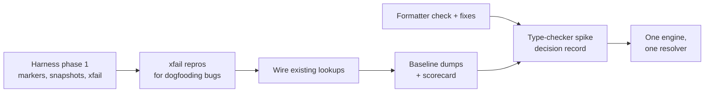

# North Star

> **gvy gives correct, honest and fast answers about Groovy code, and never damages it.**

This page is gvy's only roadmap. Every lane of work, every priority call and every quality claim should trace back to
the sentence above. The page changes rarely; live status of the lanes is tracked in
[#1551](https://github.com/albertocavalcante/gvy/issues/1551).

## Principles

| Principle                        | In practice                                                                                                                                                                                                    |
| -------------------------------- | -------------------------------------------------------------------------------------------------------------------------------------------------------------------------------------------------------------- |
| **The compiler decides**         | Types, resolution and diagnostics come from the Groovy compiler, including its static type checker. gvy adds editor concerns on top (partial code, error tolerance) instead of keeping a parallel type system. |
| **Never damage code**            | Formatting, rename and code actions are guarded by checks that need no expected output. When in doubt, gvy returns no edit.                                                                                    |
| **Honest answers**               | Unknown is shown as unknown, inferred guesses are labelled, refactorings refuse rather than guess, and no AST class names or `@hash` strings reach the user.                                                   |
| **Measured, not claimed**        | Every quality statement, including the [feature matrix](lsp/feature-support.md), comes from the scorecard at a named commit.                                                                                   |
| **Every bug is a test**          | A bug report ships as an executable repro, marked `xfail` until fixed; a fix is a test that flips.                                                                                                             |
| **Learn widely, derive our own** | We study language servers and tooling across languages, judge what fits gvy, and write our own scenarios and design records. Nothing is copied.                                                                |

## Scorecard

The quality harness will compute the scorecard for every commit. Targets are set once the first run gives a baseline;
until then only the direction is fixed.

| Metric                                                                         | Direction     |
| ------------------------------------------------------------------------------ | ------------- |
| Code-damaging bugs open                                                        | 0             |
| Formatter check failures on the corpus                                         | 0             |
| Identifiers with a resolved type that agrees with the compiler                 | up            |
| Identifiers where go-to-definition succeeds                                    | up            |
| Conformance pass rate per category                                             | up            |
| Invariant violations (AST names, hashes, placeholders, out-of-range positions) | 0             |
| p95 latency per LSP method on the fixture workspace                            | within budget |

Until the scorecard exists, statements about quality in these docs are provisional. Once it does, the feature matrix is
generated from it and states its source commit.

## Lanes

Each lane is an epic with its own plan and acceptance criteria.

| Lane                                                                                 | What it delivers                                                                                                                                                                                                                    |
| ------------------------------------------------------------------------------------ | ----------------------------------------------------------------------------------------------------------------------------------------------------------------------------------------------------------------------------------- |
| [Quality harness](https://github.com/albertocavalcante/gvy/issues/1546)              | Cursor markers, multi-file fixtures, snapshots, `xfail`, baseline dumps, expectation-free checks and the scorecard itself.                                                                                                          |
| [Formatting safety](https://github.com/albertocavalcante/gvy/issues/1549)            | A formatter check (token stream unchanged, output parses, idempotent) that gates changes to `fmt/`, plus a runtime net that returns no edit rather than a damaging one.                                                             |
| [Compiler as source of truth](https://github.com/albertocavalcante/gvy/issues/1547)  | Wire the existing lookups, run a lenient type-checker spike as a decision gate, then one engine and one resolver for every navigation feature.                                                                                      |
| [Learn widely, derive our own](https://github.com/albertocavalcante/gvy/issues/1548) | A checklist of Groovy language areas an editor must handle, each linked to gvy scenarios, and short design records for every behaviour adopted, adapted or rejected.                                                                |
| [One source of truth for docs](https://github.com/albertocavalcante/gvy/issues/1550) | Agent instructions loaded natively, command definitions generated from one source, one roadmap (this page) and a generated feature matrix.                                                                                          |
| [Review findings](https://github.com/albertocavalcante/gvy/issues/1522)              | The technical-debt lane.                                                                                                                                                                                                            |
| Dogfooding bugs                                                                      | Each verified bug from the first dogfooding pass ([#1523](https://github.com/albertocavalcante/gvy/issues/1523) to [#1543](https://github.com/albertocavalcante/gvy/issues/1543)) gets an `xfail` repro in the harness, then a fix. |

### Dependency order

Formatter safety runs in parallel with the rest because it is the only lane that fixes code-damaging bugs. Which steps
are in progress is tracked in [#1551](https://github.com/albertocavalcante/gvy/issues/1551).

### Continuing work

Work that predates the lanes continues where it serves the North Star. Its design notes stay in `kb/`:

- Indexing and compilation performance, which feeds the latency line of the scorecard:
  [optimization plan](../kb/OPTIMIZATION_PLAN.md), [performance plan](../kb/PHASE_3_PERFORMANCE_PLAN.md).
- Jenkins pipeline metadata and GDSL: [architecture](../kb/JENKINS_INTELLISENSE_ARCHITECTURE.md),
  [GDSL execution engine](../kb/specs/GDSL_EXECUTION_ENGINE.md),
  [versioned metadata](../kb/specs/VERSIONED_METADATA.md), [user overrides](../kb/specs/USER_OVERRIDES.md).
- Spock: [support notes](../kb/SPOCK_SUPPORT.md), [AST support](../kb/SPOCK_AST_SUPPORT.md).
- Build-tool integration: [build server research](../kb/GRADLE_BUILD_SERVER_INTEGRATION.md).
- Workspace-scale accuracy (symbol accuracy, watched-file correctness) and editor polish.

### Feature backlog

Not designed yet: type hierarchy, inline values, workspace file operations (create, rename, delete), notebook document
synchronization, and Gradle build-script intelligence. A backlog item is picked up when it can meet the principles
above, not to grow the feature count. Current support is listed in the [feature matrix](lsp/feature-support.md).

## How we learn

We study language servers and tooling across languages, judge what fits gvy, and write our own.

1. **Study** behaviour, edge cases, bug reports and testing practice across language servers and languages.
2. **Judge** each behaviour against gvy's principles and compiler-based design: adopt, adapt or reject, with the reason
   recorded.
3. **Derive** original work: scenarios written for gvy against gvy's fixtures, and design records in `kb/`.

Nothing is copied: not code, not test suites, not scenarios.

## Non-goals

- **Feature count for its own sake.** A feature that gives wrong answers is worse than a missing one.
- **Comparisons or positioning.** Quality and features speak for themselves, through the scorecard.

## Changing this page

Changes to the North Star sentence, the principles or the scorecard metrics go through a pull request that references
[#1551](https://github.com/albertocavalcante/gvy/issues/1551). Lane progress belongs in the tracker and the epics, not
here.
