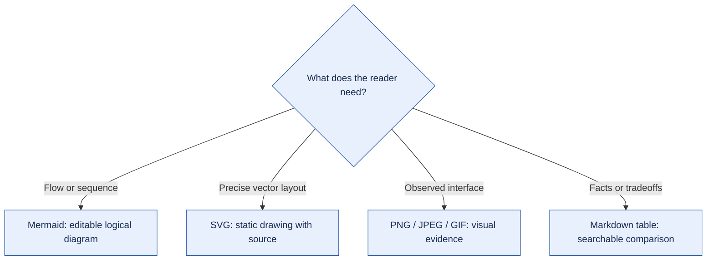

<!--
SPDX-FileCopyrightText: Alberto Cavalcante and the gvy contributors
SPDX-License-Identifier: Apache-2.0
-->

# Readable visual writing

Help a reader understand the problem, proposed behavior and evidence without reconstructing the discussion. This is a
standing preference for gvy issues, PRs, design notes, READMEs and other Markdown. Scale the presentation to the change:
a short correction may need only a paragraph.

## Start with the problem and outcome

Show a concrete trigger and its effect. For example: “A runtime library load inside a conditional does not make that
library available on every path. Completion must preserve that uncertainty.” Follow with the proposed behavior and a
small example or visual when useful.

Use descriptive headings and short paragraphs. Keep scope, acceptance criteria, blockers and validation limits visible.
Move long implementation contracts, review receipts and source catalogues into labeled `
` sections. Do not hide
a failed check or unresolved decision in collapsed content.

Distinguish **proposed behavior**, **inspected source** and **executed verification**. Label diagrams accordingly; an
attractive diagram is not evidence that a feature exists.

## Choose a format that explains the material

The labels provide the selection rule; color carries no additional meaning. Use the smallest visual that answers a
reader's question. Do not repeat the same paragraph as boxes and arrows.

| Reader needs                     | Choose                                 | GitHub reference                                                                                                                                                                                                                                                                                                         |
| -------------------------------- | -------------------------------------- | ------------------------------------------------------------------------------------------------------------------------------------------------------------------------------------------------------------------------------------------------------------------------------------------------------------------------ |
| Flow, phases or dependencies     | Mermaid                                | [Diagrams](https://docs.github.com/en/get-started/writing-on-github/working-with-advanced-formatting/creating-diagrams)                                                                                                                                                                                                  |
| Precise vector layout            | Static SVG                             | [Viewer](https://docs.github.com/en/repositories/working-with-files/using-files/working-with-non-code-files), [attachments](https://docs.github.com/en/get-started/writing-on-github/working-with-advanced-formatting/attaching-files)                                                                                   |
| Observed interface               | PNG, JPEG or GIF                       | [Attachments](https://docs.github.com/en/get-started/writing-on-github/working-with-advanced-formatting/attaching-files)                                                                                                                                                                                                 |
| Facts, alternatives or evidence  | Markdown table                         | [Tables](https://docs.github.com/en/get-started/writing-on-github/working-with-advanced-formatting/organizing-information-with-tables)                                                                                                                                                                                   |
| Supporting detail or limitations | Collapsed sections and callouts        | [Details](https://docs.github.com/en/get-started/writing-on-github/working-with-advanced-formatting/organizing-information-with-collapsed-sections), [alerts](https://docs.github.com/en/get-started/writing-on-github/getting-started-with-writing-and-formatting-on-github/basic-writing-and-formatting-syntax#alerts) |
| Equation                         | GitHub math syntax                     | [Math](https://docs.github.com/en/get-started/writing-on-github/working-with-advanced-formatting/writing-mathematical-expressions)                                                                                                                                                                                       |
| Domain data                      | GeoJSON/TopoJSON, ASCII STL or CSV/TSV | [Diagrams](https://docs.github.com/en/get-started/writing-on-github/working-with-advanced-formatting/creating-diagrams), [file viewers](https://docs.github.com/en/repositories/working-with-files/using-files/working-with-non-code-files)                                                                              |

Check GitHub's current Mermaid version before using newer syntax. Keep table cells short; split a wide comparison.
Choose specialized viewers for actual domain data, not decoration, and check their surface and size limits. Verify other
image formats on the target surface rather than assuming equivalent attachment support.

## Use SVGs deliberately

An SVG can be the right choice when a graph renderer cannot express the needed layout. Keep it self-contained and
non-scripted, with a `viewBox`, readable text and no hidden external fonts, images or network dependencies. Preserve the
editable source and any regeneration command; a hand-authored SVG is its own editable source. Do not maintain two
competing diagram sources.

For repository assets, use relative image links in Markdown. For an issue or evidence reference that must survive branch
changes, use a stable commit reference. An accepted SVG upload is not proof of inline rendering or interactive behavior
in every surface.
[Image links and alt text](https://docs.github.com/en/get-started/writing-on-github/getting-started-with-writing-and-formatting-on-github/basic-writing-and-formatting-syntax#images).

Provide descriptive alt text and an adjacent explanation of the important relationships. Label states and arrows; do not
rely on color alone. Check light/dark contrast and small-screen legibility. GitHub documents `<picture>` for
theme-specific image variants when needed.
[Theme-aware images](https://docs.github.com/en/get-started/writing-on-github/getting-started-with-writing-and-formatting-on-github/quickstart-for-writing-on-github).

Do not treat GitHub Markdown as a general HTML/JavaScript app. Use static text alternatives when richer rendering is
unavailable. An animated or interactive demonstration needs a separately supported destination and clear limits.

## Make evidence easy to inspect

Place descriptive primary-source links beside the claims they support. Pin source-code links to a revision and useful
line range. For substantial research, use a compact evidence map before the full source catalogue:

| Claim                        | Evidence                              | Status or limit                                                |
| ---------------------------- | ------------------------------------- | -------------------------------------------------------------- |
| What the implementation does | Pinned file and symbol                | Source inspected; behavior test still required if not executed |
| What should change           | Linked design or implementation issue | Proposal; acceptance remains open                              |
| What a test established      | Exact revision and result receipt     | Executed for the stated environment and scope                  |

Keep source text, test outcomes and recommendations distinct. A source catalogue alone does not make each claim
traceable. For work tracking, link implementation issues or native sub-issues; avoid giant prose-only task inventories.

## Check the delivered format

- Check Markdown structure, table columns, links, image paths and code fences.
- Validate diagram/SVG syntax with the repository's existing tools. Inspect the actual rendered target when available,
  including labels, clipping, contrast and mobile width.
- Review source and rendered views. A successful Markdown API response or recognized Mermaid container does not prove
  that the diagram parsed or that its layout is readable.
- Record missing checks plainly. For example: “GitHub Markdown recognized the diagram container; live SVG/layout
  inspection was unavailable.” Do not substitute that result for a visual pass.
- Keep visuals subordinate to the explanation: one useful diagram beats repeated decorative diagrams, badges or
  screenshots of prose.
