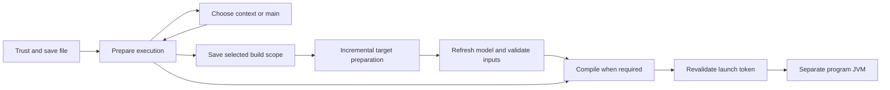

# Contextual Groovy file execution

Status: implementation under validation. [Feature issue #2023](https://github.com/albertocavalcante/gvy/issues/2023)
owns delivery and remaining qualification. This record describes the design; a capability is shipped only after its
validation and landing gates pass.

## Intended behavior

Run File executes a saved script or a selected compatible static main in a separate JVM. Compile File produces bytecode
without invoking the program. A scratch file uses a configured runtime or the dedicated bundled fallback; an
authoritatively owned Gradle source uses its source set's incremental classes task and runtime classpath.

| File/context                                  | Preparation                     | Runtime                                                                                      |
| --------------------------------------------- | ------------------------------- | -------------------------------------------------------------------------------------------- |
| Loose file or unowned workspace scratch       | None                            | Explicit runtime, local distribution, then bundled fallback                                  |
| Exact member of a complete Gradle source set  | That target's classes task      | Identifiable, nonconflicting project runtime; explicit override requires that identification |
| Scratch explicitly assigned a project context | Selected target's classes task  | Selected context                                                                             |
| Ambiguous context or main class               | Labeled choice before execution | Remember while valid                                                                         |
| Class without an entry point                  | Compile File                    | Same selection rules                                                                         |
| Hosted DSL                                    | Explain required host           | Existing host workflow                                                                       |

Source-root proximity and imports do not establish ownership. A failed standalone run never silently builds a project.
Unknown/conflicting project runtimes and incomplete owning targets fail visibly. Automatic Maven and custom build
discovery remain outside the milestone; explicit task profiles supply their classpaths and preparation tasks.

An unclassified nested file in a Gradle workspace offers Standalone or Inspect Gradle Project before any model
evaluation. Conventional/analysis roots only trigger observation; they never authorize a build. Root-level scratch files
remain immediate unless previously observed exact ownership requires a refresh. Custom layouts become automatic after
observation; initial inspection is explicit when no authoritative ownership is available.

## Protocol and process ownership

`groovy/prepareFileExecution` accepts a saved document URI/version, action, context and entry-point selections, trust,
and execution options. It returns `save`, `choices`, `preparation`, `ready`, or `unavailable`. Kotlin discovers entries
using the Groovy compiler AST and composes execution lenses with existing test lenses.



The client runs direct Java commands as VS Code `ProcessExecution` tasks with literal argument arrays, preserving stdin,
stdout/stderr, cancellation and exit status. A failed or cancelled stage prevents subsequent stages. Project Java
selection is independent of the server JVM. `groovy-file` tasks provide repeatable file/action/context, arguments, JVM
arguments, directory, environment, classpath and optional preparation-task settings.

The `save` response precedes execution-related Gradle evaluation, so dirty build configuration is saved first. A
selected project JDK is shared by model evaluation and the preparation process. Program environment overrides apply to
compilation/launch; preparation inherits its build environment and the selected `JAVA_HOME`. A project
`GRADLE_USER_HOME` override is refused instead of allowing model/build user homes to diverge. Explicit preparation tasks
must be process or shell tasks with a reportable exit status.

Project preparation and launch tokens bind the document, target/model generation, selected runtime bytes and observed
source/resource/build-configuration inputs. The client also checks saved document versions. Final launch validation runs
after compilation. The adapter cannot enumerate every arbitrary external file or environment input consumed by a Gradle
script; this is a qualification boundary, not proof that every possible build input was observed.

## Dedicated runtime and outputs

The execution bundle contains Groovy core **4.0.33** and Ivy **2.5.3**, with pinned SHA-256 values in
[`runtime-manifest.json`](../editors/code/tools/runtime-manifest.json). Ivy preserves configured `@Grab` behavior;
additional Groovy modules can be supplied through the configured classpath. The language-server fat JAR never enters a
program's classpath.

[`prepare-runtime.js`](../editors/code/tools/prepare-runtime.js) stages only existing local artifacts, verifies all
bytes, and extracts their upstream LICENSE/NOTICE files. Set `GVY_RUNTIME_SOURCE` to a directory containing the pinned
JARs or reuse the effective `GRADLE_USER_HOME` cache. The helper does not download artifacts. CI stages the dedicated
configuration separately from the server and verifies the bundle during VSIX packaging. Runtime provisioning does not
change project repositories, credentials, init scripts, user homes or offline settings. A separate JVM is not a sandbox.

Each invocation owns a fresh directory under extension storage. Run-only and failed outputs are removed. The latest
successful Compile File output remains revealable; only superseded GVY-owned directories are removed. Project build
directories and task-specified arbitrary output directories are never cleaned.

Long Java classpaths use managed argument files on qualified launchers. Legacy Java without argument-file support and
unqualified Windows argument-file encodings fail with an actionable message.

Native Windows testing with Java 21.0.12.1 demonstrated replacement of a Greek argument character under the installed
legacy native code page. The client checks the selected Java launcher's native encoding and refuses Unicode commands in
that environment. This matches the documented
[Windows launcher conversion behavior](https://docs.redhat.com/en/documentation/red_hat_build_of_openjdk/21/html/release_notes_for_red_hat_build_of_openjdk_21.0.9/rn_openjdk-2109-features_openjdk).
Long non-ASCII Windows classpaths remain unqualified; Java argument files also require a compatible
[system encoding](https://docs.oracle.com/en/java/javase/21/docs/specs/man/java.html#java-command-line-argument-files).

## Validation and capability matrix

| Capability                                                                                  | Evidence gate                                          | Current status                                                                                                              |
| ------------------------------------------------------------------------------------------- | ------------------------------------------------------ | --------------------------------------------------------------------------------------------------------------------------- |
| AST discovery, protocol, stale preparation/launch                                           | Kotlin behavior/endpoint tests                         | Authored; native candidate check pending                                                                                    |
| Exact Gradle membership, runtime-only dependencies, resources, exclusions, multiple modules | Offline real Tooling API integration                   | Authored; candidate check pending                                                                                           |
| Save/trust/cancellation/task profiles and long classpaths                                   | Editor unit/mocked host tests                          | 36 passing on macOS; final-head rerun pending                                                                               |
| Runtime packaging, corruption rejection, notices                                            | Node packaging tests                                   | 4 passing; VSIX gate pending                                                                                                |
| Groovy 4.0.33 and 2.4.21 subprocess execution                                               | Explicit native qualification harness                  | macOS: 4 cases passed; Linux Java 11 manual runtime/argument-file checks passed; final package checks pending               |
| Installed VSIX and actual task terminals                                                    | Native VS Code host                                    | Pending                                                                                                                     |
| Native Windows project preparation                                                          | Tested wrapper invocation with literal argument safety | Unavailable until qualified; direct Java is separate                                                                        |
| Native Linux and Windows execution                                                          | Execute the qualification harness on each OS           | Linux runtime subset passed; Windows Java 21 ASCII long-classpath/Unicode-refusal guard passed; broader support unqualified |
| Offline/private repositories                                                                | Local artifacts and original build configuration       | Offline adapter fixture authored; real private-repository environment pending                                               |

Run portable runtime qualification after preparing the bundle:

```sh
node editors/code/tools/prepare-runtime.js
node --test editors/code/tools/qualification/file-runtime.test.js
```

Set `GVY_TEST_GROOVY_24` to an existing Groovy 2.4.21 JAR for the additional runtime row, and `GVY_TEST_EXTENSION_ROOT`
to an unpacked VSIX extension directory to test packaged bytes. No runtime is downloaded by this harness. Native
execution proves the selected runtime path; mocked editor tests do not prove terminal behavior.

## Remaining acceptance work

The feature owner retains responsibility under #2023 for native JVM/editor/package checks, any actionable review or lint
findings, platform limits, exact-head CI, independent final-diff review, squash landing and owned-resource cleanup. The
milestone is not complete while those gates remain open. Arbitrary external Gradle inputs, included builds and
unidentified local-file runtimes need explicit qualification or visible unavailability; they must not cause scratch
fallback for a file whose source membership is known.
