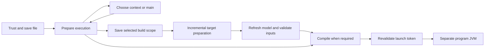

# Contextual Groovy file execution

Status: experimental implementation for VS Code.
[Implementation PR #2044](https://github.com/albertocavalcante/gvy/pull/2044) records review, exact-head CI and landing
evidence. [Feature issue #2023](https://github.com/albertocavalcante/gvy/issues/2023) tracks further adapter and
platform qualification. The matrix below distinguishes executed checks from unsupported paths.

## Intended behavior

Run File executes a saved script or a selected compatible static main in a separate JVM. Compile File produces bytecode
without invoking the program. A scratch file uses a configured runtime or the dedicated bundled fallback; an
authoritatively owned Gradle source uses its source set's incremental classes task and runtime classpath.

| File/context                                  | Preparation                     | Runtime                                                                                      |
| --------------------------------------------- | ------------------------------- | -------------------------------------------------------------------------------------------- |
| Loose file or unowned workspace scratch       | None                            | Explicit runtime, local distribution, then bundled fallback                                  |
| Exact member of a complete Gradle source set  | That target's classes task      | Identifiable, nonconflicting project runtime; explicit override requires that identification |
| Scratch explicitly assigned a project context | Selected target's classes task  | Selected context                                                                             |
| Ambiguous context or main class               | Labeled choice before execution | Remember while valid                                                                         |
| Class without an entry point                  | Compile File                    | Same selection rules                                                                         |
| Hosted DSL                                    | Explain required host           | Existing host workflow                                                                       |

Source-root proximity and imports do not establish ownership. A failed standalone run never silently builds a project.
Unknown/conflicting project runtimes and incomplete owning targets fail visibly. Automatic Maven and custom build
discovery remain outside the milestone; explicit task profiles supply their classpaths and preparation tasks.

An unclassified nested file in a Gradle workspace offers Standalone or Inspect Gradle Project before any model
evaluation. Conventional/analysis roots only trigger observation; they never authorize a build. Root-level scratch files
remain immediate unless previously observed exact ownership requires a refresh. Custom layouts become automatic after
observation; initial inspection is explicit when no authoritative ownership is available.

## Protocol and process ownership

`groovy/prepareFileExecution` accepts a saved document URI/version, action, context and entry-point selections, trust,
and execution options. It returns `save`, `choices`, `preparation`, `ready`, or `unavailable`. Kotlin discovers entries
using the Groovy compiler AST and composes execution lenses with existing test lenses.



The client runs direct Java commands as VS Code `ProcessExecution` tasks with literal argument arrays, preserving stdin,
stdout/stderr, cancellation and exit status. A failed or cancelled stage prevents subsequent stages. Project Java
selection is independent of the server JVM. `groovy-file` tasks provide repeatable file/action/context, arguments, JVM
arguments, directory, environment, classpath and optional preparation-task settings.

The `save` response precedes execution-related Gradle evaluation, so dirty build configuration is saved first. A
selected project JDK is shared by model evaluation and the preparation process. Program environment overrides apply to
compilation/launch; preparation inherits its build environment and the selected `JAVA_HOME`. A project
`GRADLE_USER_HOME` override is refused instead of allowing model/build user homes to diverge. Explicit preparation tasks
must be process or shell tasks with a reportable exit status.

Project preparation and launch tokens bind the document, target/model generation, selected runtime bytes and observed
source/resource/build-configuration inputs. The client also checks saved document versions. Final launch validation runs
after compilation. The adapter cannot enumerate every arbitrary external file or environment input consumed by a Gradle
script; this is a qualification boundary, not proof that every possible build input was observed.

## Dedicated runtime and outputs

The execution bundle contains Groovy core **4.0.33** and Ivy **2.5.3**, with pinned SHA-256 values in
[`runtime-manifest.json`](../editors/code/tools/runtime-manifest.json). Ivy preserves configured `@Grab` behavior;
additional Groovy modules can be supplied through the configured classpath. The language-server fat JAR never enters a
program's classpath.

Runtime inspection rejects duplicate cores and recognizable Groovy modules with conflicting versions. Selected runtime
metadata reads are bounded: at most 1,024 JARs, 128 MiB per JAR, 256 MiB total and 64 KiB per manifest or release-info
entry. Empty optional runtime settings mean no override, so the normal project/local/bundled selection still applies.

[`prepare-runtime.js`](../editors/code/tools/prepare-runtime.js) stages only existing local artifacts, verifies all
bytes, and extracts their upstream LICENSE/NOTICE files. Set `GVY_RUNTIME_SOURCE` to a directory containing the pinned
JARs or reuse the effective `GRADLE_USER_HOME` cache. The helper does not download artifacts. CI stages the dedicated
configuration separately from the server and verifies the bundle during VSIX packaging. Runtime provisioning does not
change project repositories, credentials, init scripts, user homes or offline settings. A separate JVM is not a sandbox.

Each invocation owns a fresh directory under extension storage. Run-only and failed outputs are removed. The latest
successful Compile File output remains revealable; only superseded GVY-owned directories are removed. Project build
directories and task-specified arbitrary output directories are never cleaned.

Long Java classpaths use managed argument files on qualified launchers. Legacy Java without argument-file support and
unqualified Windows argument-file encodings fail with an actionable message.

Native Windows testing with Java 21.0.12.1 demonstrated replacement of a Greek argument character under the installed
legacy native code page. The client checks the selected Java launcher's native encoding and refuses Unicode commands in
that environment. This matches the documented
[Windows launcher conversion behavior](https://docs.redhat.com/en/documentation/red_hat_build_of_openjdk/21/html/release_notes_for_red_hat_build_of_openjdk_21.0.9/rn_openjdk-2109-features_openjdk).
Long non-ASCII Windows classpaths remain unqualified; Java argument files also require a compatible
[system encoding](https://docs.oracle.com/en/java/javase/21/docs/specs/man/java.html#java-command-line-argument-files).

## Validation and capability matrix

| Capability                                                                                  | Executed evidence                                                                                                                                   | Qualification                                                                                                                        |
| ------------------------------------------------------------------------------------------- | --------------------------------------------------------------------------------------------------------------------------------------------------- | ------------------------------------------------------------------------------------------------------------------------------------ |
| AST discovery, protocol, stale preparation/launch, runtime metadata                         | 49 Kotlin GLS behavior tests; 65 SDK protocol/JSON controls                                                                                         | macOS Java 17; no failures or skips                                                                                                  |
| Exact Gradle compiler membership and targeted preparation                                   | 53 adapter/projection tests, including a real offline multi-module fixture                                                                          | One optional older-Gradle test skipped locally; dedicated CI compatibility job covers older/latest Gradle                            |
| Runtime-only dependencies, resources and dependency edits                                   | Fixture builds `:app:classes`, launches with resources/runtime-only code, edits a library, observes the next result, and rejects failed preparation | Existing local artifacts and configured local Maven repository; real private-repository authentication remains unqualified           |
| Save, trust, cancellation, profiles, output publication, runtime defaults and JDK selection | 970 editor unit tests; deterministic storage failure/concurrency regressions                                                                        | macOS Java 17; zero pending tests                                                                                                    |
| Runtime staging, checksums, notices and packaging helpers                                   | 156 Node tool tests, including the cache fixture under the CI runtime-source environment                                                            | Dedicated runtime and server present in the built and installed VSIX; installed bytes verified                                       |
| Actual task terminals and file commands                                                     | Five file-execution scenarios passed across native macOS VS Code runs                                                                               | Run, Compile, stdin/profile/Run Again, `System.exit`, and task termination followed by a responsive server and successful run        |
| Groovy 4.0.33 and 2.4.21 subprocess behavior                                                | Five packaged-runtime/long-classpath checks passed with Java 17                                                                                     | Both versions cover literal arguments, Unicode paths, stdin, compile-only, main classes, nonzero exit and infinite-child termination |
| Native Windows and Linux runtime behavior                                                   | Linux Java 11 runtime subset passed; Windows Java 21 ASCII long-classpath and Unicode-refusal guard passed                                          | Linux server/editor qualification is recorded in CI; broader Windows Unicode support remains unqualified                             |
| Native Windows project preparation                                                          | No qualified wrapper invocation                                                                                                                     | Unavailable until literal argument and path handling are verified natively                                                           |

The exact-head CI matrix and independent review are linked from PR #2044. General editor UI checks also retain their
original strict assertions; passing mocked feature tests alone does not establish a native terminal or UI result.

The local VS Code 1.146 Smart Select UI assertion failed even though its provider-range assertions passed.
[Issue #2056](https://github.com/albertocavalcante/gvy/issues/2056) tracks baseline/candidate attribution and further
qualification. The original test assertions remain required in CI; the complete local general-editor suite is not
reported as passing.

Run portable runtime qualification after preparing the bundle:

```sh
node editors/code/tools/prepare-runtime.js
node --test editors/code/tools/qualification/file-runtime.test.js
```

Set `GVY_TEST_GROOVY_24` to an existing Groovy 2.4.21 JAR for the additional runtime row, and `GVY_TEST_EXTENSION_ROOT`
to an unpacked VSIX extension directory to test packaged bytes. No runtime is downloaded by this harness. Native
execution proves the selected runtime path; mocked editor tests do not prove terminal behavior.

## Qualification boundaries

| Scope                                      | Current behavior                                                                                   | Owner and next qualification gate                                                                                         |
| ------------------------------------------ | -------------------------------------------------------------------------------------------------- | ------------------------------------------------------------------------------------------------------------------------- |
| Included/independent nested builds         | Open the build as its own workspace or use an explicit profile; incomplete ownership fails visibly | Execution adapter: establish compiler membership, coherent runtime and targeted preparation for each participating build  |
| Maven and custom-build discovery           | Explicit standalone profiles can provide classpath and a preparation task                          | Build-tool adapters: implement and test the same authoritative execution-context contract before automatic routing        |
| Unidentified local-file Groovy runtimes    | A project cannot silently substitute the bundled runtime                                           | Gradle adapter: identify and qualify the runtime before allowing automatic project execution                              |
| Windows wrapper and non-ASCII launch paths | Windows project execution is unavailable; unsafe native encoding is rejected                       | Editor process adapter: qualify wrapper arguments, Unicode paths and long classpaths with native execution                |
| Private repositories                       | Existing repositories, credentials, user home and offline behavior are preserved                   | Build-tool integration: validate an authorized real private-repository environment without public fallback                |
| Arbitrary external Gradle inputs           | Fingerprints cover observed source/resource/configuration/runtime inputs                           | Build-tool model: extend observable inputs where possible; a changed observed input must invalidate preparation or launch |

These limits remain visible in #2023. They do not authorize scratch fallback for a file with known project ownership.
