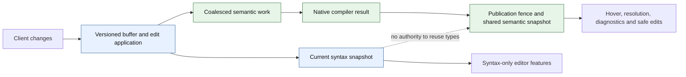

# Incremental editing, compilation and reparsing delivery plan

**Status: proposed implementation plan; production behavior is unchanged.** Source audit baseline:
`95e53ab642e3def9055494b6ee2d16011a4727cb`, 2026-11-11 Pacific. Related issue/PR states below are observations at
planning time, not permanent status. This plan serves the Fast, Correct and Safe properties of the
[Quality Bar](../docs/quality-bar.md), especially [#614](https://github.com/albertocavalcante/gvy/issues/614),
[#1547](https://github.com/albertocavalcante/gvy/issues/1547) and
[#1551](https://github.com/albertocavalcante/gvy/issues/1551). It is a delivery design, not another project roadmap.

## Recommendation and first milestone

Use Native as the shared compiler-backed semantic authority. Retain `parser/core` utilities and existing consumers; do
not turn its lossy AST adapter into the new incremental syntax foundation. Deliver coherent ranged text updates, remove
duplicate default-hover parsing through the existing hover work, and establish a reproducible editing baseline first.
Then bound compilation to conservatively affected files and evaluate true syntax reuse behind a separate, versioned
contract.

The first milestone is **one coherent editor state, one shared default semantic result, and measured edit costs**. Its
gate is a real protocol replay proving that text, versions, diagnostics, hover and navigation agree after edits;
unchanged default hover must not invoke a second parser. Ranged sync can land independently of hover consolidation.
Neither milestone may be described as incremental AST reparsing.

No speedup percentage or completion date is justified yet. The compiler-reuse and syntax-frontend experiments below
determine whether the last stages are an integration project or a substantially larger parser project.

## What exists, and what does not

Paths are relative to the audit revision. Recheck them against the publication head of each implementation PR.

| Layer             | Observed implementation                                                                                                                                   | Consequence                                                                                                           |
| ----------------- | --------------------------------------------------------------------------------------------------------------------------------------------------------- | --------------------------------------------------------------------------------------------------------------------- |
| Protocol          | `ServerCapabilitiesFactory.kt:29` advertises Full; `GroovyTextDocumentService.kt:396` rejects any ranged notification.                                    | Incremental transport is absent.                                                                                      |
| Buffer            | `DocumentProvider.kt:8,54` holds immutable text/version snapshots and preserves an open/close incarnation.                                                | Reuse these lifecycle fences; do not create a second buffer store.                                                    |
| Scheduling        | `DiagnosticsOrchestrator.kt:31,111` debounces changes by 250 ms and retires obsolete publications.                                                        | Coalescing already exists; account for its delay in user-visible latency.                                             |
| Cache             | `CompilationCache.kt:10,43` matches complete text and configuration; `CompilationIdentity.kt:10` identifies pending work without requested compile phase. | Exact-source reuse exists. Phase, semantic inputs and dependency generations need an explicit compatibility contract. |
| Native            | `GroovyParserFacade.kt:378` constructs a compiler unit and source, compiles, fully lexes, and rebuilds relationships/symbols.                             | No previous-tree/edit input or subtree reuse.                                                                         |
| Core              | `GroovyParser.kt:81` also invokes Groovy compilation, then converts the module into a Kotlin AST.                                                         | Core is not an independent incremental grammar implementation.                                                        |
| Tokens            | `GroovyTokenIndex.kt:79` lexes the whole source and retains comment/string classification spans.                                                          | It is not a complete token stream or lexer checkpoint cache.                                                          |
| Dependencies      | `DependencyGraph.updateFromModule()` has no production caller; extraction covers imports and inheritance.                                                 | Bounded source selection cannot currently rely on a populated, complete graph.                                        |
| Incremental names | `TokenEditDistance` has only tests as callers; `shouldUseIncrementalCompilation()` has no production consumer.                                            | Do not mistake names/configuration for shipped behavior.                                                              |

Existing snapshot fences, per-phase cancellation and exact-content caches are useful foundations. Do not claim that gvy
has no cancellation or no caching. `source/Utf16LineIndex.kt` already exists, including CRLF/bare-CR handling; its
`offsetOf()` deliberately permits columns to cross lines, so it must not be used as an unchecked LSP edit decoder.

The evidence is strong for the absence of production subtree reuse, partial for current edit/lifecycle correctness, and
missing for incremental-versus-fresh equivalence, incremental resource bounds and end-to-end speedup. Existing visitor
benchmarks in [the performance plan](PHASE_3_PERFORMANCE_PLAN.md) and [optimization results](OPTIMIZATION_PLAN.md) do
not measure editor reparsing.

## Core versus Native

| Question          | Core today                                                                                                | Native today                                                                            | Plan                                                                                           |
| ----------------- | --------------------------------------------------------------------------------------------------------- | --------------------------------------------------------------------------------------- | ---------------------------------------------------------------------------------------------- |
| Parsing           | Fresh compiler parse through CONVERSION, followed by conversion.                                          | Fresh compiler parse with project context and requested phase; fallback/recovery paths. | Neither is incrementally reusable today.                                                       |
| Representation    | Kotlin nodes with mutable parents/ranges; information is lost during conversion.                          | Groovy compiler objects with mutable relationships, scopes and metadata.                | Use Native for semantics; require a separate safe syntax representation for subtree reuse.     |
| Project knowledge | Default Core engine parses without the Native request's project classpath and uses its reflection solver. | Supplies classpath, source roots and unsaved companion buffers.                         | Preserve project context in every semantic result.                                             |
| Feature coverage  | Default hover uses Core; visualization and parser API consumers also use it.                              | Most LSP features already use Native; held-snapshot hover can avoid reparsing.          | Coordinate default-hover consolidation; inventory explicit Core consumers before removal.      |
| Recovery          | Missing compiler module can yield an empty unit.                                                          | Can exclude broken companion sources, retry a lower phase and report degradation.       | Compare malformed buffers and report achieved phase; do not assume Core has superior recovery. |
| Reusable value    | Groovydoc/comment support, type solvers, resolver and parser API consumers.                               | Compiler fidelity, workspace resolution, existing LSP integration.                      | Keep useful Core code without keeping two default semantic answers.                            |

Concrete Core losses: `GroovyAstConverter.kt:320` converts unknown expressions to `ConstantExpr(text)`;
`StatementConverter.kt:75` substitutes empty blocks for unsupported statements; `DeclarationConverter.kt:67` retains
only whether a field has an initializer. Its current tree therefore cannot serve as a full-fidelity incremental syntax
tree without major representation and parser changes.

Native is the recommended authority, not a claim that its inference is complete. The main compile requests
CANONICALIZATION, and workspace compilation requests SEMANTIC_ANALYSIS. The compiler type-checker investigation in
[#1547](https://github.com/albertocavalcante/gvy/issues/1547) remains relevant; do not equate these phases with complete
compiler-derived expression types or manufacture a second type system in a new syntax frontend.

[#1276](https://github.com/albertocavalcante/gvy/issues/1276) proposes retiring Core hover. Active
[PR #1775](https://github.com/albertocavalcante/gvy/pull/1775) already changes the default and improves Native cards,
while preserving explicit Core configuration. Its observed head was `e1546e6158b75afe01642ed683f9b23f91231322`; its
description records a CI metaspace readiness blocker. Coordinate with that work, recheck its actual state, and review
the combined behavior after landing. This plan neither duplicates its changes nor declares it ready.

## Architecture and invariants



The syntax branch is proposed, not implemented. The parser decision experiment may retain whole-file syntax parsing if
reuse does not earn its maintenance and runtime costs.

1. One buffer authority owns text, version, content hash and incarnation. A proposed edit batch identifies both its base
   and resulting snapshots and stores edits in application order. Versions must increase; they need not be consecutive.
   A full replacement resets accumulated edit history.
2. A syntax snapshot identifies source, grammar/options and its base tree. It owns immutable/shared tree data and
   snapshot-relative positions. Old snapshots must remain unchanged when a new edit moves later text.
3. A semantic result identifies source and incarnation, compiler/worker, target/classpath/options, requested and
   achieved phases, degradation, and dependencies with their observed generations. Content equality alone cannot
   authorize semantic reuse after another open file changes.
4. Publish the parse, dependency facts, symbol index and semantic facts under compatible ownership. Obsolete work cannot
   publish any part. A cyclic component may require a batch publication boundary. Capture companion buffers coherently
   or revalidate their recorded identities before committing.
5. Syntax equality does not establish semantic equality. Last-good facts may support explicitly uncertain display
   behavior, but cannot authorize rename, formatting or code-action edits against newer text. Such operations acquire
   current coherent facts or refuse.
6. Debouncing may skip analysis of intermediate versions, never application of their text edits. Compose edits from the
   last parsed snapshot to the latest buffer; when history is unavailable, replaced or over budget, parse fresh.

## Delivery phases and PR-sized work packages

Every row is planned work. The source audit and external API investigation are complete; the runtime experiment is
described below. No implementation gate in this table is claimed passed by publishing this plan.

| Phase / package                 | Work and owner boundary                                                                                                                                           | Dependencies                                   | Completion evidence                                                                                                                                                  |
| ------------------------------- | ----------------------------------------------------------------------------------------------------------------------------------------------------------------- | ---------------------------------------------- | -------------------------------------------------------------------------------------------------------------------------------------------------------------------- |
| P0-A: contracts                 | GLS/parser maintainers define edit ordering, snapshot identity, phase compatibility and degraded-result rules.                                                    | Current source audit.                          | Contracts cover duplicate/old versions, reopen, companion edits, phase changes and cancellation without assuming contiguous versions.                                |
| P0-B: characterization          | Extend existing E2E/public-endpoint tests under #1546/#1654; add a named edit replay and collect compiler, lexer, indexing and queue costs.                       | P0-A.                                          | Full-replacement replay is reproducible; actual applied text/versions are asserted; baseline reports cold and warm results separately.                               |
| P0-C: compiler experiment       | Exercise retained Groovy units on addition, replacement, removal, error recovery, changed signatures and changed transform context.                               | P0-A; pinned Groovy 4.0.33.                    | Compare each operation with a fresh unit; report old snapshot mutation, stale classes and retained state. Reject failing reuse modes.                                |
| P1-A: pure edit application     | Put a reusable edit applier beside the neutral source utilities; GLS decodes protocol changes into it.                                                            | P0-A.                                          | Sequential mixed replacements/ranges produce exact text; bounds, UTF-16, CRLF, bare CR, EOF and supplementary characters follow the LSP contract.                    |
| P1-B: sync integration          | Update DocumentProvider/didChange and negotiate Incremental only after edit application works. Preserve full replacements and lifecycle fences.                   | P1-A.                                          | Public initialize/didChange tests prove capability and behavior; out-of-date or invalid batches cannot partially mutate a buffer.                                    |
| P1-C: analysis handoff          | Carry base/result identity and bounded edit history through debounce; retire analysis without losing accepted text.                                               | P1-B; P0-B.                                    | Burst edits, undo, full reset and close/reopen produce the same latest state and answers as a fresh-open control.                                                    |
| P2-A: one default semantic path | Reuse the Native held-snapshot hover path through existing #1775/#1276 work; retain explicit Core compatibility and utilities as required.                        | Existing PR integration; may run beside P1.    | Parser invocation counts show no second unchanged default-hover parse; hover/current-buffer/race/Unicode and project-type tests pass.                                |
| P2-B: dependency facts          | Prepare dependency records from current compiler facts, including signatures, annotations, generics, arrays and resolved body references; commit with the parse.  | P0-A; #776/#663.                               | A→B→C and cycles update reverse edges; renamed/deleted/failed sources remove or conservatively invalidate old evidence; no stale compile can overwrite the graph.    |
| P2-C: selective analysis        | Include phase/context/dependency generation compatibility in result and pending-work reuse; schedule changed files and conservative transitive dependents.        | P2-B; P0-B.                                    | Changing an unsaved companion or a public return type invalidates consumers; unrelated work is reused only with proof; fresh and selective workspace results agree.  |
| P2-D: bound retained state      | Separate detached facts from heavyweight compiler graphs where consumers allow; bound weights/history/concurrency and remove eager N-by-N work under #1569/#1571. | Consumer audit; P2-C for selective scheduling. | Named 50/200/500-file workloads complete within an explicit heap; retained bytes and compiler calls are measured; eviction/reopen/cancellation preserve correctness. |
| P3-A: syntax decision           | Compare restartable Groovy/ANTLR, retained compiler sessions and a dedicated incremental syntax frontend on the same edit corpus.                                 | P0-C; P0-B; invariants above.                  | Written decision includes grammar coverage, malformed recovery, coordinate contracts, packaging, maintenance cost and measured end-to-end benefit.                   |
| P3-B: lexer reuse, if justified | Retain complete relevant lexical state; relex from a proven restart point until state and token stream converge, otherwise to EOF.                                | P3-A; lexer-state experiment.                  | Classification equals full lex after every edit; cancellation and relex spans are observable. Report this as lexer incrementality only.                              |
| P3-C: first subtree reuse       | Add an edit-aware syntax API with a full-parse implementation first, then one explicit safe reparse class, such as a method-body edit.                            | P3-A; token checkpoint proof where required.   | Fresh syntax equivalence passes for supported and fallback cases; unchanged structure is actually reused; held older trees/ranges stay unchanged.                    |
| P4: harden and ship             | Expand supported edits only as evidence permits; run protocol/editor, corpus, resource and comparative performance gates, then enable the proven mode.            | P1–P3 applicable gates.                        | Correctness, memory, fallback rate and latency reports identify the exact artifact/head; disable/restart restores the full-parse path without changing text.         |

P1 does not wait for P2 or a new parser. P2 does not require subtree parsing. P3 experiments can run beside P2 after the
baseline exists. The production syntax slice needs the snapshot/safety contract, but does not need complete fine-grained
semantic reuse. Do not turn every row into a serial dependency.

### P1 details: protocol and edit history

- Validate/normalize positions according to the negotiated LSP encoding, initially the existing UTF-16 contract. Respect
  the specification's out-of-range position rules; do not let `offsetOf()` cross into the next line by accident. Define
  handling of reversed ranges, negative/overflowing input and surrogate interiors explicitly.
- Apply changes against the evolving text in notification order; a later edit's coordinates refer to preceding edits.
  Retain support for full content replacement. Do not trust deprecated `rangeLength` as the source of truth.
- Compute a candidate result before atomically accepting its version. If a batch cannot be applied, keep the last
  coherent state, invalidate incompatible analysis and report the synchronization problem. gvy has no generic LSP
  pull-current-buffer operation: an error must not silently allow later deltas to corrupt the buffer. Establish a tested
  client-compatible recovery/reset policy before advertising the capability.
- Bound history by bytes and count. If a parser has version 10 while edits 11–15 are coalesced, compose that exact chain
  or derive a safe fresh parse from the authoritative latest text. Never apply only edit 15 to tree 10.
- Reuse the existing line index where its contract fits. Start with ordinary immutable strings; introduce a rope or
  piece table only if the editing benchmark shows text copying/index construction is material.

### P2 details: conservative semantics before clever invalidation

Populating today's partial graph must not immediately activate its bounded source-selection branch. Mark evidence as
incomplete until extraction/resolution is adequate. Include unresolved names, same-package lookup, wildcard/static
imports, extension methods, scripts, class-name changes and transform-generated members in the conservative policy.
Unknown/dynamic/transform-sensitive relationships expand the invalidation set, potentially to the whole target.

Initially reanalyze transitive consumers after any relevant source change. ABI/signature hashes can later avoid
implementation-only propagation, but only after proving that inferred returns, closures/delegates, constants and
transforms cannot change consumer answers. Do not classify method-body dependencies as unconditionally optional.

Do not feed compiler dependencies into a new graph with different lifecycle rules. Prepare replacement edges, remove
obsolete names, and commit under the existing artifact ownership boundary. Test empty dependency sets as known facts,
not indistinguishable from files never analyzed. Prefer qualified declaration identities to ambiguous simple names.

Cache entries and in-flight work must distinguish requested phases; a lower-phase fallback cannot satisfy a stronger
request merely because text matches. The same text under a new classpath, target, worker, transform policy or changed
companion-buffer generation is not a reusable semantic result. Implement a coarse target generation first if that is the
only sound evidence; optimize its invalidation later.

### P3 details: choose a parser from evidence

| Alternative                                      | What it can buy                                                                             | Main difficulty                                                                                                   | Decision gate                                                                                               |
| ------------------------------------------------ | ------------------------------------------------------------------------------------------- | ----------------------------------------------------------------------------------------------------------------- | ----------------------------------------------------------------------------------------------------------- |
| Keep full Native parsing and optimize scheduling | Fidelity and a small maintenance surface; fewer duplicate/irrelevant compiles.              | Large-file compiler work remains full-file.                                                                       | Prefer while it meets measured editing budgets; do not call it subtree reuse.                               |
| Retain a Groovy CompilationUnit                  | Potential reuse of compiler state/unchanged sources.                                        | Replacement/deletion, errors, transformed ASTs, type caches, cross-file invalidation and snapshot isolation.      | Pass P0-C before any production retention; session reuse alone does not prove subtree reparsing.            |
| Extend Groovy/ANTLR for local reparsing          | Alignment with the pinned Groovy grammar.                                                   | Restart state, grammar context, fragment entry rules, recovery and maintaining upstream coupling.                 | A method/closure edit and a boundary-breaking edit must match a full parse, including malformed recovery.   |
| Dedicated incremental syntax frontend            | Persistent syntax, local reparse and error nodes while Native remains the semantic backend. | Groovy grammar coverage/version drift, position bridging, duplicate state, JVM packaging and grammar maintenance. | Corpus/edit proof and enough saved work in an actual consumer; syntax acceptance is not semantic agreement. |
| Extend today's Core AST                          | Existing Kotlin-facing consumers.                                                           | First repair lossy nodes/trivia/recovery, then replace its full compiler parse anyway.                            | Not the recommended starting point; reconsider only if consumer evidence changes the tradeoff.              |

Groovy 4.0.33's
[CompilationUnit API](https://docs.groovy-lang.org/docs/groovy-4.0.33/html/gapi/org/codehaus/groovy/control/CompilationUnit.html)
describes delta recompilation. Its
[pinned source](https://github.com/apache/groovy/blob/GROOVY_4_0_33/src/main/java/org/codehaus/groovy/control/CompilationUnit.java#L621)
restarts the unit's phase traversal while individual operations can skip already processed sources. This warrants a
bounded experiment; it does not prove safe editor replacement, deletion or subtree parsing. Do not claim the upstream
compiler has no incremental behavior simply because gvy does not use it.

A synthetic API probe ran on macOS arm64, OpenJDK 21.0.13.0.3, Groovy 4.0.33, with `-Xmx128m`. Recompiling unchanged
input retained one class; adding a distinct source produced both classes. Replacing `A.groovy` in the retained unit and
recompiling failed with `MultipleCompilationErrorsException` reporting a duplicate definition of `A`. The same revised
source in a fresh unit succeeded. This disproves the naive same-name replacement route, not every possible compiler
reuse design. Deletion, dependent invalidation, transforms and recovery still need P0-C experiments.

The failing operation is reproducible in a Groovy 4.0.33 script:

```groovy
import org.codehaus.groovy.control.CompilationUnit
import org.codehaus.groovy.control.Phases

def unit = new CompilationUnit()
unit.addSource('A.groovy', 'class A { String before() { "a" } }')
unit.compile(Phases.CANONICALIZATION)
unit.addSource('A.groovy', 'class A { Integer after() { 1 } }')
unit.compile(Phases.CANONICALIZATION) // duplicate class A
```

For an example of the alternative contract,
[Tree-sitter documents editing the old tree and supplying it to the next parse](https://tree-sitter.github.io/tree-sitter/using-parsers/3-advanced-parsing.html).
That demonstrates an edit-aware API shape, not a recommendation of any particular Groovy grammar. A candidate grammar,
license, supported language level, pinned artifacts and JVM/native distribution still require evaluation. No new parser
dependency is selected by this plan.

Lexical restart cannot be based on line boundaries or brace counts alone. Slashy/division ambiguity, dollar-slashy and
multiline strings, interpolation mode stacks, nested delimiters, command expressions and significant newlines can change
interpretation beyond an edited region. Recovery expands to an enclosing safe unit or the whole file.

Do not splice live `ClassNode` objects between versions. Native relationship maps use object identity, while compiler
passes and transforms mutate nodes, scopes and metadata. Even untouched text after an insertion moves source ranges.
Reuse immutable syntax structure with snapshot-relative positions; rederive semantic facts unless context and dependency
validity are proven. A retained compiler experiment must demonstrate old-snapshot isolation separately.

## Validation and rollout contract

Use two different oracles. Fresh Native parsing establishes incremental equivalence to gvy's existing path; it does not
prove that path is correct. Curated cases and the pinned Groovy compiler, under the same language/transform policy and
applicable phase, establish independent language behavior. Missing/degraded types remain labelled unknown.

The edit matrix includes:

- insert/delete/replace at start, middle and EOF; multiple changes; version jumps; duplicate/stale changes; undo/redo;
  full replacement after ranges; close/reopen and identical text with a new incarnation;
- LF, CRLF, bare CR, trailing empty lines, supplementary characters, combining characters and edits near line breaks;
- identifiers/literals, import and class/package changes, method/closure boundaries, GStrings, slashy strings, comments,
  significant newline changes and unfinished delimiters;
- multiple unsaved files, cycles, signature changes, missing classes, deleted/renamed files, classpath/target/worker
  changes, transform-policy changes and lower-phase recovery;
- cancellation before/within a phase, failed/out-of-order publication, rapid edits during navigation, cache eviction,
  bounded history fallback and retained-snapshot inspection after later edits.

Compare exact resulting text and source identity first, then token/classification spans, syntax shape and error
structure, diagnostics/degraded outcomes, declaration/reference bindings and edit safety. Public endpoint checks must
apply returned edits and verify the resulting text; an `applied=true` callback alone is not evidence. Derive original
fixtures for gvy and pin any external corpus immutably; ordinary unit tests must not download corpora or require SDKs.

Performance runs separately report edit acceptance, syntax availability, semantic readiness and final diagnostics.
Include queue/debounce time and compiler invocations, cancellation/coalescing counts, parsed/relexed spans, node reuse,
fallback reasons, allocations and retained heap. Use named small/large files and 50/200/500-file workspaces spanning
ordinary Groovy, Jenkins, Gradle and Spock; a copied synthetic file is not corpus diversity. Report p50/p95 with
workload, artifact hashes, JVM/heap/GC/platform, warmup, cache state and host contention. Reuse
`tools/perf/evidence.mjs` for its existing run envelope; extend its closed schema only through a separately reviewed
change.

Set latency/resource budgets from P0 measurements before enabling the feature, and publish the budgets with the
workload. Do not invent a percentage target from old issue prose or compare instrumented candidates to uninstrumented
baselines. Full parsing remains the fallback and may legitimately be faster for small files.

Each implementation PR gets a failing behavior test first, focused checks, independent complete-diff review, and the
repository's applicable native/CI gates. Snapshot/API changes verify both parser providers and affected consumers;
protocol/default changes include the packaged editor/server path. Run heavy checks through `build-slot` with explicit
JVM bounds; do not run builds in main. This narrative plan receives Markdown/link/independent review, not unrelated
runtime suites. Rollout starts with an explicit experimental mode; enable the default only after the gates pass. On
failure, retain authoritative text, discard incompatible cached state, and use the full parser. Reverting transport
capabilities requires a server/client restart and a full didOpen state, not an unannounced mid-session mode switch.

## Existing work, remaining debt and handoff

| Responsible scope / existing record | Impact and reason still open                                                                         | Next action and acceptance                                                                                                    |
| ----------------------------------- | ---------------------------------------------------------------------------------------------------- | ----------------------------------------------------------------------------------------------------------------------------- |
| GLS editing, #614                   | No ranged sync or subtree contract.                                                                  | Deliver P0/P1; maintain separate claims for transport, selective compilation and tree reuse.                                  |
| Hover, #1276 / #1775                | Default Core parses independently; existing integration has a reported CI resource blocker.          | Finish the existing reviewed PR and validate invocation counts/coherence; do not duplicate or waive its blocker.              |
| Compilation, #776 / #663            | Graph unpopulated and incomplete; unsound selection could omit required sources.                     | P2-B then P2-C with conservative fallbacks, transitive/cycle and unsaved-buffer tests.                                        |
| Compilation, #660                   | Historical IncrementalCompiler.kt referenced by the issue is absent at the audit revision.           | Reconcile the issue around current WorkspaceCompiler/Orchestrator before implementation; selective/fresh agreement closes it. |
| Coordinates, #1190                  | Shared UTF-16 utility exists, but provider coordinate normalization remains broader unfinished work. | Reuse neutral utilities and prove edit-boundary semantics; do not claim the entire issue closed by ranged sync.               |
| Harness, #1546 / #1654              | Incomplete stateful client support can produce false-positive edit evidence.                         | Assert actual buffer/file changes and equivalent post-edit requests; reuse active harness work.                               |
| Semantics, #1547                    | Native compiler phases do not establish complete compiler type inference.                            | Keep its checker/lookup investigation separate; incremental optimization must preserve honest degraded results.               |
| Memory/startup, #1569 / #1571       | Compiler graphs retained by caches; eager compilation can repeat workspace work.                     | Measure and deliver P2-D; neither count-only LRU nor source reduction alone proves bounded heap.                              |
| Parser maintainers, #614            | No chosen edit-aware syntax representation or compatibility evidence.                                | P0-C/P3 decision and first reuse proof; retain whole parsing until a candidate passes.                                        |

This ledger records debt; it does not resolve it. New work packages should extend these owners/issues, adding a child
issue only where an existing one does not cover the acceptance contract. Keep live status in linked issues and the
Quality Bar tracker, with dated evidence rather than unchecked duplicate roadmaps.

Do not bundle a Groovy major upgrade, full compiler fork, new independent type system, full Core-module deletion,
whole-project rope migration, formatter rewrite or unrelated CI migration into this program. They are not prerequisites
for P1 or conservative P2. Any necessary upstream contribution is prepared locally for human review under the
[dependency policy](../docs/dependency-bugs.md); this plan does not authorize upstream submissions.

Start with P0 characterization and P1-A/B, coordinate #1775, and make the P0-C/P3 decision before promising subtree
reuse. These packages can deliver real responsiveness improvements even if the syntax experiment ultimately retains
whole-file parsing.
