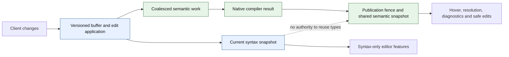
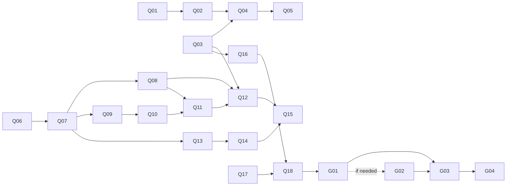

# Incremental editing, compilation and reparsing delivery plan

**Status: proposed implementation plan; production behavior is unchanged.** Source audit baseline:
`95e53ab642e3def9055494b6ee2d16011a4727cb`, 2026-11-11 Pacific. Related issue/PR states below are observations at
planning time, not permanent status. This plan serves the Fast, Correct and Safe properties of the
[Quality Bar](../docs/quality-bar.md), especially [#614](https://github.com/albertocavalcante/gvy/issues/614),
[#1547](https://github.com/albertocavalcante/gvy/issues/1547) and
[#1551](https://github.com/albertocavalcante/gvy/issues/1551). It is a delivery design, not another project roadmap.

## Recommendation and first milestone

Use Native as the shared compiler-backed semantic authority. Retain `parser/core` utilities and existing consumers; do
not turn its lossy AST adapter into the new incremental syntax foundation. Deliver coherent ranged text updates, remove
duplicate default-hover parsing through the existing hover work, and establish a reproducible editing baseline first.
Then bound compilation to conservatively affected files and evaluate true syntax reuse behind a separate, versioned
contract.

The first milestone is **one coherent editor state, one shared default semantic result, and measured edit costs**. Its
gate is a real protocol replay proving that text, versions, diagnostics, hover and navigation agree after edits;
unchanged default hover must not invoke a second parser. Ranged sync can land independently; hover is already
consolidated on Native (81fc6d52). Neither milestone may be described as incremental AST reparsing.

The [PR queue and next-PR packet](#pr-queue-and-next-pr-packet) below expand these phases into independently reviewable
changes. Their planning baseline is newer than the original source audit; open prerequisites are not counted as landed.

No speedup percentage or completion date is justified yet. The compiler-reuse and syntax-frontend experiments below
determine whether the last stages are an integration project or a substantially larger parser project.

## What exists, and what does not

Paths are relative to the audit revision. Recheck them against the publication head of each implementation PR.

| Layer             | Observed implementation                                                                                                                                   | Consequence                                                                                                           |
| ----------------- | --------------------------------------------------------------------------------------------------------------------------------------------------------- | --------------------------------------------------------------------------------------------------------------------- |
| Protocol          | `ServerCapabilitiesFactory.kt:29` advertises Full; `GroovyTextDocumentService.kt:396` rejects any ranged notification.                                    | Incremental transport is absent.                                                                                      |
| Buffer            | `DocumentProvider.kt:8,54` holds immutable text/version snapshots and preserves an open/close incarnation.                                                | Reuse these lifecycle fences; do not create a second buffer store.                                                    |
| Scheduling        | `DiagnosticsOrchestrator.kt:31,111` debounces changes by 250 ms and retires obsolete publications.                                                        | Coalescing already exists; account for its delay in user-visible latency.                                             |
| Cache             | `CompilationCache.kt:10,43` matches complete text and configuration; `CompilationIdentity.kt:10` identifies pending work without requested compile phase. | Exact-source reuse exists. Phase, semantic inputs and dependency generations need an explicit compatibility contract. |
| Native            | `GroovyParserFacade.kt:378` constructs a compiler unit and source, compiles, fully lexes, and rebuilds relationships/symbols.                             | No previous-tree/edit input or subtree reuse.                                                                         |
| Core              | `GroovyParser.kt:81` also invokes Groovy compilation, then converts the module into a Kotlin AST.                                                         | Core is not an independent incremental grammar implementation.                                                        |
| Tokens            | `GroovyTokenIndex.kt:79` lexes the whole source and retains comment/string classification spans.                                                          | It is not a complete token stream or lexer checkpoint cache.                                                          |
| Dependencies      | `DependencyGraph.updateFromModule()` has no production caller; extraction covers imports and inheritance.                                                 | Bounded source selection cannot currently rely on a populated, complete graph.                                        |
| Incremental names | `TokenEditDistance` has only tests as callers; `shouldUseIncrementalCompilation()` has no production consumer.                                            | Do not mistake names/configuration for shipped behavior.                                                              |

Existing snapshot fences, per-phase cancellation and exact-content caches are useful foundations. Do not claim that gvy
has no cancellation or no caching. `source/Utf16LineIndex.kt` already exists, including CRLF/bare-CR handling; its
`offsetOf()` deliberately permits columns to cross lines, so it must not be used as an unchecked LSP edit decoder.

The evidence is strong for the absence of production subtree reuse, partial for current edit/lifecycle correctness, and
missing for incremental-versus-fresh equivalence, incremental resource bounds and end-to-end speedup. Existing visitor
benchmarks in [the performance plan](PHASE_3_PERFORMANCE_PLAN.md) and [optimization results](OPTIMIZATION_PLAN.md) do
not measure editor reparsing.

## Core versus Native

| Question          | Core (parser/core)                                                                                                                    | Native today                                                                            | Plan                                                                                           |
| ----------------- | ------------------------------------------------------------------------------------------------------------------------------------- | --------------------------------------------------------------------------------------- | ---------------------------------------------------------------------------------------------- |
| Parsing           | Fresh compiler parse through CONVERSION, followed by conversion.                                                                      | Fresh compiler parse with project context and requested phase; fallback/recovery paths. | Neither is incrementally reusable today.                                                       |
| Representation    | Kotlin nodes with mutable parents/ranges; information is lost during conversion.                                                      | Groovy compiler objects with mutable relationships, scopes and metadata.                | Use Native for semantics; require a separate safe syntax representation for subtree reuse.     |
| Project knowledge | Former default Core hover engine parsed without the Native request's project classpath and used its reflection solver.                | Supplies classpath, source roots and unsaved companion buffers.                         | Preserve project context in every semantic result.                                             |
| Feature coverage  | Hover formerly used Core (retired); type solvers, Groovydoc extraction, visualization and parser API consumers still use parser/core. | Most LSP features already use Native; held-snapshot hover can avoid reparsing.          | Hover consolidated on Native (81fc6d52); keep parser/core consumers that remain in use.        |
| Recovery          | Missing compiler module can yield an empty unit.                                                                                      | Can exclude broken companion sources, retry a lower phase and report degradation.       | Compare malformed buffers and report achieved phase; do not assume Core has superior recovery. |
| Reusable value    | Groovydoc/comment support, type solvers, resolver and parser API consumers.                                                           | Compiler fidelity, workspace resolution, existing LSP integration.                      | Keep useful Core code without keeping two default semantic answers.                            |

Concrete Core losses: `GroovyAstConverter.kt:320` converts unknown expressions to `ConstantExpr(text)`;
`StatementConverter.kt:75` substitutes empty blocks for unsupported statements; `DeclarationConverter.kt:67` retains
only whether a field has an initializer. Its current tree therefore cannot serve as a full-fidelity incremental syntax
tree without major representation and parser changes.

Native is the recommended authority, not a claim that its inference is complete. The main compile requests
CANONICALIZATION, and workspace compilation requests SEMANTIC_ANALYSIS. The compiler type-checker investigation in
[#1547](https://github.com/albertocavalcante/gvy/issues/1547) remains relevant; do not equate these phases with complete
compiler-derived expression types or manufacture a second type system in a new syntax frontend.

[#1276](https://github.com/albertocavalcante/gvy/issues/1276) proposed retiring Core hover, and commit `81fc6d52`
retired it: hover always uses Native, and `core` is accepted as a legacy alias that selects Native. Earlier,
[PR #1775](https://github.com/albertocavalcante/gvy/pull/1775) changed the default and improved Native cards; its
observed head was `e1546e6158b75afe01642ed683f9b23f91231322`.

## Architecture and invariants



The syntax branch is proposed, not implemented. The parser decision experiment may retain whole-file syntax parsing if
reuse does not earn its maintenance and runtime costs.

1. One buffer authority owns text, version, content hash and incarnation. A proposed edit batch identifies both its base
   and resulting snapshots and stores edits in application order. Versions must increase; they need not be consecutive.
   A full replacement resets accumulated edit history.
2. A syntax snapshot identifies source, grammar/options and its base tree. It owns immutable/shared tree data and
   snapshot-relative positions. Old snapshots must remain unchanged when a new edit moves later text.
3. A semantic result identifies source and incarnation, compiler/worker, target/classpath/options, requested and
   achieved phases, degradation, and dependencies with their observed generations. Content equality alone cannot
   authorize semantic reuse after another open file changes.
4. Publish the parse, dependency facts, symbol index and semantic facts under compatible ownership. Obsolete work cannot
   publish any part. A cyclic component may require a batch publication boundary. Capture companion buffers coherently
   or revalidate their recorded identities before committing.
5. Syntax equality does not establish semantic equality. Last-good facts may support explicitly uncertain display
   behavior, but cannot authorize rename, formatting or code-action edits against newer text. Such operations acquire
   current coherent facts or refuse.
6. Debouncing may skip analysis of intermediate versions, never application of their text edits. Compose edits from the
   last parsed snapshot to the latest buffer; when history is unavailable, replaced or over budget, parse fresh.

## Delivery phases and PR-sized work packages

Every row is planned work. The source audit and external API investigation are complete; the runtime experiment is
described below. No implementation gate in this table is claimed passed by publishing this plan.

| Phase / package                 | Work and owner boundary                                                                                                                                           | Dependencies                                   | Completion evidence                                                                                                                                                  |
| ------------------------------- | ----------------------------------------------------------------------------------------------------------------------------------------------------------------- | ---------------------------------------------- | -------------------------------------------------------------------------------------------------------------------------------------------------------------------- |
| P0-A: contracts                 | GLS/parser maintainers define edit ordering, snapshot identity, phase compatibility and degraded-result rules.                                                    | Current source audit.                          | Contracts cover duplicate/old versions, reopen, companion edits, phase changes and cancellation without assuming contiguous versions.                                |
| P0-B: characterization          | Extend existing E2E/public-endpoint tests under #1546/#1654; add a named edit replay and collect compiler, lexer, indexing and queue costs.                       | P0-A.                                          | Full-replacement replay is reproducible; actual applied text/versions are asserted; baseline reports cold and warm results separately.                               |
| P0-C: compiler experiment       | Exercise retained Groovy units on addition, replacement, removal, error recovery, changed signatures and changed transform context.                               | P0-A; pinned Groovy 4.0.33.                    | Compare each operation with a fresh unit; report old snapshot mutation, stale classes and retained state. Reject failing reuse modes.                                |
| P1-A: pure edit application     | Put a reusable edit applier beside the neutral source utilities; GLS decodes protocol changes into it.                                                            | P0-A.                                          | Sequential mixed replacements/ranges produce exact text; bounds, UTF-16, CRLF, bare CR, EOF and supplementary characters follow the LSP contract.                    |
| P1-B: sync integration          | Update DocumentProvider/didChange and negotiate Incremental only after edit application works. Preserve full replacements and lifecycle fences.                   | P1-A.                                          | Public initialize/didChange tests prove capability and behavior; out-of-date or invalid batches cannot partially mutate a buffer.                                    |
| P1-C: analysis handoff          | Carry base/result identity and bounded edit history through debounce; retire analysis without losing accepted text.                                               | P1-B; P0-B.                                    | Burst edits, undo, full reset and close/reopen produce the same latest state and answers as a fresh-open control.                                                    |
| P2-A: one default semantic path | Done: #1775 (merged) made Native the default hover and 81fc6d52 retired Core hover (#1276); and `parser/core` utilities and consumers are retained.               | Done (#1775, 81fc6d52).                        | Parser invocation counts show no second unchanged default-hover parse; hover/current-buffer/race/Unicode and project-type tests pass.                                |
| P2-B: dependency facts          | Prepare dependency records from current compiler facts, including signatures, annotations, generics, arrays and resolved body references; commit with the parse.  | P0-A; #776/#663.                               | A→B→C and cycles update reverse edges; renamed/deleted/failed sources remove or conservatively invalidate old evidence; no stale compile can overwrite the graph.    |
| P2-C: selective analysis        | Include phase/context/dependency generation compatibility in result and pending-work reuse; schedule changed files and conservative transitive dependents.        | P2-B; P0-B.                                    | Changing an unsaved companion or a public return type invalidates consumers; unrelated work is reused only with proof; fresh and selective workspace results agree.  |
| P2-D: bound retained state      | Separate detached facts from heavyweight compiler graphs where consumers allow; bound weights/history/concurrency and remove eager N-by-N work under #1569/#1571. | Consumer audit; P2-C for selective scheduling. | Named 50/200/500-file workloads complete within an explicit heap; retained bytes and compiler calls are measured; eviction/reopen/cancellation preserve correctness. |
| P3-A: syntax decision           | Compare restartable Groovy/ANTLR, retained compiler sessions and a dedicated incremental syntax frontend on the same edit corpus.                                 | P0-C; P0-B; invariants above.                  | Written decision includes grammar coverage, malformed recovery, coordinate contracts, packaging, maintenance cost and measured end-to-end benefit.                   |
| P3-B: lexer reuse, if justified | Retain complete relevant lexical state; relex from a proven restart point until state and token stream converge, otherwise to EOF.                                | P3-A; lexer-state experiment.                  | Classification equals full lex after every edit; cancellation and relex spans are observable. Report this as lexer incrementality only.                              |
| P3-C: first subtree reuse       | Add an edit-aware syntax API with a full-parse implementation first, then one explicit safe reparse class, such as a method-body edit.                            | P3-A; token checkpoint proof where required.   | Fresh syntax equivalence passes for supported and fallback cases; unchanged structure is actually reused; held older trees/ranges stay unchanged.                    |
| P4: harden and ship             | Expand supported edits only as evidence permits; run protocol/editor, corpus, resource and comparative performance gates, then enable the proven mode.            | P1–P3 applicable gates.                        | Correctness, memory, fallback rate and latency reports identify the exact artifact/head; disable/restart restores the full-parse path without changing text.         |

P1 does not wait for P2 or a new parser. P2 does not require subtree parsing. P3 experiments can run beside P2 after the
baseline exists. The production syntax slice needs the snapshot/safety contract, but does not need complete fine-grained
semantic reuse. Do not turn every row into a serial dependency.

### P1 details: protocol and edit history

- Validate/normalize positions according to the negotiated LSP encoding, initially the existing UTF-16 contract. Respect
  the specification's out-of-range position rules; do not let `offsetOf()` cross into the next line by accident. Define
  handling of reversed ranges, negative/overflowing input and surrogate interiors explicitly.
- Apply changes against the evolving text in notification order; a later edit's coordinates refer to preceding edits.
  Retain support for full content replacement. Do not trust deprecated `rangeLength` as the source of truth.
- Compute a candidate result before atomically accepting its version. If a batch cannot be applied, keep the last
  coherent state, invalidate incompatible analysis and report the synchronization problem. gvy has no generic LSP
  pull-current-buffer operation: an error must not silently allow later deltas to corrupt the buffer. Establish a tested
  client-compatible recovery/reset policy before advertising the capability.
- Bound history by bytes and count. If a parser has version 10 while edits 11–15 are coalesced, compose that exact chain
  or derive a safe fresh parse from the authoritative latest text. Never apply only edit 15 to tree 10.
- Reuse the existing line index where its contract fits. Start with ordinary immutable strings; introduce a rope or
  piece table only if the editing benchmark shows text copying/index construction is material.

### P2 details: conservative semantics before clever invalidation

Populating today's partial graph must not immediately activate its bounded source-selection branch. Mark evidence as
incomplete until extraction/resolution is adequate. Include unresolved names, same-package lookup, wildcard/static
imports, extension methods, scripts, class-name changes and transform-generated members in the conservative policy.
Unknown/dynamic/transform-sensitive relationships expand the invalidation set, potentially to the whole target.

Initially reanalyze transitive consumers after any relevant source change. ABI/signature hashes can later avoid
implementation-only propagation, but only after proving that inferred returns, closures/delegates, constants and
transforms cannot change consumer answers. Do not classify method-body dependencies as unconditionally optional.

Do not feed compiler dependencies into a new graph with different lifecycle rules. Prepare replacement edges, remove
obsolete names, and commit under the existing artifact ownership boundary. Test empty dependency sets as known facts,
not indistinguishable from files never analyzed. Prefer qualified declaration identities to ambiguous simple names.

Cache entries and in-flight work must distinguish requested phases; a lower-phase fallback cannot satisfy a stronger
request merely because text matches. The same text under a new classpath, target, worker, transform policy or changed
companion-buffer generation is not a reusable semantic result. Implement a coarse target generation first if that is the
only sound evidence; optimize its invalidation later.

### P3 details: choose a parser from evidence

| Alternative                                      | What it can buy                                                                             | Main difficulty                                                                                                   | Decision gate                                                                                               |
| ------------------------------------------------ | ------------------------------------------------------------------------------------------- | ----------------------------------------------------------------------------------------------------------------- | ----------------------------------------------------------------------------------------------------------- |
| Keep full Native parsing and optimize scheduling | Fidelity and a small maintenance surface; fewer duplicate/irrelevant compiles.              | Large-file compiler work remains full-file.                                                                       | Prefer while it meets measured editing budgets; do not call it subtree reuse.                               |
| Retain a Groovy CompilationUnit                  | Potential reuse of compiler state/unchanged sources.                                        | Replacement/deletion, errors, transformed ASTs, type caches, cross-file invalidation and snapshot isolation.      | Pass P0-C before any production retention; session reuse alone does not prove subtree reparsing.            |
| Extend Groovy/ANTLR for local reparsing          | Alignment with the pinned Groovy grammar.                                                   | Restart state, grammar context, fragment entry rules, recovery and maintaining upstream coupling.                 | A method/closure edit and a boundary-breaking edit must match a full parse, including malformed recovery.   |
| Dedicated incremental syntax frontend            | Persistent syntax, local reparse and error nodes while Native remains the semantic backend. | Groovy grammar coverage/version drift, position bridging, duplicate state, JVM packaging and grammar maintenance. | Corpus/edit proof and enough saved work in an actual consumer; syntax acceptance is not semantic agreement. |
| Extend today's Core AST                          | Existing Kotlin-facing consumers.                                                           | First repair lossy nodes/trivia/recovery, then replace its full compiler parse anyway.                            | Not the recommended starting point; reconsider only if consumer evidence changes the tradeoff.              |

Groovy 4.0.33's
[CompilationUnit API](https://docs.groovy-lang.org/docs/groovy-4.0.33/html/gapi/org/codehaus/groovy/control/CompilationUnit.html)
describes delta recompilation. Its
[pinned source](https://github.com/apache/groovy/blob/GROOVY_4_0_33/src/main/java/org/codehaus/groovy/control/CompilationUnit.java#L621)
restarts the unit's phase traversal while individual operations can skip already processed sources. This warrants a
bounded experiment; it does not prove safe editor replacement, deletion or subtree parsing. Do not claim the upstream
compiler has no incremental behavior simply because gvy does not use it.

A synthetic API probe ran on macOS arm64, OpenJDK 21.0.13.0.3, Groovy 4.0.33, with `-Xmx128m`. Recompiling unchanged
input retained one class; adding a distinct source produced both classes. Replacing `A.groovy` in the retained unit and
recompiling failed with `MultipleCompilationErrorsException` reporting a duplicate definition of `A`. The same revised
source in a fresh unit succeeded. This disproves the naive same-name replacement route, not every possible compiler
reuse design. Deletion, dependent invalidation, transforms and recovery still need P0-C experiments.

The failing operation is reproducible in a Groovy 4.0.33 script:

```groovy
import org.codehaus.groovy.control.CompilationUnit
import org.codehaus.groovy.control.Phases

def unit = new CompilationUnit()
unit.addSource('A.groovy', 'class A { String before() { "a" } }')
unit.compile(Phases.CANONICALIZATION)
unit.addSource('A.groovy', 'class A { Integer after() { 1 } }')
unit.compile(Phases.CANONICALIZATION) // duplicate class A
```

For an example of the alternative contract,
[Tree-sitter documents editing the old tree and supplying it to the next parse](https://tree-sitter.github.io/tree-sitter/using-parsers/3-advanced-parsing.html).
That demonstrates an edit-aware API shape, not a recommendation of any particular Groovy grammar. A candidate grammar,
license, supported language level, pinned artifacts and JVM/native distribution still require evaluation. No new parser
dependency is selected by this plan.

Lexical restart cannot be based on line boundaries or brace counts alone. Slashy/division ambiguity, dollar-slashy and
multiline strings, interpolation mode stacks, nested delimiters, command expressions and significant newlines can change
interpretation beyond an edited region. Recovery expands to an enclosing safe unit or the whole file.

Do not splice live `ClassNode` objects between versions. Native relationship maps use object identity, while compiler
passes and transforms mutate nodes, scopes and metadata. Even untouched text after an insertion moves source ranges.
Reuse immutable syntax structure with snapshot-relative positions; rederive semantic facts unless context and dependency
validity are proven. A retained compiler experiment must demonstrate old-snapshot isolation separately.

## Validation and rollout contract

Use two different oracles. Fresh Native parsing establishes incremental equivalence to gvy's existing path; it does not
prove that path is correct. Curated cases and the pinned Groovy compiler, under the same language/transform policy and
applicable phase, establish independent language behavior. Missing/degraded types remain labelled unknown.

The edit matrix includes:

- insert/delete/replace at start, middle and EOF; multiple changes; version jumps; duplicate/stale changes; undo/redo;
  full replacement after ranges; close/reopen and identical text with a new incarnation;
- LF, CRLF, bare CR, trailing empty lines, supplementary characters, combining characters and edits near line breaks;
- identifiers/literals, import and class/package changes, method/closure boundaries, GStrings, slashy strings, comments,
  significant newline changes and unfinished delimiters;
- multiple unsaved files, cycles, signature changes, missing classes, deleted/renamed files, classpath/target/worker
  changes, transform-policy changes and lower-phase recovery;
- cancellation before/within a phase, failed/out-of-order publication, rapid edits during navigation, cache eviction,
  bounded history fallback and retained-snapshot inspection after later edits.

Compare exact resulting text and source identity first, then token/classification spans, syntax shape and error
structure, diagnostics/degraded outcomes, declaration/reference bindings and edit safety. Public endpoint checks must
apply returned edits and verify the resulting text; an `applied=true` callback alone is not evidence. Derive original
fixtures for gvy and pin any external corpus immutably; ordinary unit tests must not download corpora or require SDKs.

Performance runs separately report edit acceptance, syntax availability, semantic readiness and final diagnostics.
Include queue/debounce time and compiler invocations, cancellation/coalescing counts, parsed/relexed spans, node reuse,
fallback reasons, allocations and retained heap. Use named small/large files and 50/200/500-file workspaces spanning
ordinary Groovy, Jenkins, Gradle and Spock; a copied synthetic file is not corpus diversity. Report p50/p95 with
workload, artifact hashes, JVM/heap/GC/platform, warmup, cache state and host contention. Reuse
`tools/perf/evidence.mjs` for its existing run envelope; extend its closed schema only through a separately reviewed
change.

Set latency/resource budgets from P0 measurements before enabling the feature, and publish the budgets with the
workload. Do not invent a percentage target from old issue prose or compare instrumented candidates to uninstrumented
baselines. Full parsing remains the fallback and may legitimately be faster for small files.

Each implementation PR gets a failing behavior test first, focused checks, independent complete-diff review, and the
repository's applicable native/CI gates. Snapshot/API changes verify both parser providers and affected consumers;
protocol/default changes include the packaged editor/server path. Run heavy checks through `build-slot` with explicit
JVM bounds; do not run builds in main. This narrative plan receives Markdown/link/independent review, not unrelated
runtime suites. Rollout starts with an explicit experimental mode; enable the default only after the gates pass. On
failure, retain authoritative text, discard incompatible cached state, and use the full parser. Reverting transport
capabilities requires a server/client restart and a full didOpen state, not an unannounced mid-session mode switch.

## Existing work, remaining debt and handoff

| Responsible scope / existing record | Impact and reason still open                                                                         | Next action and acceptance                                                                                                    |
| ----------------------------------- | ---------------------------------------------------------------------------------------------------- | ----------------------------------------------------------------------------------------------------------------------------- |
| GLS editing, #614                   | No ranged sync or subtree contract.                                                                  | Deliver P0/P1; maintain separate claims for transport, selective compilation and tree reuse.                                  |
| Hover, #1276 / #1775                | Resolved by 81fc6d52: Core hover is retired, so the former independent default parse is gone.        | Validate invocation counts and coherence on the Native hover path; #1775's historical CI blocker is not a waiver.             |
| Compilation, #776 / #663            | Graph unpopulated and incomplete; unsound selection could omit required sources.                     | P2-B then P2-C with conservative fallbacks, transitive/cycle and unsaved-buffer tests.                                        |
| Compilation, #660                   | Historical IncrementalCompiler.kt referenced by the issue is absent at the audit revision.           | Reconcile the issue around current WorkspaceCompiler/Orchestrator before implementation; selective/fresh agreement closes it. |
| Coordinates, #1190                  | Shared UTF-16 utility exists, but provider coordinate normalization remains broader unfinished work. | Reuse neutral utilities and prove edit-boundary semantics; do not claim the entire issue closed by ranged sync.               |
| Harness, #1546 / #1654              | Incomplete stateful client support can produce false-positive edit evidence.                         | Assert actual buffer/file changes and equivalent post-edit requests; reuse active harness work.                               |
| Semantics, #1547                    | Native compiler phases do not establish complete compiler type inference.                            | Keep its checker/lookup investigation separate; incremental optimization must preserve honest degraded results.               |
| Memory/startup, #1569 / #1571       | Compiler graphs retained by caches; eager compilation can repeat workspace work.                     | Measure and deliver P2-D; neither count-only LRU nor source reduction alone proves bounded heap.                              |
| Parser maintainers, #614            | No chosen edit-aware syntax representation or compatibility evidence.                                | P0-C/P3 decision and first reuse proof; retain whole parsing until a candidate passes.                                        |

This ledger records debt; it does not resolve it. New work packages should extend these owners/issues, adding a child
issue only where an existing one does not cover the acceptance contract. Keep live status in linked issues and the
Quality Bar tracker, with dated evidence rather than unchecked duplicate roadmaps.

Do not bundle a Groovy major upgrade, full compiler fork, new independent type system, full Core-module deletion,
whole-project rope migration, formatter rewrite or unrelated CI migration into this program. They are not prerequisites
for P1 or conservative P2. Any necessary upstream contribution is prepared locally for human review under the
[dependency policy](../docs/dependency-bugs.md); this plan does not authorize upstream submissions.

Start with P0 characterization and P1-A/B, build on the merged #1775 Native hover, and make the P0-C/P3 decision before
promising subtree reuse. These packages can deliver real responsiveness improvements even if the syntax experiment
ultimately retains whole-file parsing.

## PR queue and next-PR packet

Queue baseline: `dd3a3a20a28a1854c879071092ba241e41343508`, 2026-11-11 Pacific. The next PR is Q01. There are **18
scoped PR packets and four experiment-gated follow-ons**, not 22 branches or promises of a selected parser. “Scoped”
means the problem, contract, proof and boundary can be specified now; dependencies still have to land and integration
heads must be rechecked. Q identifiers are planning references, not GitHub issue numbers. Existing issues remain the
live trackers.

### Coordinate existing work before opening a replacement

The states below were refreshed during queue review after #1803 landed; the source planning baseline remains
`dd3a3a20a`. Read each PR's current readiness and final reviewed head before using it. Open drafts do not establish
passed gates.

| Existing work                                                                                                                                            | Observed head / dependency                          | Use in this program                                                                                                                       |
| -------------------------------------------------------------------------------------------------------------------------------------------------------- | --------------------------------------------------- | ----------------------------------------------------------------------------------------------------------------------------------------- |
| [#1775](https://github.com/albertocavalcante/gvy/pull/1775), Native default hover                                                                        | `e1546e615`; base main                              | Merged 2026-11-12; add any missing parser-count/coherence proof rather than repeat the engine/default change.                             |
| [#1803](https://github.com/albertocavalcante/gvy/pull/1803), simultaneous editor edits                                                                   | Merged `628407fe2`; reviewed head `258ee8da8`       | Outbound client TextEdit[] semantics for #1654, not the sequential incoming-change algorithm in Q01.                                      |
| [#1806](https://github.com/albertocavalcante/gvy/pull/1806), multi-buffer edit plans                                                                     | Draft `8cea9ebbf`; rebased onto main                | Reuse when stateful workspace-edit tests are needed; it does not yet own a live editor transaction.                                       |
| [#1813](https://github.com/albertocavalcante/gvy/pull/1813), refuse unapplied edits                                                                      | `8d9acd814`; base main                              | Keep the client honest until real application exists; do not treat this as applied-edit support.                                          |
| [#1755](https://github.com/albertocavalcante/gvy/pull/1755), frozen declarations                                                                         | `8142ba3c7`; base main                              | Existing detached declaration representation; avoid inventing another one in Q07/Q13.                                                     |
| [#1805](https://github.com/albertocavalcante/gvy/pull/1805) / [#1810](https://github.com/albertocavalcante/gvy/pull/1810), declaration cache/currentness | `96596eac1` / `2ed230434`; stacked on #1755 / #1805 | Reuse the immutable view and DB-retirement check after landing; neither supplies buffer/classpath or atomic response coherence by itself. |

The full-sync replay in Q03 can use explicitly sent document notifications and public server endpoints. It does not need
to wait for workspace/applyEdit support. The independent oracle must not be implemented using either edit applicator
being tested. Q01 does not depend on the client edit stack.

### Q01: next PR — ordered UTF-16 document changes

**Title:** `feat(source): apply ordered UTF-16 document changes`. Owner boundary: neutral source utilities, part of
#614/#1190. Intended branch: `feat/ordered-document-changes`. One reviewer should be able to understand this complete
diff without reading compiler or workspace code.

**Files:** add `OrderedDocumentChanges.kt` and `OrderedDocumentChangesTest.kt` under the existing
`source/src/main/kotlin/com/github/albertocavalcante/gvy/source/` and matching test package. Existing Gradle/Bazel/Buck
source globs already include Kotlin files. Preserve `Utf16LineIndex.offsetOf()` and its compatibility tests. No new
dependency, LSP4J type, coroutine, logger, URI, buffer version or filesystem operation belongs in this PR.

Proposed public shape; names may be refined without changing the following contract:

```kotlin
public data class Utf16Position(val line: Int, val character: Int)
public data class Utf16Range(val start: Utf16Position, val end: Utf16Position)

public sealed interface DocumentChange {
    public data class Replace(val range: Utf16Range, val text: String) : DocumentChange
    public data class ReplaceAll(val text: String) : DocumentChange
}

// Applied(text), or Rejected(changeIndex, reason); never intermediate text.
public fun applyOrderedDocumentChanges(
    initialText: String,
    changes: List<DocumentChange>,
): DocumentChangeResult
```

**Contract:**

1. Apply events in authored order against the evolving string. Never sort them or apply simultaneous-overlap rules.
   `ReplaceAll` resets the current string; subsequent ranges address it. Empty input changes return unchanged text.
2. Use zero-based UTF-16 code units and half-open ranges. Reject negative coordinates, nonexistent lines and authored
   start positions after their end. Nonexistent-line rejection is an explicit local policy, not a claim about a
   normalization mandated by the position specification.
3. Clamp an oversized character to the content end of its current line, excluding the break. Resolve with
   `lineStart + min(character, lineLength)` after validation. Do not use legacy `offsetOf()` to decode edits, and do not
   pre-normalize every event against the initial text. `Int.MAX_VALUE` columns must not overflow.
4. LF, CRLF and bare CR end lines. Preserve exact code units except where a selected range replaces them. End-of-line to
   next-line-start removes the complete break; coordinates cannot name a CRLF interior.
5. Preserve raw UTF-16, including unpaired units and boundaries inside surrogate pairs. Incoming changes mirror client
   state and can pass through intermediate unpaired units. This differs deliberately from the outbound destructive-edit
   safety restrictions in #1803; do not describe scalar-boundary rejection as required by the LSP specification.
6. Check resulting length with wider arithmetic before allocation; distinguish unsupported string length from invalid
   coordinates. Reject the whole batch with a typed reason and failing event index. No partial state or source text
   enters the failure. VM allocation failure is not converted into an ordinary validation result.

The ordering and column rules follow the primary
[didChange definition](https://github.com/microsoft/language-server-protocol/blob/gh-pages/_specifications/lsp/3.17/textDocument/didChange.md)
and
[Position definition](https://github.com/microsoft/language-server-protocol/blob/gh-pages/_specifications/lsp/3.17/types/position.md).
They differ from
[TextEdit[]](https://github.com/microsoft/language-server-protocol/blob/gh-pages/_specifications/lsp/3.17/types/textEditArray.md),
whose ranges all refer to the same original state. Deprecated `rangeLength` does not enter the neutral API.

**Test-first packet:**

| Case                                                                         | Required observation                                                                                     |
| ---------------------------------------------------------------------------- | -------------------------------------------------------------------------------------------------------- |
| Insert X then Y at `(0,1)` in `ab`                                           | `aYXb`, proving sequential rather than simultaneous insertion order.                                     |
| First event changes line count or line length                                | Next event resolves against that changed text; sorting or pre-normalization fails a control.             |
| Full → range; range → full → range; repeated full replacements               | Exact authored final state, including empty/trailing lines.                                              |
| Oversized columns before a newline; maximum Int column                       | Clamp within that line, no crossing to another line or integer overflow.                                 |
| Mixed breaks and a range across CRLF                                         | Exact break preservation/deletion; no accidental one-unit CRLF remainder.                                |
| Emoji offsets, pair-interior edits, staged pair replacement, lone surrogates | Exact UTF-16 units preserved without normalization.                                                      |
| Negative/missing line, reversed range, later invalid event                   | Typed rejection with event index; no partially applied text escapes.                                     |
| Output-length boundary                                                       | Test checked-length arithmetic without allocating a near-limit string; do not create an OOM test.        |
| Small generated valid sequences with fixed seeds                             | Compare against an independently written simple splice oracle and print the reproducing seed on failure. |

Start with the same-position sequence and a column-crossing case. Demonstrate a behavioral RED through a deliberately
wrong simultaneous-order/unchecked-offset implementation if the new API's initial RED is only a missing symbol. Tests
must assert exact text or UTF-16 units, not just length or lack of exceptions.

**Gate and validation:** all source tests plus formatting/lint, unchanged legacy line-index tests, independent
final-diff review and applicable CI. After repository environment setup, use
`build-slot -- ./gradlew :source:test :source:lint` and the required lint-fix workflow. Verify Bazel with
`build-slot -- bazel --host_jvm_args=-Xmx1024m test //source:source_test`; verify the declared Buck library with
`build-slot -- buck2 build //source:source` where that backend is available/required. Use the repository's reviewed
Gradle/test memory profile and report unavailable checks. These commands are planned gates, not runs claimed here.

**Completion:** the function has no I/O or protocol dependency; inputs remain immutable; failure has no partial result;
all semantic controls pass. Runtime acceptance of ranged notifications and capabilities stay unchanged. Rollback is a
revert of the new utility/test files before any consumer depends on them; no stored state migration is required.

### Scoped queue after Q01

Dependencies below define the order; the numeric IDs do not make unrelated lanes serial. Every packet uses the common
review/validation contract above plus its stated behavior proof. Close no broad parent issue merely for landing one
packet. A packet's implementation PR must refresh its exact touched paths against the then-current main.

| ID  | Proposed PR title / owner boundary                                                             | Prerequisites                          |
| --- | ---------------------------------------------------------------------------------------------- | -------------------------------------- |
| Q02 | `feat(lsp): accept atomic versioned buffer change batches` — DocumentProvider/lifecycle        | Q01                                    |
| Q03 | `test(lsp): replay edits against fresh document controls` — protocol characterization          | None; use Full sync baseline           |
| Q04 | `feat(lsp): handle incremental changes with explicit recovery` — didChange/readiness           | Q02, Q03                               |
| Q05 | `feat(lsp): enable verified incremental text synchronization` — capabilities/real client       | Q04 and packaged protocol proof        |
| Q06 | `fix(compilation): separate phase-sensitive cached and pending work` — compatibility keys      | None; independent correctness lane     |
| Q07 | `fix(compilation): capture coherent source and workspace inputs` — compile snapshot            | Q06; coordinate declaration-view stack |
| Q08 | `fix(compilation): retire analysis on target input changes` — coarse generations               | Q07                                    |
| Q09 | `feat(compilation): capture declaration dependency evidence` — pure facts/preparation          | Q07                                    |
| Q10 | `feat(compilation): record resolved body dependencies and uncertainty` — compiler observations | Q09                                    |
| Q11 | `feat(compilation): publish dependency graphs with artifact ownership` — graph transaction     | Q08, Q09, Q10                          |
| Q12 | `perf(compilation): restrict work to proven affected source sets` — scheduler                  | Q08, Q11, Q03                          |
| Q13 | `refactor(compilation): detach proven cache facts from compiler state` — retained artifacts    | Q07; coordinate declaration-view stack |
| Q14 | `perf(compilation): bound retained artifacts by estimated weight` — cache admission/eviction   | Q13                                    |
| Q15 | `perf(workspace): replace repeated eager whole-workspace compiles` — startup scheduling        | Q12, Q14                               |
| Q16 | `test(perf): record reproducible editing workloads` — evidence producer                        | Q03; may begin before Q04              |
| Q17 | `test(parser): characterize retained compiler edit behavior` — bounded experiment              | None; pinned compiler                  |
| Q18 | `docs(parser): select the incremental syntax strategy from evidence` — decision experiment     | Q03, Q16, Q17                          |

**Q02 — atomic buffer transition.** Extend `DocumentProvider` using Q01, retaining one incarnation and one accepted
version/text snapshot. Prepare outside long-held locks, then revalidate the captured source identity and commit once;
retry or reject a raced base rather than applying to different text. Keep existing full-text update compatibility. Tests
cover version jumps, duplicate/old updates, concurrent replace, invalid later event, and close/reopen with the same
text/version. Gate: exactly one coherent transition or no change. No public ranged acceptance yet. Rollback: restore the
previous full-text transition API; no persistent data.

**Q03 — edit replay characterization.** Extend public-server protocol tests around `DocumentSynchronizationTest`,
snapshot/readiness tests and existing client journal. Replay named full replacements, await the matching diagnostic or
readiness state without sleeps, then compare selected public answers with a fresh-open control of final text. Apply
returned edits only through actual verified client state; until #1654's adapter exists, compare/apply them in an
independent explicit test fixture and state that narrower scope. Gate: exact source/version/range/answer equality for
the chosen cases and reproducible test invocation. Rollback: remove the new tests, without changing runtime behavior.

**Q04 — incoming protocol adapter and recovery.** Convert ordered content-change events into Q01/Q02 without sorting,
preserve full replacements and signed versions, and ignore deprecated rangeLength as authority. Add a synchronization
state: a newer-version notification with an invalid batch retires incompatible analysis and marks the buffer
desynchronized. Retain the last coherent text separately from the observed-version watermark; every newer notification
advances the watermark, including a ranged update dropped during recovery. Subsequent ranges and semantic/editing
answers cannot treat that text as current. A complete replacement newer than that watermark, or a new didOpen,
establishes a coherent state again. Duplicate/stale notifications do not poison a newer valid state. Surface a bounded
client-visible error; do not invent a standard pull-buffer RPC. Gate: real notification tests cover rejection, quiet
subsequent ranges, refused stale answers, reset recovery, cancellation and reopen races. Include invalid v8 → ignored
ranged v10 → full v9 still desynchronized → full v11 recovered. Advertise Full by default until Q05; the explicit opt-in
initialization/test session advertises Incremental when exercising the new protocol path. Rollback requires restart with
Full and fresh didOpen, not mid-session capability mutation.

**Q05 — capability and real-client integration.** Update the initialize contract and feature documentation to
Incremental only after a packaged client/server run covers UTF-16, multiple events, full reset, undo and rapid edits.
Assert the editor's actual latest text and versions and matching diagnostic/hover/navigation snapshots. Build on the
merged #1775 for default-hover parser-count proof; the sync contract need not wait for its semantic presentation
changes. Gate: the default capability agrees with the tested runtime path; no stale edit is offered during recovery.
Rollback: restart under the previous Full capability with a fresh open state. This closes the transport milestone only.

**Q06 — phase-sensitive reuse.** Include requested phase and parse mode/context in cache and pending-work compatibility.
Initially require exact phase/mode compatibility; do not assume a later transformed AST is suitable for a caller needing
pre-transform CONVERSION. Check achieved phase and degraded outcome against the caller's explicit policy, and never
present a lower-phase result as a strict higher-phase answer. Gate: same text requested in either phase order,
simultaneous incompatible waiters, fallback, cancellation and cache eviction all give compatible results. Use existing
`CompilationCache*`, `CompilationJobOwnershipTest` and `CompilationDegradationDiagnosticTest` call paths. Rollback:
clear results/pending work and disable reuse for incompatible requests, rather than restoring unsound hits.

**Q07 — coherent compile input capture.** Capture target/workspace, own buffer and companion-buffer identities as one
validated input record, using bounded capture/revalidation rather than holding service locks through compilation. Pass
the captured companion text to the parser; do not reread live maps halfway through a request. Reuse landed frozen
declaration views where appropriate, without treating DB currentness as buffer/classpath currentness. Gate:
deterministic latches change a companion, reopen or switch workspace during capture/compile; the result is coherent or
retired, never a mixture. Rollback: conservatively recapture/recompile and refuse stale publication; no mixed-input
fallback.

**Q08 — conservative target generations.** Retire result and pending-work compatibility when relevant source, companion,
classpath, worker, target or transform-policy inputs change. Begin with coarse target invalidation and
refresh-on-demand, not an incomplete fine-grained dependency shortcut. Gate: changing B invalidates unchanged A that
used B, including unsaved/closed/watcher and same-text-new-context transitions; obsolete work cannot republish. Unknown
target ownership falls back conservatively. Rollback: broader workspace invalidation and fresh compiles.

**Q09 — declaration dependency facts.** Prepare immutable records from imports, inheritance, fields, parameters,
returns, arrays, generics and annotations, tied to qualified declarations and the observed compile input. Represent
complete, partial and unknown evidence separately, including a known empty set. Pure extraction must not activate
today's direct-only bounded selection. Gate: fixtures for aliases, wildcard/static imports, nested types and
same-package names record correct owners or uncertainty, with no arbitrary simple-name winner. Rollback: retain broad
compilation.

**Q10 — body and dynamic evidence.** Extend Q09 with resolved calls, constructors, casts, local declarations, class
literals and other type/member uses actually represented by the pinned compiler. Mark unresolved, dynamic,
extension/delegate and transform-sensitive cases incomplete unless independently proven. A body dependency is not
optional merely because it is absent from a public signature. Gate: body-only changes that affect inferred returns,
closures or generated members expand the affected set; missing evidence never falsely certifies completeness. Rollback:
downgrade completeness and reanalyze the target.

**Q11 — graph commit and retirement.** Publish forward/reverse edges and completeness under the same compatible artifact
ownership as parse/symbol facts. Replace stale edges, class-name ownership and empty sets; invalidate on deletion,
failure, close/shadow changes and configuration retirement. Compute transitive closures and strongly connected
components with explicit generation rules, not direct-neighbor-only selection. Gate: A→B→C, cycles, rename/delete,
failed replacement and out-of-order publication preserve graph/parse agreement. Rollback: ignore the graph for source
selection and invalidate broadly while clearing its state.

**Q12 — selective compile scheduler.** Use dependency-provider closure to supply required sources and reverse consumer
closure to choose reanalysis; handle cycles together. These are different sets. Only complete applicable evidence
permits restriction; uncertainty falls back to a target/workspace set. Preserve unsaved-source precedence, class-name
lookup and degraded outcomes. Gate: selective versus fresh public answers/diagnostics agree after each cross-file edit,
while counters prove unrelated eligible work is skipped. Rollback: full source selection and fresh analysis. Do not add
ABI-only pruning in this PR.

**Q13 — retained artifact boundary.** Inventory every later reader of ParseResult/CompilationUnit/SourceUnit,
relationships and classloaders; use existing detached declaration work before inventing parallel records. Migrate one
proven cache use to a detached representation and remove only references that consumer proof makes unnecessary.
Consumers that still need compiler objects keep an explicit owned lifetime. Gate: navigation, documentation, hover,
rename and eviction/reload work without the removed references; heap reachability evidence confirms the intended graph
is no longer pinned. Rollback: retain the previous artifact under an explicit budget; do not strip fields blindly.

**Q14 — cache weight and admission.** Replace count-only protection with configurable estimated weight/admission,
eviction and explicit lifecycle ownership; avoid double-counting shared detached graphs. Open buffers keep text but
cannot pin unlimited heavyweight analyses. Bound active work separately: a cache limit is not a total-heap guarantee.
Gate: churn/eviction/reopen under a fixed heap stays correct, retained estimates track named heap observations, and
oversized inputs produce controlled unavailable/fresh-work behavior rather than unbounded pinning. Rollback: fresh
on-demand parsing with a conservative small cache, not the old unbounded-open exemption.

**Q15 — workspace startup scheduling.** Replace per-file compiles that each ingest the whole workspace with on-demand or
bounded dependency groups selected by the measured workload. Bound active compiles, cancellation and publication; retain
coverage for unopened-file references and workspace symbols. Gate: 50/200/500-file runs show the actual compiler
call/input counts and peak heap, final index coverage agrees with fresh analysis, and shutdown/churn do not leak jobs.
Rollback: conservative bounded batches or lazy fresh compilation; do not reinstate N-by-N eager retention.

**Q16 — editing evidence producer.** Reuse tools/perf's existing run envelope and add a reviewed schema extension only
for missing counters. Record input/artifact hashes, cache/runtime settings, queue/debounce, semantic-ready latency,
compiler/lexer/index counts, cancellations/coalescing and correctness outcomes. Preserve signed LSP document versions:
the current generic nonnegative-number validator cannot silently coerce or omit negative versions. Gate: missing,
partial or correctness-failing runs cannot count as successful samples; named baseline repeats are comparable and raw
results explain every expected operation. Rollback: retain raw baseline/reproduction files and turn off optional
instrumentation without changing result semantics. Set budgets from this evidence, before Q18/default syntax rollout.

**Q17 — retained-compiler characterization.** Turn the earlier four-case probe into bounded reproducible compiler API
experiments for replacement, deletion strategy, errors/recovery, dependent signatures and transforms. Compare with fresh
units and inspect held-old-result mutation; explicitly record unsupported operations. Use only the pinned dependency and
synthetic inputs, not a downloaded corpus in unit tests. Gate: a decision record can distinguish viable reuse from
duplicate/stale state and no experiment is advertised as production support. Rollback: remove the experimental seam;
Native continues creating fresh units. Do not submit an upstream report without the separate approval policy.

**Q18 — syntax strategy decision.** On Q16's same workloads compare optimized full Native parsing, any viable retained
compiler route, restartable Groovy/ANTLR and a concrete dedicated syntax candidate where available. A candidate needs
pinned grammar/runtime provenance, licensing, supported language features, broken-code recovery, coordinate bridging,
packaging and maintenance assessment. Gate: choose a route based on actual consumer benefit and equivalence, or
explicitly retain full parsing with the remaining limitation recorded. No production parser switch belongs in this
experiment PR; no grammar gets selected from API availability alone. Rollback: preserve evidence; no runtime change.

### Experiment-gated follow-ons

These contracts can be planned now, but exact implementation files, dependencies and supported edit classes cannot be
honestly frozen before Q18. Refresh them from the selected backend instead of opening speculative implementation PRs.

| ID  | Bounded follow-on                                                                  | Entry gate / completion proof / rollback                                                                                                                                                                                                                                                                                                                                                    |
| --- | ---------------------------------------------------------------------------------- | ------------------------------------------------------------------------------------------------------------------------------------------------------------------------------------------------------------------------------------------------------------------------------------------------------------------------------------------------------------------------------------------- |
| G01 | Versioned syntax snapshot API with a fresh-parse backend and bounded edit history  | Q18 chooses ownership/representation; Q01/Q02 supply edits. Prove base/result/grammar identity, full-reset/history-overflow fallback, cancellation, old-snapshot immutability and a real consumer seam. Revert to fresh parsing without losing buffer text.                                                                                                                                 |
| G02 | Lexer restart/checkpoint reuse, only if the selected route requires custom support | Q18/G01 and a demonstrated complete lexer restart state. Compare full tokens/classification and lexer state after every edit, including interpolation/slashy/newline cases; bound checkpoints/relex work and fall back to EOF. Disable checkpoint reuse independently. A backend that already supplies this absorbs the packet.                                                             |
| G03 | First proven local syntax reparse and subtree reuse                                | G01 and any required G02 proof. Select the edit class from experiments, not a promise that every method body is context-free. Show fresh syntax/error/range equivalence, actual unchanged-structure reuse and immutable older snapshots. Unsupported or ambiguous edits use full parsing.                                                                                                   |
| G04 | First syntax-only consumer and measured default rollout                            | G03 plus measured benefit in a selected consumer, protocol/package/corpus proof and explicit budgets. Semantic/refactoring operations continue requiring current Native facts. Gate zero correctness regressions in the declared matrix, bounded memory/fallback behavior and the recorded latency budget. Disable the syntax consumer and restore full parsing independently of transport. |

### Dependency lanes and execution rule



Start Q01 next. Q03, Q06 and Q17 can be authored independently; use the smallest available team and serialize heavy
checks under the host build slot. Coordinate existing owners before touching the same call paths. Each open PR must
stand alone with passing tests; do not stack unrelated lanes or create all proposed branches in advance. Rebase any
necessary stack onto the verified squash result, not onto assumed ancestry.

When a gate fails, record its concrete limitation in the existing issue and keep the conservative path. Defer decisions
that require Q18: a new grammar/runtime, persistent syntax-node layout, exact local-reparse boundaries and a syntax
consumer selected without cost evidence. Also defer ABI-only invalidation, rope migration and complete Core removal
until their own correctness/performance case exists. This queue specifies all currently bounded deliveries without
pretending those architecture choices are settled.
