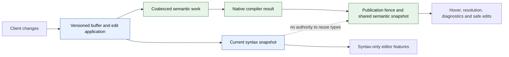
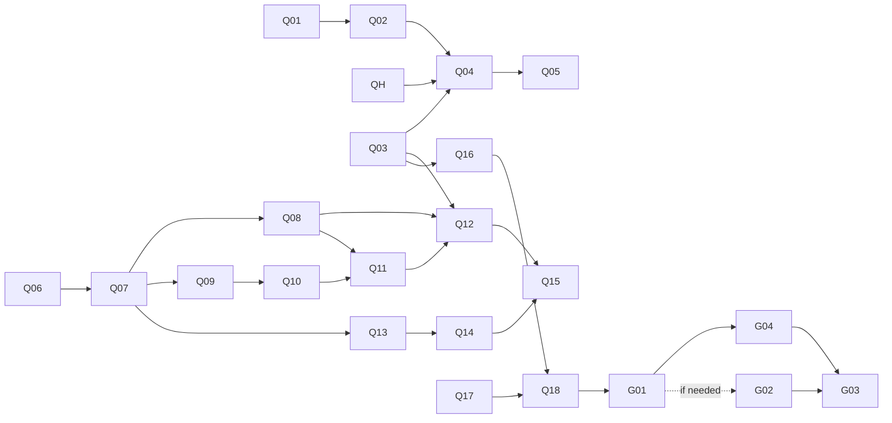

# Incremental editing, compilation and reparsing delivery plan

**Status: proposed implementation plan; production behavior is unchanged.** Source audit baseline:
`95e53ab642e3def9055494b6ee2d16011a4727cb`, 2026-11-11 Pacific. Related issue/PR states below are observations at
planning time, not permanent status. This plan serves the Fast, Correct and Safe properties of the
[Quality Bar](../docs/quality-bar.md), especially [#614](https://github.com/albertocavalcante/gvy/issues/614),
[#1547](https://github.com/albertocavalcante/gvy/issues/1547) and
[#1551](https://github.com/albertocavalcante/gvy/issues/1551). It is a delivery design, not another project roadmap.

> [!IMPORTANT]
> The [recovery and mixed-version implementation contract](#recovery-and-mixed-version-implementation-contract) below
> records the current owner requirement, restart instructions and 33 PR packets. It qualifies the older single-Native
> semantic direction and moves the first tolerant syntax consumer before optional subtree reuse. These are required
> outcomes, not delivered support.

## Recommendation and first milestone

Use a qualified target provider for compiler-backed semantic facts; Native remains the current default adapter during
the migration. The bundled compiler is not universal authority across target versions. Independent tolerant syntax
serves ordinary broken buffers without successful compilation. Retain `parser/core` utilities and existing consumers; do
not turn its lossy AST adapter into the new incremental syntax foundation. Deliver coherent ranged text updates, keep
default hover on its single Native parse (already consolidated by 81fc6d52), and establish a reproducible editing
baseline first. Then bound compilation to conservatively affected files and evaluate true syntax reuse behind a
separate, versioned contract.

The original transport milestone is **one coherent editor state, one shared semantic result per qualified target, and
measured edit costs**. Its gate is a real protocol replay proving that text, versions, diagnostics, hover and navigation
agree after edits; unchanged default hover must not invoke a second parser. Ranged sync can land independently; hover is
already consolidated on Native (81fc6d52). Neither milestone may be described as incremental AST reparsing.

The [PR queue and next-PR packet](#pr-queue-and-next-pr-packet) below expand these phases into independently reviewable
changes. Their planning baseline is newer than the original source audit; open prerequisites are not counted as landed.

No speedup percentage or completion date is justified yet. The compiler-reuse and syntax-frontend experiments below
determine whether the last stages are an integration project or a substantially larger parser project.

## What exists, and what does not

Paths are relative to the audit revision. Recheck them against the publication head of each implementation PR.

| Layer             | Observed implementation                                                                                                                                   | Consequence                                                                                                           |
| ----------------- | --------------------------------------------------------------------------------------------------------------------------------------------------------- | --------------------------------------------------------------------------------------------------------------------- |
| Protocol          | `ServerCapabilitiesFactory.kt:29` advertises Full; `GroovyTextDocumentService.kt:396` rejects any ranged notification.                                    | Incremental transport is absent.                                                                                      |
| Buffer            | `DocumentProvider.kt:8,54` holds immutable text/version snapshots and preserves an open/close incarnation.                                                | Reuse these lifecycle fences; do not create a second buffer store.                                                    |
| Scheduling        | `DiagnosticsOrchestrator.kt:31,111` debounces changes by 250 ms and retires obsolete publications.                                                        | Coalescing already exists; account for its delay in user-visible latency.                                             |
| Cache             | `CompilationCache.kt:10,43` matches complete text and configuration; `CompilationIdentity.kt:10` identifies pending work without requested compile phase. | Exact-source reuse exists. Phase, semantic inputs and dependency generations need an explicit compatibility contract. |
| Native            | `GroovyParserFacade.kt:378` constructs a compiler unit and source, compiles, fully lexes, and rebuilds relationships/symbols.                             | No previous-tree/edit input or subtree reuse.                                                                         |
| Core              | `GroovyParser.kt:81` also invokes Groovy compilation, then converts the module into a Kotlin AST.                                                         | Core is not an independent incremental grammar implementation.                                                        |
| Tokens            | `GroovyTokenIndex.kt:79` lexes the whole source and retains comment/string classification spans.                                                          | It is not a complete token stream or lexer checkpoint cache.                                                          |
| Dependencies      | `DependencyGraph.updateFromModule()` has no production caller; extraction covers imports and inheritance.                                                 | Bounded source selection cannot currently rely on a populated, complete graph.                                        |
| Incremental names | `TokenEditDistance` has only tests as callers; `shouldUseIncrementalCompilation()` has no production consumer.                                            | Do not mistake names/configuration for shipped behavior.                                                              |

Existing snapshot fences, per-phase cancellation and exact-content caches are useful foundations. Do not claim that gvy
has no cancellation or no caching. `source/Utf16LineIndex.kt` already exists, including CRLF/bare-CR handling; its
`offsetOf()` deliberately permits columns to cross lines, so it must not be used as an unchecked LSP edit decoder.

The evidence is strong for the absence of production subtree reuse, partial for current edit/lifecycle correctness, and
missing for incremental-versus-fresh equivalence, incremental resource bounds and end-to-end speedup. Existing visitor
benchmarks in [the performance plan](PHASE_3_PERFORMANCE_PLAN.md) and [optimization results](OPTIMIZATION_PLAN.md) do
not measure editor reparsing.

## Core versus Native

| Question          | Core (parser/core)                                                                                                                    | Native today                                                                            | Plan                                                                                           |
| ----------------- | ------------------------------------------------------------------------------------------------------------------------------------- | --------------------------------------------------------------------------------------- | ---------------------------------------------------------------------------------------------- |
| Parsing           | Fresh compiler parse through CONVERSION, followed by conversion.                                                                      | Fresh compiler parse with project context and requested phase; fallback/recovery paths. | Neither is incrementally reusable today.                                                       |
| Representation    | Kotlin nodes with mutable parents/ranges; information is lost during conversion.                                                      | Groovy compiler objects with mutable relationships, scopes and metadata.                | Use Native for semantics; require a separate safe syntax representation for subtree reuse.     |
| Project knowledge | Former default Core hover engine parsed without the Native request's project classpath and used its reflection solver.                | Supplies classpath, source roots and unsaved companion buffers.                         | Preserve project context in every semantic result.                                             |
| Feature coverage  | Hover formerly used Core (retired); type solvers, Groovydoc extraction, visualization and parser API consumers still use parser/core. | Most LSP features already use Native; held-snapshot hover can avoid reparsing.          | Hover consolidated on Native (81fc6d52); keep parser/core consumers that remain in use.        |
| Recovery          | Missing compiler module can yield an empty unit.                                                                                      | Can exclude broken companion sources, retry a lower phase and report degradation.       | Compare malformed buffers and report achieved phase; do not assume Core has superior recovery. |
| Reusable value    | Groovydoc/comment support, type solvers, resolver and parser API consumers.                                                           | Compiler fidelity, workspace resolution, existing LSP integration.                      | Keep useful Core code without keeping two default semantic answers.                            |

Concrete Core losses: `GroovyAstConverter.kt:320` converts unknown expressions to `ConstantExpr(text)`;
`StatementConverter.kt:75` substitutes empty blocks for unsupported statements; `DeclarationConverter.kt:67` retains
only whether a field has an initializer. Its current tree therefore cannot serve as a full-fidelity incremental syntax
tree without major representation and parser changes.

Native is the current default compiler adapter for qualified contexts, not a claim of complete inference or universal
version compatibility. The main compile requests CANONICALIZATION, and workspace compilation requests SEMANTIC_ANALYSIS.
The compiler type-checker investigation in [#1547](https://github.com/albertocavalcante/gvy/issues/1547) remains
relevant; do not equate these phases with complete compiler-derived expression types or manufacture a second type system
in a new syntax frontend.

[#1276](https://github.com/albertocavalcante/gvy/issues/1276) proposed retiring Core hover, and commit `81fc6d52`
retired it: hover always uses Native, and `core` is accepted as a legacy alias that selects Native. Earlier,
[PR #1775](https://github.com/albertocavalcante/gvy/pull/1775) changed the default and improved Native cards; its
observed head was `e1546e6158b75afe01642ed683f9b23f91231322`.

## Architecture and invariants



The syntax branch is proposed, not implemented. The parser decision experiment may retain whole-file syntax parsing if
reuse does not earn its maintenance and runtime costs.

1. One buffer authority owns text, version, content hash and incarnation. A proposed edit batch identifies both its base
   and resulting snapshots and stores edits in application order. Versions must increase; they need not be consecutive.
   A full replacement resets accumulated edit history.
2. A syntax snapshot identifies source, grammar/options and its base tree. It owns immutable/shared tree data and
   snapshot-relative positions. Old snapshots must remain unchanged when a new edit moves later text.
3. A semantic result identifies source and incarnation, compiler/worker, target/classpath/options, requested and
   achieved phases, degradation, and dependencies with their observed generations. Content equality alone cannot
   authorize semantic reuse after another open file changes.
4. Publish the parse, dependency facts, symbol index and semantic facts under compatible ownership. Obsolete work cannot
   publish any part. A cyclic component may require a batch publication boundary. Capture companion buffers coherently
   or revalidate their recorded identities before committing.
5. Syntax equality does not establish semantic equality. Last-good facts may support explicitly uncertain display
   behavior, but cannot authorize rename, formatting or code-action edits against newer text. Such operations acquire
   current coherent facts or refuse.
6. Debouncing may skip analysis of intermediate versions, never application of their text edits. Compose edits from the
   last parsed snapshot to the latest buffer; when history is unavailable, replaced or over budget, parse fresh.

## Delivery phases and PR-sized work packages

Every row is planned work. The source audit and external API investigation are complete; the runtime experiment is
described below. No implementation gate in this table is claimed passed by publishing this plan.

| Phase / package                 | Work and owner boundary                                                                                                                                           | Dependencies                                   | Completion evidence                                                                                                                                                  |
| ------------------------------- | ----------------------------------------------------------------------------------------------------------------------------------------------------------------- | ---------------------------------------------- | -------------------------------------------------------------------------------------------------------------------------------------------------------------------- |
| P0-A: contracts                 | GLS/parser maintainers define edit ordering, snapshot identity, phase compatibility and degraded-result rules.                                                    | Current source audit.                          | Contracts cover duplicate/old versions, reopen, companion edits, phase changes and cancellation without assuming contiguous versions.                                |
| P0-B: characterization          | Extend existing E2E/public-endpoint tests under #1546/#1654; add a named edit replay and collect compiler, lexer, indexing and queue costs.                       | P0-A.                                          | Full-replacement replay is reproducible; actual applied text/versions are asserted; baseline reports cold and warm results separately.                               |
| P0-C: compiler experiment       | Exercise retained Groovy units on addition, replacement, removal, error recovery, changed signatures and changed transform context.                               | P0-A; pinned Groovy 4.0.33.                    | Compare each operation with a fresh unit; report old snapshot mutation, stale classes and retained state. Reject failing reuse modes.                                |
| P1-A: pure edit application     | Put a reusable edit applier beside the neutral source utilities; GLS decodes protocol changes into it.                                                            | P0-A.                                          | Sequential mixed replacements/ranges produce exact text; bounds, UTF-16, CRLF, bare CR, EOF and supplementary characters follow the LSP contract.                    |
| P1-B: sync integration          | Update DocumentProvider/didChange and negotiate Incremental only after edit application works. Preserve full replacements and lifecycle fences.                   | P1-A.                                          | Public initialize/didChange tests prove capability and behavior; out-of-date or invalid batches cannot partially mutate a buffer.                                    |
| P1-C: analysis handoff          | Carry base/result identity and bounded edit history through debounce; retire analysis without losing accepted text.                                               | P1-B; P0-B.                                    | Burst edits, undo, full reset and close/reopen produce the same latest state and answers as a fresh-open control.                                                    |
| P2-A: one default semantic path | Done: #1775 (merged) made Native the default hover and 81fc6d52 retired Core hover (#1276); `parser/core` utilities and consumers are retained.                   | Done (#1775, 81fc6d52).                        | Parser invocation counts show no second unchanged default-hover parse; hover/current-buffer/race/Unicode and project-type tests pass.                                |
| P2-B: dependency facts          | Prepare dependency records from current compiler facts, including signatures, annotations, generics, arrays and resolved body references; commit with the parse.  | P0-A; #776/#663.                               | A→B→C and cycles update reverse edges; renamed/deleted/failed sources remove or conservatively invalidate old evidence; no stale compile can overwrite the graph.    |
| P2-C: selective analysis        | Include phase/context/dependency generation compatibility in result and pending-work reuse; schedule changed files and conservative transitive dependents.        | P2-B; P0-B.                                    | Changing an unsaved companion or a public return type invalidates consumers; unrelated work is reused only with proof; fresh and selective workspace results agree.  |
| P2-D: bound retained state      | Separate detached facts from heavyweight compiler graphs where consumers allow; bound weights/history/concurrency and remove eager N-by-N work under #1569/#1571. | Consumer audit; P2-C for selective scheduling. | Named 50/200/500-file workloads complete within an explicit heap; retained bytes and compiler calls are measured; eviction/reopen/cancellation preserve correctness. |
| P3-A: syntax decision           | Compare restartable Groovy/ANTLR, retained compiler sessions and a dedicated incremental syntax frontend on the same edit corpus.                                 | P0-C; P0-B; invariants above.                  | Written decision includes grammar coverage, malformed recovery, coordinate contracts, packaging, maintenance cost and measured end-to-end benefit.                   |
| P3-B: lexer reuse, if justified | Retain complete relevant lexical state; relex from a proven restart point until state and token stream converge, otherwise to EOF.                                | P3-A; lexer-state experiment.                  | Classification equals full lex after every edit; cancellation and relex spans are observable. Report this as lexer incrementality only.                              |
| P3-C: first subtree reuse       | Add an edit-aware syntax API with a full-parse implementation first, then one explicit safe reparse class, such as a method-body edit.                            | P3-A; token checkpoint proof where required.   | Fresh syntax equivalence passes for supported and fallback cases; unchanged structure is actually reused; held older trees/ranges stay unchanged.                    |
| P4: harden and ship             | Expand supported edits only as evidence permits; run protocol/editor, corpus, resource and comparative performance gates, then enable the proven mode.            | P1–P3 applicable gates.                        | Correctness, memory, fallback rate and latency reports identify the exact artifact/head; disable/restart restores the full-parse path without changing text.         |

P1 does not wait for P2 or a new parser. P2 does not require subtree parsing. P3 experiments can run beside P2 after the
baseline exists. The production syntax slice needs the snapshot/safety contract, but does not need complete fine-grained
semantic reuse. Do not turn every row into a serial dependency.

### P1 details: protocol and edit history

- Validate/normalize positions according to the negotiated LSP encoding, initially the existing UTF-16 contract. Respect
  the specification's out-of-range position rules; do not let `offsetOf()` cross into the next line by accident. Define
  handling of reversed ranges, negative/overflowing input and surrogate interiors explicitly.
- Apply changes against the evolving text in notification order; a later edit's coordinates refer to preceding edits.
  Retain support for full content replacement. Do not trust deprecated `rangeLength` as the source of truth.
- Compute a candidate result before atomically accepting its version. If a batch cannot be applied, keep the last
  coherent state, invalidate incompatible analysis and report the synchronization problem. gvy has no generic LSP
  pull-current-buffer operation: an error must not silently allow later deltas to corrupt the buffer. Establish a tested
  client-compatible recovery/reset policy before advertising the capability.
- Bound history by bytes and count. If a parser has version 10 while edits 11–15 are coalesced, compose that exact chain
  or derive a safe fresh parse from the authoritative latest text. Never apply only edit 15 to tree 10.
- Reuse the existing line index where its contract fits. Start with ordinary immutable strings; introduce a rope or
  piece table only if the editing benchmark shows text copying/index construction is material.

### P2 details: conservative semantics before clever invalidation

Populating today's partial graph must not immediately activate its bounded source-selection branch. Mark evidence as
incomplete until extraction/resolution is adequate. Include unresolved names, same-package lookup, wildcard/static
imports, extension methods, scripts, class-name changes and transform-generated members in the conservative policy.
Unknown/dynamic/transform-sensitive relationships expand the invalidation set, potentially to the whole target.

Initially reanalyze transitive consumers after any relevant source change. ABI/signature hashes can later avoid
implementation-only propagation, but only after proving that inferred returns, closures/delegates, constants and
transforms cannot change consumer answers. Do not classify method-body dependencies as unconditionally optional.

Do not feed compiler dependencies into a new graph with different lifecycle rules. Prepare replacement edges, remove
obsolete names, and commit under the existing artifact ownership boundary. Test empty dependency sets as known facts,
not indistinguishable from files never analyzed. Prefer qualified declaration identities to ambiguous simple names.

Cache entries and in-flight work must distinguish requested phases; a lower-phase fallback cannot satisfy a stronger
request merely because text matches. The same text under a new classpath, target, worker, transform policy or changed
companion-buffer generation is not a reusable semantic result. Implement a coarse target generation first if that is the
only sound evidence; optimize its invalidation later.

### P3 details: choose a parser from evidence

| Alternative                                      | What it can buy                                                                             | Main difficulty                                                                                                   | Decision gate                                                                                               |
| ------------------------------------------------ | ------------------------------------------------------------------------------------------- | ----------------------------------------------------------------------------------------------------------------- | ----------------------------------------------------------------------------------------------------------- |
| Keep full Native parsing and optimize scheduling | Fidelity and a small maintenance surface; fewer duplicate/irrelevant compiles.              | Large-file compiler work remains full-file.                                                                       | Prefer while it meets measured editing budgets; do not call it subtree reuse.                               |
| Retain a Groovy CompilationUnit                  | Potential reuse of compiler state/unchanged sources.                                        | Replacement/deletion, errors, transformed ASTs, type caches, cross-file invalidation and snapshot isolation.      | Pass P0-C before any production retention; session reuse alone does not prove subtree reparsing.            |
| Extend Groovy/ANTLR for local reparsing          | Alignment with the pinned Groovy grammar.                                                   | Restart state, grammar context, fragment entry rules, recovery and maintaining upstream coupling.                 | A method/closure edit and a boundary-breaking edit must match a full parse, including malformed recovery.   |
| Dedicated incremental syntax frontend            | Persistent syntax, local reparse and error nodes while Native remains the semantic backend. | Groovy grammar coverage/version drift, position bridging, duplicate state, JVM packaging and grammar maintenance. | Corpus/edit proof and enough saved work in an actual consumer; syntax acceptance is not semantic agreement. |
| Extend today's Core AST                          | Existing Kotlin-facing consumers.                                                           | First repair lossy nodes/trivia/recovery, then replace its full compiler parse anyway.                            | Not the recommended starting point; reconsider only if consumer evidence changes the tradeoff.              |

Groovy 4.0.33's
[CompilationUnit API](https://docs.groovy-lang.org/docs/groovy-4.0.33/html/gapi/org/codehaus/groovy/control/CompilationUnit.html)
describes delta recompilation. Its
[pinned source](https://github.com/apache/groovy/blob/GROOVY_4_0_33/src/main/java/org/codehaus/groovy/control/CompilationUnit.java#L621)
restarts the unit's phase traversal while individual operations can skip already processed sources. This warrants a
bounded experiment; it does not prove safe editor replacement, deletion or subtree parsing. Do not claim the upstream
compiler has no incremental behavior simply because gvy does not use it.

A synthetic API probe ran on macOS arm64, OpenJDK 21.0.13.0.3, Groovy 4.0.33, with `-Xmx128m`. Recompiling unchanged
input retained one class; adding a distinct source produced both classes. Replacing `A.groovy` in the retained unit and
recompiling failed with `MultipleCompilationErrorsException` reporting a duplicate definition of `A`. The same revised
source in a fresh unit succeeded. This disproves the naive same-name replacement route, not every possible compiler
reuse design. Deletion, dependent invalidation, transforms and recovery still need P0-C experiments.

The failing operation is reproducible in a Groovy 4.0.33 script:

```groovy
import org.codehaus.groovy.control.CompilationUnit
import org.codehaus.groovy.control.Phases

def unit = new CompilationUnit()
unit.addSource('A.groovy', 'class A { String before() { "a" } }')
unit.compile(Phases.CANONICALIZATION)
unit.addSource('A.groovy', 'class A { Integer after() { 1 } }')
unit.compile(Phases.CANONICALIZATION) // duplicate class A
```

For an example of the alternative contract,
[Tree-sitter documents editing the old tree and supplying it to the next parse](https://tree-sitter.github.io/tree-sitter/using-parsers/3-advanced-parsing.html).
That demonstrates an edit-aware API shape, not a recommendation of any particular Groovy grammar. A candidate grammar,
license, supported language level, pinned artifacts and JVM/native distribution still require evaluation. No new parser
dependency is selected by this plan.

Lexical restart cannot be based on line boundaries or brace counts alone. Slashy/division ambiguity, dollar-slashy and
multiline strings, interpolation mode stacks, nested delimiters, command expressions and significant newlines can change
interpretation beyond an edited region. Recovery expands to an enclosing safe unit or the whole file.

Do not splice live `ClassNode` objects between versions. Native relationship maps use object identity, while compiler
passes and transforms mutate nodes, scopes and metadata. Even untouched text after an insertion moves source ranges.
Reuse immutable syntax structure with snapshot-relative positions; rederive semantic facts unless context and dependency
validity are proven. A retained compiler experiment must demonstrate old-snapshot isolation separately.

## Validation and rollout contract

Use two different oracles. Fresh Native parsing establishes incremental equivalence to gvy's existing path; it does not
prove that path is correct. Curated cases and the pinned Groovy compiler, under the same language/transform policy and
applicable phase, establish independent language behavior. Missing/degraded types remain labelled unknown.

The edit matrix includes:

- insert/delete/replace at start, middle and EOF; multiple changes; version jumps; duplicate/stale changes; undo/redo;
  full replacement after ranges; close/reopen and identical text with a new incarnation;
- LF, CRLF, bare CR, trailing empty lines, supplementary characters, combining characters and edits near line breaks;
- identifiers/literals, import and class/package changes, method/closure boundaries, GStrings, slashy strings, comments,
  significant newline changes and unfinished delimiters;
- multiple unsaved files, cycles, signature changes, missing classes, deleted/renamed files, classpath/target/worker
  changes, transform-policy changes and lower-phase recovery;
- cancellation before/within a phase, failed/out-of-order publication, rapid edits during navigation, cache eviction,
  bounded history fallback and retained-snapshot inspection after later edits.

Compare exact resulting text and source identity first, then token/classification spans, syntax shape and error
structure, diagnostics/degraded outcomes, declaration/reference bindings and edit safety. Public endpoint checks must
apply returned edits and verify the resulting text; an `applied=true` callback alone is not evidence. Derive original
fixtures for gvy and pin any external corpus immutably; ordinary unit tests must not download corpora or require SDKs.

Performance runs separately report edit acceptance, syntax availability, semantic readiness and final diagnostics.
Include queue/debounce time and compiler invocations, cancellation/coalescing counts, parsed/relexed spans, node reuse,
fallback reasons, allocations and retained heap. Use named small/large files and 50/200/500-file workspaces spanning
ordinary Groovy, Jenkins, Gradle and Spock; a copied synthetic file is not corpus diversity. Report p50/p95 with
workload, artifact hashes, JVM/heap/GC/platform, warmup, cache state and host contention. Reuse
`tools/perf/evidence.mjs` for its existing run envelope; extend its closed schema only through a separately reviewed
change.

Set latency/resource budgets from P0 measurements before enabling the feature, and publish the budgets with the
workload. Do not invent a percentage target from old issue prose or compare instrumented candidates to uninstrumented
baselines. Full parsing remains the fallback and may legitimately be faster for small files.

Each implementation PR gets a failing behavior test first, focused checks, independent complete-diff review, and the
repository's applicable native/CI gates. Snapshot/API changes verify both parser providers and affected consumers;
protocol/default changes include the packaged editor/server path. Run heavy checks through `build-slot` with explicit
JVM bounds; do not run builds in main. This narrative plan receives Markdown/link/independent review, not unrelated
runtime suites. Rollout starts with an explicit experimental mode; enable the default only after the gates pass. On
failure, retain authoritative text, discard incompatible cached state, and use the full parser. Reverting transport
capabilities requires a server/client restart and a full didOpen state, not an unannounced mid-session mode switch.

## Existing work, remaining debt and handoff

| Responsible scope / existing record | Impact and reason still open                                                                         | Next action and acceptance                                                                                                    |
| ----------------------------------- | ---------------------------------------------------------------------------------------------------- | ----------------------------------------------------------------------------------------------------------------------------- |
| GLS editing, #614                   | No ranged sync or subtree contract.                                                                  | Deliver P0/P1; maintain separate claims for transport, selective compilation and tree reuse.                                  |
| Hover, #1276 / #1775                | Resolved by 81fc6d52: Core hover is retired, so the former independent default parse is gone.        | Validate invocation counts and coherence on the Native hover path; #1775's historical CI blocker is not a waiver.             |
| Compilation, #776 / #663            | Graph unpopulated and incomplete; unsound selection could omit required sources.                     | P2-B then P2-C with conservative fallbacks, transitive/cycle and unsaved-buffer tests.                                        |
| Compilation, #660                   | Historical IncrementalCompiler.kt referenced by the issue is absent at the audit revision.           | Reconcile the issue around current WorkspaceCompiler/Orchestrator before implementation; selective/fresh agreement closes it. |
| Coordinates, #1190                  | Shared UTF-16 utility exists, but provider coordinate normalization remains broader unfinished work. | Reuse neutral utilities and prove edit-boundary semantics; do not claim the entire issue closed by ranged sync.               |
| Harness, #1546 / #1654              | Incomplete stateful client support can produce false-positive edit evidence.                         | Assert actual buffer/file changes and equivalent post-edit requests; reuse active harness work.                               |
| Semantics, #1547                    | Native compiler phases do not establish complete compiler type inference.                            | Keep its checker/lookup investigation separate; incremental optimization must preserve honest degraded results.               |
| Memory/startup, #1569 / #1571       | Compiler graphs retained by caches; eager compilation can repeat workspace work.                     | Measure and deliver P2-D; neither count-only LRU nor source reduction alone proves bounded heap.                              |
| Parser maintainers, #614            | No chosen edit-aware syntax representation or compatibility evidence.                                | P0-C/P3 decision and first reuse proof; retain whole parsing until a candidate passes.                                        |

This ledger records debt; it does not resolve it. New work packages should extend these owners/issues, adding a child
issue only where an existing one does not cover the acceptance contract. Keep live status in linked issues and the
Quality Bar tracker, with dated evidence rather than unchecked duplicate roadmaps.

Do not bundle a Groovy major upgrade, full compiler fork, new independent type system, full Core-module deletion,
whole-project rope migration, formatter rewrite or unrelated CI migration into this program. They are not prerequisites
for P1 or conservative P2. Any necessary upstream contribution is prepared locally for human review under the
[dependency policy](../docs/dependency-bugs.md); this plan does not authorize upstream submissions.

Start with P0 characterization and P1-A/B, build on the merged #1775 Native hover, and make the P0-C/P3 decision before
promising subtree reuse. These packages can deliver real responsiveness improvements even if the syntax experiment
ultimately retains whole-file parsing.

## PR queue and next-PR packet

Queue baseline: `dd3a3a20a28a1854c879071092ba241e41343508`, 2026-11-11 Pacific. At that baseline the next transport PR
was Q01. There are **19 scoped PR packets and four experiment-gated follow-ons**, not 23 branches or promises of a
selected parser. QH was added after auditing raw UTF-16 identity during Q02 preparation. “Scoped” means the problem,
contract, proof and boundary can be specified now; dependencies still have to land and integration heads must be
rechecked. Q identifiers are planning references, not GitHub issue numbers. Existing issues remain the live trackers.

### Coordinate existing work before opening a replacement

The states below were refreshed during queue review after #1803 landed; the source planning baseline remains
`dd3a3a20a`. Read each PR's current readiness and final reviewed head before using it. Open drafts do not establish
passed gates.

| Existing work                                                                                                                                            | Observed head / dependency                          | Use in this program                                                                                                                       |
| -------------------------------------------------------------------------------------------------------------------------------------------------------- | --------------------------------------------------- | ----------------------------------------------------------------------------------------------------------------------------------------- |
| [#1775](https://github.com/albertocavalcante/gvy/pull/1775), Native default hover                                                                        | `e1546e615`; base main                              | Merged 2026-11-12; add any missing parser-count/coherence proof rather than repeat the engine/default change.                             |
| [#1803](https://github.com/albertocavalcante/gvy/pull/1803), simultaneous editor edits                                                                   | Merged `628407fe2`; reviewed head `258ee8da8`       | Outbound client TextEdit[] semantics for #1654, not the sequential incoming-change algorithm in Q01.                                      |
| [#1806](https://github.com/albertocavalcante/gvy/pull/1806), multi-buffer edit plans                                                                     | Draft `8cea9ebbf`; rebased onto main                | Reuse when stateful workspace-edit tests are needed; it does not yet own a live editor transaction.                                       |
| [#1813](https://github.com/albertocavalcante/gvy/pull/1813), refuse unapplied edits                                                                      | `8d9acd814`; base main                              | Keep the client honest until real application exists; do not treat this as applied-edit support.                                          |
| [#1755](https://github.com/albertocavalcante/gvy/pull/1755), frozen declarations                                                                         | `8142ba3c7`; base main                              | Existing detached declaration representation; avoid inventing another one in Q07/Q13.                                                     |
| [#1805](https://github.com/albertocavalcante/gvy/pull/1805) / [#1810](https://github.com/albertocavalcante/gvy/pull/1810), declaration cache/currentness | `96596eac1` / `2ed230434`; stacked on #1755 / #1805 | Reuse the immutable view and DB-retirement check after landing; neither supplies buffer/classpath or atomic response coherence by itself. |

The full-sync replay in Q03 can use explicitly sent document notifications and public server endpoints. It does not need
to wait for workspace/applyEdit support. The independent oracle must not be implemented using either edit applicator
being tested. Q01 does not depend on the client edit stack.

### Q01: next PR — ordered UTF-16 document changes

**Title:** `feat(source): apply ordered UTF-16 document changes`. Owner boundary: neutral source utilities, part of
#614/#1190. Intended branch: `feat/ordered-document-changes`. One reviewer should be able to understand this complete
diff without reading compiler or workspace code.

**Files:** add `OrderedDocumentChanges.kt` and `OrderedDocumentChangesTest.kt` under the existing
`source/src/main/kotlin/com/github/albertocavalcante/gvy/source/` and matching test package. Existing Gradle/Bazel/Buck
source globs already include Kotlin files. Preserve `Utf16LineIndex.offsetOf()` and its compatibility tests. No new
dependency, LSP4J type, coroutine, logger, URI, buffer version or filesystem operation belongs in this PR.

Proposed public shape; names may be refined without changing the following contract:

```kotlin
public data class RawUtf16Position(val line: Int, val character: Int)
public data class RawUtf16Range(val start: RawUtf16Position, val endExclusive: RawUtf16Position)

public sealed interface DocumentChange {
    public data class Replace(val range: RawUtf16Range, val text: String) : DocumentChange
    public data class ReplaceAll(val text: String) : DocumentChange
}

// Applied(text), or Rejected(changeIndex, reason); never intermediate text.
public fun applyOrderedDocumentChanges(
    initialText: String,
    changes: List<DocumentChange>,
): DocumentChangeResult
```

**Contract:**

The `Raw` types intentionally accept malformed incoming coordinates so the applicator can reject a batch with its event
index. They are distinct from structurally validated source-location positions/ranges; converting between those
contracts must be explicit. `endExclusive` names the half-open endpoint consistently.

1. Apply events in authored order against the evolving string. Never sort them or apply simultaneous-overlap rules.
   `ReplaceAll` resets the current string; subsequent ranges address it. Empty input changes return unchanged text.
2. Use zero-based UTF-16 code units and half-open ranges. Reject negative coordinates, nonexistent lines and authored
   start positions after their end. Nonexistent-line rejection is an explicit local policy, not a claim about a
   normalization mandated by the position specification.
3. Clamp an oversized character to the content end of its current line, excluding the break. Resolve with
   `lineStart + min(character, lineLength)` after validation. Do not use legacy `offsetOf()` to decode edits, and do not
   pre-normalize every event against the initial text. `Int.MAX_VALUE` columns must not overflow.
4. LF, CRLF and bare CR end lines. Preserve exact code units except where a selected range replaces them. End-of-line to
   next-line-start removes the complete break; coordinates cannot name a CRLF interior.
5. Preserve raw UTF-16, including unpaired units and boundaries inside surrogate pairs. Incoming changes mirror client
   state and can pass through intermediate unpaired units. This differs deliberately from the outbound destructive-edit
   safety restrictions in #1803; do not describe scalar-boundary rejection as required by the LSP specification.
6. Check resulting length with wider arithmetic before allocation; distinguish unsupported string length from invalid
   coordinates. Reject the whole batch with a typed reason and failing event index. No partial state or source text
   enters the failure. VM allocation failure is not converted into an ordinary validation result.

The ordering and column rules follow the primary
[didChange definition](https://github.com/microsoft/language-server-protocol/blob/gh-pages/_specifications/lsp/3.17/textDocument/didChange.md)
and
[Position definition](https://github.com/microsoft/language-server-protocol/blob/gh-pages/_specifications/lsp/3.17/types/position.md).
They differ from
[TextEdit[]](https://github.com/microsoft/language-server-protocol/blob/gh-pages/_specifications/lsp/3.17/types/textEditArray.md),
whose ranges all refer to the same original state. Deprecated `rangeLength` does not enter the neutral API.

**Test-first packet:**

| Case                                                                         | Required observation                                                                                     |
| ---------------------------------------------------------------------------- | -------------------------------------------------------------------------------------------------------- |
| Insert X then Y at `(0,1)` in `ab`                                           | `aYXb`, proving sequential rather than simultaneous insertion order.                                     |
| First event changes line count or line length                                | Next event resolves against that changed text; sorting or pre-normalization fails a control.             |
| Full → range; range → full → range; repeated full replacements               | Exact authored final state, including empty/trailing lines.                                              |
| Oversized columns before a newline; maximum Int column                       | Clamp within that line, no crossing to another line or integer overflow.                                 |
| Mixed breaks and a range across CRLF                                         | Exact break preservation/deletion; no accidental one-unit CRLF remainder.                                |
| Emoji offsets, pair-interior edits, staged pair replacement, lone surrogates | Exact UTF-16 units preserved without normalization.                                                      |
| Negative/missing line, reversed range, later invalid event                   | Typed rejection with event index; no partially applied text escapes.                                     |
| Output-length boundary                                                       | Test checked-length arithmetic without allocating a near-limit string; do not create an OOM test.        |
| Small generated valid sequences with fixed seeds                             | Compare against an independently written simple splice oracle and print the reproducing seed on failure. |

Start with the same-position sequence and a column-crossing case. Demonstrate a behavioral RED through a deliberately
wrong simultaneous-order/unchecked-offset implementation if the new API's initial RED is only a missing symbol. Tests
must assert exact text or UTF-16 units, not just length or lack of exceptions.

**Gate and validation:** all source tests plus formatting/lint, unchanged legacy line-index tests, independent
final-diff review and applicable CI. After repository environment setup, use
`build-slot -- ./gradlew :source:test :source:lint` and the required lint-fix workflow. Verify Bazel with
`build-slot -- bazel --host_jvm_args=-Xmx1024m test //source:source_test`; verify the declared Buck library with
`build-slot -- buck2 build //source:source` where that backend is available/required. Use the repository's reviewed
Gradle/test memory profile and report unavailable checks. These commands are planned gates, not runs claimed here.

**Completion:** the function has no I/O or protocol dependency; inputs remain immutable; failure has no partial result;
all semantic controls pass. Runtime acceptance of ranged notifications and capabilities stay unchanged. Rollback is a
revert of the new utility/test files before any consumer depends on them; no stored state migration is required.

### Scoped queue after Q01

Dependencies below define the order; the numeric IDs do not make unrelated lanes serial. Every packet uses the common
review/validation contract above plus its stated behavior proof. Close no broad parent issue merely for landing one
packet. A packet's implementation PR must refresh its exact touched paths against the then-current main.

| ID  | Proposed PR title / owner boundary                                                             | Prerequisites                          |
| --- | ---------------------------------------------------------------------------------------------- | -------------------------------------- |
| Q02 | `feat(lsp): accept atomic versioned buffer change batches` — DocumentProvider/lifecycle        | Q01                                    |
| QH  | `fix(compilation): preserve raw UTF-16 source identity` — hashing/index freshness              | Independent; coordinate #1754/#1713    |
| Q03 | `test(lsp): replay edits against fresh document controls` — protocol characterization          | None; use Full sync baseline           |
| Q04 | `feat(lsp): handle incremental changes with explicit recovery` — didChange/readiness           | Q02, Q03, QH                           |
| Q05 | `feat(lsp): enable verified incremental text synchronization` — capabilities/real client       | Q04 and packaged protocol proof        |
| Q06 | `fix(compilation): separate phase-sensitive cached and pending work` — compatibility keys      | None; independent correctness lane     |
| Q07 | `fix(compilation): capture coherent source and workspace inputs` — compile snapshot            | Q06; coordinate declaration-view stack |
| Q08 | `fix(compilation): retire analysis on target input changes` — coarse generations               | Q07                                    |
| Q09 | `feat(compilation): capture declaration dependency evidence` — pure facts/preparation          | Q07                                    |
| Q10 | `feat(compilation): record resolved body dependencies and uncertainty` — compiler observations | Q09                                    |
| Q11 | `feat(compilation): publish dependency graphs with artifact ownership` — graph transaction     | Q08, Q09, Q10                          |
| Q12 | `perf(compilation): restrict work to proven affected source sets` — scheduler                  | Q08, Q11, Q03                          |
| Q13 | `refactor(compilation): detach proven cache facts from compiler state` — retained artifacts    | Q07; coordinate declaration-view stack |
| Q14 | `perf(compilation): bound retained artifacts by estimated weight` — cache admission/eviction   | Q13                                    |
| Q15 | `perf(workspace): replace repeated eager whole-workspace compiles` — startup scheduling        | Q12, Q14                               |
| Q16 | `test(perf): record reproducible editing workloads` — evidence producer                        | Q03; may begin before Q04              |
| Q17 | `test(parser): characterize retained compiler edit behavior` — bounded experiment              | None; pinned compiler                  |
| Q18 | `docs(parser): select the incremental syntax strategy from evidence` — decision experiment     | Q03, Q16, Q17                          |

**Q02 — atomic buffer transition.** Extend `DocumentProvider` using Q01, retaining one incarnation and one accepted
version/text snapshot. Validate identity and version before inspecting edits; prepare outside long-held locks, then
revalidate the captured source identity before returning an invalid result or committing once. Reject a raced base;
never retry its edits against different text. Keep existing full-text update compatibility. Tests cover version jumps,
duplicate/old updates, preflight short-circuit, concurrent replace, invalid later event, and close/reopen with the same
text/version. Gate: exactly one coherent transition or no change. No public ranged acceptance yet. Rollback: restore the
previous full-text transition API; no persistent data.

**QH — lossless source identity.** A code audit found that `SemanticIndexer.contentHash` hashes UTF-8 encoding, whose
[replacement behavior](https://docs.oracle.com/en/java/javase/17/docs/api/java.base/java/lang/String.html#getBytes(java.nio.charset.Charset))
can turn distinct lone surrogate units into identical bytes before hashing. A bounded JVM probe of the compiled helper
confirmed that two distinct lone high units, a lone low unit and a literal question mark produced the same digest;
replacement-character and valid-pair controls differed. This is an encoding alias, not a cryptographic collision.
Digest-only freshness checks in semantic/symbol indexing and unparseable-text tracking need a separate correctness fix
before Q04 exposes ranged changes; `CompilationCache` already compares complete strings. Turn the codec reproduction
into a regression test and reproduce an affected index/freshness path under TDD. Compilation/readiness owners must
select a representation that preserves raw code units and coordinate any public hash contract with #1754/#1713. Gate:
explicit lone-high/low, literal replacement and valid-pair controls distinguish the affected texts, stale facts cannot
survive the change, and protocol hash compatibility and bounded memory costs are documented. Index-level reproduction
and the fix remain pending. Rollback must retire affected facts and use exact-source comparison or disable reuse; do not
restore digest-only freshness with the lossy encoding.

**Q03 — edit replay characterization.** Extend public-server protocol tests around `DocumentSynchronizationTest`,
snapshot/readiness tests and existing client journal. Replay named full replacements, await the matching diagnostic or
readiness state without sleeps, then compare selected public answers with a fresh-open control of final text. Apply
returned edits only through actual verified client state; until #1654's adapter exists, compare/apply them in an
independent explicit test fixture and state that narrower scope. At the audited base, the first parser publication is
not terminal analysis and initialization readiness is not an edit barrier. Start with an explicitly parser-only cohort
and endpoint freshness checks; terminal merged-provider coverage requires the actual public fence from #1754. Use
distinct packaged processes with the same immutable workspace/URIs and final versions. Gate: exact authored client
text/version, versioned parser diagnostics and nonempty expected hover/definition projections agree with the fresh
control for the chosen cases; this does not establish arbitrary server-text equality from public answers. Rollback:
remove the new tests, without changing runtime behavior.

**Q04 — incoming protocol adapter and recovery.** Convert ordered content-change events into Q01/Q02 without sorting,
preserve full replacements and signed versions, and ignore deprecated rangeLength as authority. Add a synchronization
state: a newer-version notification with an invalid batch retires incompatible analysis and marks the buffer
desynchronized. Retain the last coherent text separately from the observed-version watermark; every newer notification
advances the watermark, including a ranged update dropped during recovery. Subsequent ranges and semantic/editing
answers cannot treat that text as current. A complete replacement newer than that watermark, or a new didOpen,
establishes a coherent state again. Duplicate/stale notifications do not poison a newer valid state. Surface a bounded
client-visible error; do not invent a standard pull-buffer RPC. Gate: real notification tests cover rejection, quiet
subsequent ranges, refused stale answers, reset recovery, cancellation and reopen races. Include invalid v8 → ignored
ranged v10 → full v9 still desynchronized → full v11 recovered. Advertise Full by default until Q05; the explicit opt-in
initialization/test session advertises Incremental when exercising the new protocol path. Rollback requires restart with
Full and fresh didOpen, not mid-session capability mutation.

**Q05 — capability and real-client integration.** Update the initialize contract and feature documentation to
Incremental only after a packaged client/server run covers UTF-16, multiple events, full reset, undo and rapid edits.
Assert the editor's actual latest text and versions and matching diagnostic/hover/navigation snapshots. Build on the
merged #1775 for default-hover parser-count proof; the sync contract need not wait for its semantic presentation
changes. Gate: the default capability agrees with the tested runtime path; no stale edit is offered during recovery.
Rollback: restart under the previous Full capability with a fresh open state. This closes the transport milestone only.

**Q06 — phase-sensitive reuse.** Include requested phase and parse mode/context in cache and pending-work compatibility.
Initially require exact phase/mode compatibility; do not assume a later transformed AST is suitable for a caller needing
pre-transform CONVERSION. Check achieved phase and degraded outcome against the caller's explicit policy, and never
present a lower-phase result as a strict higher-phase answer. Gate: same text requested in either phase order,
simultaneous incompatible waiters, fallback, cancellation and cache eviction all give compatible results. Use existing
`CompilationCache*`, `CompilationJobOwnershipTest` and `CompilationDegradationDiagnosticTest` call paths. Rollback:
clear results/pending work and disable reuse for incompatible requests, rather than restoring unsound hits.

**Q07 — coherent compile input capture.** Capture target/workspace, own buffer and companion-buffer identities as one
validated input record, using bounded capture/revalidation rather than holding service locks through compilation. Pass
the captured companion text to the parser; do not reread live maps halfway through a request. Reuse landed frozen
declaration views where appropriate, without treating DB currentness as buffer/classpath currentness. Gate:
deterministic latches change a companion, reopen or switch workspace during capture/compile; the result is coherent or
retired, never a mixture. Rollback: conservatively recapture/recompile and refuse stale publication; no mixed-input
fallback.

**Q08 — conservative target generations.** Retire result and pending-work compatibility when relevant source, companion,
classpath, worker, target or transform-policy inputs change. Begin with coarse target invalidation and
refresh-on-demand, not an incomplete fine-grained dependency shortcut. Gate: changing B invalidates unchanged A that
used B, including unsaved/closed/watcher and same-text-new-context transitions; obsolete work cannot republish. Unknown
target ownership falls back conservatively. Rollback: broader workspace invalidation and fresh compiles.

**Q09 — declaration dependency facts.** Prepare immutable records from imports, inheritance, fields, parameters,
returns, arrays, generics and annotations, tied to qualified declarations and the observed compile input. Represent
complete, partial and unknown evidence separately, including a known empty set. Pure extraction must not activate
today's direct-only bounded selection. Gate: fixtures for aliases, wildcard/static imports, nested types and
same-package names record correct owners or uncertainty, with no arbitrary simple-name winner. Rollback: retain broad
compilation.

**Q10 — body and dynamic evidence.** Extend Q09 with resolved calls, constructors, casts, local declarations, class
literals and other type/member uses actually represented by the pinned compiler. Mark unresolved, dynamic,
extension/delegate and transform-sensitive cases incomplete unless independently proven. A body dependency is not
optional merely because it is absent from a public signature. Gate: body-only changes that affect inferred returns,
closures or generated members expand the affected set; missing evidence never falsely certifies completeness. Rollback:
downgrade completeness and reanalyze the target.

**Q11 — graph commit and retirement.** Publish forward/reverse edges and completeness under the same compatible artifact
ownership as parse/symbol facts. Replace stale edges, class-name ownership and empty sets; invalidate on deletion,
failure, close/shadow changes and configuration retirement. Compute transitive closures and strongly connected
components with explicit generation rules, not direct-neighbor-only selection. Gate: A→B→C, cycles, rename/delete,
failed replacement and out-of-order publication preserve graph/parse agreement. Rollback: ignore the graph for source
selection and invalidate broadly while clearing its state.

**Q12 — selective compile scheduler.** Use dependency-provider closure to supply required sources and reverse consumer
closure to choose reanalysis; handle cycles together. These are different sets. Only complete applicable evidence
permits restriction; uncertainty falls back to a target/workspace set. Preserve unsaved-source precedence, class-name
lookup and degraded outcomes. Gate: selective versus fresh public answers/diagnostics agree after each cross-file edit,
while counters prove unrelated eligible work is skipped. Rollback: full source selection and fresh analysis. Do not add
ABI-only pruning in this PR.

**Q13 — retained artifact boundary.** Inventory every later reader of ParseResult/CompilationUnit/SourceUnit,
relationships and classloaders; use existing detached declaration work before inventing parallel records. Migrate one
proven cache use to a detached representation and remove only references that consumer proof makes unnecessary.
Consumers that still need compiler objects keep an explicit owned lifetime. Gate: navigation, documentation, hover,
rename and eviction/reload work without the removed references; heap reachability evidence confirms the intended graph
is no longer pinned. Rollback: retain the previous artifact under an explicit budget; do not strip fields blindly.

**Q14 — cache weight and admission.** Replace count-only protection with configurable estimated weight/admission,
eviction and explicit lifecycle ownership; avoid double-counting shared detached graphs. Open buffers keep text but
cannot pin unlimited heavyweight analyses. Bound active work separately: a cache limit is not a total-heap guarantee.
Gate: churn/eviction/reopen under a fixed heap stays correct, retained estimates track named heap observations, and
oversized inputs produce controlled unavailable/fresh-work behavior rather than unbounded pinning. Rollback: fresh
on-demand parsing with a conservative small cache, not the old unbounded-open exemption.

**Q15 — workspace startup scheduling.** Replace per-file compiles that each ingest the whole workspace with on-demand or
bounded dependency groups selected by the measured workload. Bound active compiles, cancellation and publication; retain
coverage for unopened-file references and workspace symbols. Gate: 50/200/500-file runs show the actual compiler
call/input counts and peak heap, final index coverage agrees with fresh analysis, and shutdown/churn do not leak jobs.
Rollback: conservative bounded batches or lazy fresh compilation; do not reinstate N-by-N eager retention.

**Q16 — editing evidence producer.** Reuse tools/perf's existing run envelope and add a reviewed schema extension only
for missing counters. Record input/artifact hashes, cache/runtime settings, queue/debounce, semantic-ready latency,
compiler/lexer/index counts, cancellations/coalescing and correctness outcomes. Preserve signed LSP document versions:
the current generic nonnegative-number validator cannot silently coerce or omit negative versions. Gate: missing,
partial or correctness-failing runs cannot count as successful samples; named baseline repeats are comparable and raw
results explain every expected operation. Rollback: retain raw baseline/reproduction files and turn off optional
instrumentation without changing result semantics. Set budgets from this evidence, before Q18/default syntax rollout.

**Q17 — retained-compiler characterization.** Turn the earlier four-case probe into bounded reproducible compiler API
experiments for replacement, deletion strategy, errors/recovery, dependent signatures and transforms. Compare with fresh
units and inspect held-old-result mutation; explicitly record unsupported operations. Use only the pinned dependency and
synthetic inputs, not a downloaded corpus in unit tests. Gate: a decision record can distinguish viable reuse from
duplicate/stale state and no experiment is advertised as production support. Rollback: remove the experimental seam;
Native continues creating fresh units. Do not submit an upstream report without the separate approval policy.

**Q18 — syntax strategy decision.** On Q16's same workloads compare optimized full Native parsing, any viable retained
compiler route, restartable Groovy/ANTLR and a concrete dedicated syntax candidate where available. A candidate needs
pinned grammar/runtime provenance, licensing, supported language features, broken-code recovery, coordinate bridging,
packaging and maintenance assessment. Gate: choose a route based on actual consumer benefit and equivalence, or
explicitly retain full parsing with the remaining limitation recorded. No production parser switch belongs in this
experiment PR; no grammar gets selected from API availability alone. Rollback: preserve evidence; no runtime change.

### Experiment-gated follow-ons

These contracts can be planned now, but exact implementation files, dependencies and supported edit classes cannot be
honestly frozen before Q18. Refresh them from the selected backend instead of opening speculative implementation PRs.

| ID  | Bounded follow-on                                                                  | Entry gate / completion proof / rollback                                                                                                                                                                                                                                                                                                                               |
| --- | ---------------------------------------------------------------------------------- | ---------------------------------------------------------------------------------------------------------------------------------------------------------------------------------------------------------------------------------------------------------------------------------------------------------------------------------------------------------------------- |
| G01 | Versioned syntax snapshot API with a fresh-parse backend and bounded edit history  | Q18 chooses ownership/representation; Q01/Q02 supply edits. Prove base/result/grammar identity, full-reset/history-overflow fallback, cancellation, old-snapshot immutability and a real consumer seam. Revert to fresh parsing without losing buffer text.                                                                                                            |
| G02 | Lexer restart/checkpoint reuse, only if the selected route requires custom support | Q18/G01 and a demonstrated complete lexer restart state. Compare full tokens/classification and lexer state after every edit, including interpolation/slashy/newline cases; bound checkpoints/relex work and fall back to EOF. Disable checkpoint reuse independently. A backend that already supplies this absorbs the packet.                                        |
| G03 | First proven local syntax reparse and subtree reuse                                | G01 and any required G02 proof. Select the edit class from experiments, not a promise that every method body is context-free. Show fresh syntax/error/range equivalence, actual unchanged-structure reuse and immutable older snapshots. Unsupported or ambiguous edits use full parsing.                                                                              |
| G04 | First syntax-only consumer and measured default rollout                            | Q18/G01 with a qualified fresh tolerant backend, consumer/protocol/package/corpus proof and explicit budgets; G03 reuse is optional and follows recovery. M4.5–M4.8 below define current-source outline/tokens/completion gates. Compiler-backed semantic/refactoring facts stay context-qualified. Disable the new consumer independently without losing source text. |

### Dependency lanes and execution rule



For the original transport queue, Q01 is its first unit; refresh its actual landing before starting it. The current
recovery/mixed-version next actions are M0.1, M1.1 and M3.1 below. Q03, Q06 and Q17 can be authored independently; use
the smallest available team and serialize heavy checks under the host build slot. Coordinate existing owners before
touching the same call paths. Each open PR must stand alone with passing tests; do not stack unrelated lanes or create
all proposed branches in advance. Rebase any necessary stack onto the verified squash result, not onto assumed ancestry.

When a gate fails, record its concrete limitation in the existing issue and keep the conservative path. Defer decisions
that require Q18: a new grammar/runtime, persistent syntax-node layout, exact local-reparse boundaries and a syntax
consumer selected without cost evidence. Also defer ABI-only invalidation, rope migration and complete Core removal
until their own correctness/performance case exists. This queue specifies all currently bounded deliveries without
pretending those architecture choices are settled.

## Recovery and mixed-version implementation contract

**Owner requirement, recorded 2026-11-16. Status: implementation required; product support is not established by this
plan.** Preserve useful services while a user is typing invalid Groovy, and support different Groovy/compiler/JDK/
framework environments concurrently in one editor session. This section is the current contract for the original
recovery report and the SDK/worker migration. It qualifies the older single-Native authority language above and
supersedes the earlier G04 ordering: **fresh tolerant syntax consumers precede optional subtree reuse**.

### Start here after a session ends

1. Read this contract, the relevant packet below and the [SDK extraction boundary](SDK_EXTRACTION_DELIVERY_PLAN.md).
2. Refresh actual main, issue/PR heads, source membership and check results before claiming a prerequisite landed.
   Initial coordination includes #2073 compiler evidence, #2067 membership, #2069 Jenkins source/call contexts,
   #1834/#1856 ordered/atomic edits and the #2068 compatibility oracle. These identifiers are lineage, not current
   readiness assertions.
3. Select the next packet whose evidence prerequisites pass; record responsible scope, actual base/head, next action,
   acceptance gate and unresolved debt. Start M0.1, M1.1 and M3.1 independently when their owners are available.
4. Before handoff update the delivery record with observed passes/failures and remaining gates. A planned, reviewed or
   merged document is not an implemented feature; a merged feature is not an installed-client verification.

No private chat, machine-specific path, agent memory or previous session is required to recover these requirements.
Supporting private investigation may exist, but the required outcomes, code seams, packets and gates are retained here.

### Why the work is critical

The triggering edit removes a member from a valid chain, leaving `.status(OrderStatus.)`. The reported behavior is loss
of useful semantic highlighting/hover across the file and irrelevant completion entries. Ordinary editor buffers are
often invalid; successful batch compilation cannot be a prerequisite for syntax structure or every unaffected editor
fact. Regressions must cover the first request after a cold malformed open, not only a warm last-good AST. Use declared
constants such as `NEW`, `PAID`, `SHIPPED`, `CANCELLED` in the minimized enum fixture; the original `PENDING` example
was not a declared enum constant.

The reviewed Core parser invokes Groovy compilation before converting the result; Kotlin-shaped AST values alone do not
establish an independent grammar. The reviewed worker factory shares one bundled parser between in-process sessions;
version detection/descriptor selection does not load the target's compiler. The existing Go frontend is independent
syntax work, but complete version coverage, immutable host snapshots, bridge packaging and incremental reuse need proof.
See the
[Core parse path](https://github.com/albertocavalcante/gvy/blob/47f55c7749ba0fc179984882e301e02b8881948f/parser/core/src/main/kotlin/com/github/albertocavalcante/groovyparser/GroovyParser.kt#L84-L116)
and
[bundled factory](https://github.com/albertocavalcante/gvy/blob/71c7241e6ca89b3399c8ad107b256558ebb3ac58/gls/src/main/kotlin/com/github/albertocavalcante/gvy/gls/compilation/GroovyCompilationService.kt#L83-L87).
These are pinned source observations, not claims about every future revision.

### Required invariants and open design choices

| Required outcome                              | Evidence needed to close it                                                                                                                                                                                          |
| --------------------------------------------- | -------------------------------------------------------------------------------------------------------------------------------------------------------------------------------------------------------------------- |
| Useful current-source recovery                | Valid → missing member → partial member → valid and cold malformed LSP replays retain useful declarations, ranges, tokens, declared enum completion and unaffected declaration hover; local errors remain attributed |
| Independent reusable syntax/analysis boundary | Isolated compile/runtime consumer has no mandatory Groovy compiler, foreign AST, host Class or reflection escape hatch; parsing preserves exact source and explicit coordinate units                                 |
| Concurrent target semantics                   | Root/build/target, compiler/JDK/artifacts, source closure, language/API and framework policy qualify requests, caches, indexes and provider facts; shared URI/FQN variants coexist without union classpaths          |
| Safe incremental migration                    | Before mixed-context activation every semantic route/resolver is context-owned or unavailable (M2.4); legacy whole-store single-context exceptions cannot rely on unique membership per file                         |
| Honest availability                           | Unknown/ambiguous membership, missing offline artifacts, provider failure and unsupported facts stay explicit; no highest-JAR or silent bundled-compiler fallback claims exact target support                        |
| Safe editor presentation and edits            | Context-only switches invalidate client cached results/resolves; physical edits account for all affected contexts/dependents or refuse; stock LSP post-delivery limitations remain explicit                          |
| Qualified compiler/framework providers        | Actual loaded artifact/JDK/adapter handshake, old/new same-session proof, controlled transforms and bounded lifecycle/RSS pass; no Pipeline/build execution is needed for ordinary editor analysis                   |

Frontend choice (Go bridge, independent Kotlin or justified alternative), exact version/JDK/framework support, worker
reuse and numeric resource defaults remain evidence-gated. A newer bundled analyzer with proven language/API modes can
serve qualified targets; exact historical compilers are not required for every keystroke. This does not permit
pretending one Groovy flag reproduces every historical compiler/plugin environment. Necessary API breaks are accepted;
preserve useful existing consumers through explicit adapters while they migrate.

Metals offers per-build-target presentation compilers, so one server need not mean one Scala version; supported versions
and fallback behavior are bounded. Java/Kotlin analyzers also distinguish target language/API modes from their host
runtime, rather than promising every historical compiler's behavior. This is a design precedent, not proof of Groovy
compatibility. Sources:
[Metals compiler ownership](https://github.com/scalameta/metals/blob/49625bab0b32e533158d00c80e69230d9e6d1fe1/metals/src/main/scala/scala/meta/internal/metals/Compilers.scala#L160-L173),
[JDT LS target/runtime setup](https://github.com/eclipse-jdtls/eclipse.jdt.ls/blob/af3be304735d76d42fae8edf471944d2d6fbc744/README.md#L14-L45).
A pinned Jenkins release still declares Groovy 2.4.21; CPS, libraries and plugins add separate profile semantics.
[Release-specific Jenkins BOM](https://github.com/jenkinsci/jenkins/blob/c82499bc18e254051ec6a1c88a409293b97c5200/bom/pom.xml#L40-L42).
A hypothetical newer Groovy application does not establish that a particular Grails/Groovy pairing is released.

### PR review and completion gates

For an affected PR, identify its packet and explain the concrete failure fixed, required invariants, actual validation
and remaining unsupported surface. Independent review inspects failure/retirement/rollback paths, consumer dependency
closure and the actual publication head. Preserve the first failing control and its subsequent required pass. Do not
replace missing behavior with a text-presence check, broad skipped suite or a green documentation check.

The packet descriptions below are implementation work, not passes. Existing runtime checks do not yet enforce all of
these outcomes. M0.1 establishes visible failing controls; the corresponding behavior PR must make its acceptance
assertions required before it merges. Once implemented, those behavior tests provide stronger regression protection than
agent instructions alone. No instruction can guarantee that every tool or future agent reads a document.

### Delivery evidence and next action

| Responsibility                | Current evidence                                                                          | Next action / completion gate                                                                  |
| ----------------------------- | ----------------------------------------------------------------------------------------- | ---------------------------------------------------------------------------------------------- |
| Parser/session test owner     | Reported defect and source investigation; cold packaged LSP acceptance still required     | M0.1: minimize and capture exact request/output controls; no false product pass                |
| Build import owner            | #2073 defines the missing compiler role                                                   | M1.1: actual two-task/offline producer evidence                                                |
| Source/syntax SDK owner       | Existing neutral line-index work and compiler-coupled parser APIs                         | M3.1: isolated compiler-free syntax consumer                                                   |
| Analysis routing/index owners | Existing snapshot retirement; contextual variants and all-route quarantine still required | M2.1–M2.4: captured context, separated stores, physical edit guard and guarded entry points    |
| Frontend/worker owners        | Candidate/provider approach is a plan                                                     | M4/M5: choose from retained experiment evidence and prove actual isolated old/new environments |

Update this record in each affected implementation PR with merged identity and observed evidence. Keep unresolved items
visible with impact, responsible scope, next action and gate. The following 33 packets include repeatable/conditional
families; they are not a promise that exactly 33 PRs suffice or that all should be opened as speculative stacks.

### Phase 1: exact contracts, repro and evidence

#### M0.1 — Capture the broken-buffer and mixed-context acceptance controls

**Depends on:** none.

Delivery is split into M0.1a (packaged incomplete-buffer controls) and M0.1b (executable shared-target contradiction
controls). M0.1a first supplies durable named-result reporting, followed by the actual recovery workload; report
plumbing alone does not close it. Parent M0.1 remains incomplete until both slices have their acceptance evidence.

The report producer landed in #2081. The next pure test-oracle slice decodes semantic tokens against the actual legend
and authored UTF-16 source, with corrupt-data and coordinate controls. Neither slice establishes packaged recovery.
Issue #2082 owns the observed loss of tokens, hover and outline around incomplete member access; the workload must
retain passing completion controls and measure each required replay before assigning narrow expected failures.

Cold replay work follows the pure oracle (#2083): fresh serial packaged processes, unsaved handwritten source, LF/CRLF
and independent first-feature requests with valid controls. Its named outcomes retain bounded wire, request/source
bindings and launch/runtime facts. This is only the cold slice: warm edits, reused-version reopen, actual
supplementary-character coordinates and unknown/shadowed receiver controls remain acceptance gates, alongside M0.1b. A
source review or pure oracle pass does not establish a packaged replay result.

The source-verified packaged cold baseline reached 26 passing checks and six before-anchor recovery failures, with six
after-anchor checks blocked. Classifying only the observed failures allowed the next run to reach the remaining six
failures without blocked checks. #2082 now has narrow per-check metadata for those measured absences; valid and
enum-completion controls remain required. Semantic diagnostic attribution and the other M0.1a replays remain open.

**Owner and goal:** parser/session test owner. Make the reported failure reproducible through public LSP requests and
retain exact source/package identity. This is the next concrete PR:
`test(lsp): capture incomplete-buffer recovery controls`.

**Owned seams:** existing `gls` service/token/completion tests, `tests/lsp-client` session support and
`tests/e2e/resources/scenarios`; extend existing builder-chain, current-buffer tokens and cold completion fixtures. Keep
the source workload reusable by the existing performance harness. Add a small two-target fixture without requiring
project-selected compilers to work yet.

**Fail-first evidence:** valid → `OrderStatus.` → partial member → valid; first request after a cold malformed open;
close/reopen at a reused version; an unrelated declaration before/after the error; the same URI and FQN with
contradictory target members. Use declared `NEW`, `PAID`, `SHIPPED`, `CANCELLED` constants in assertions: the
screenshot's `PENDING` is not declared in the original reported enum. Separate compiler diagnostics from CodeNarc
failure.

**Gate:** expected spans/kinds/declarations and context-specific positive/negative assertions exist, the
packaged/current baseline's failures are recorded with request ordering and artifacts, and the replay has a positive
control proving the harness can observe correct results. No production acceptance pass is claimed. The
characterization/report job can merge green while reporting the known failing product checks explicitly; it must not
silently turn failures into success or introduce broad disabled tests. Each behavior PR activates its corresponding
required acceptance assertion before merging. If the existing harness cannot express that visibly, keep the failing test
in that behavior PR and merge only the reusable replay/fixtures first.

**Rollback:** fixture/harness only. No product flag or default changes. Preserve this plan's qualified-provider scope
and fresh-consumer-before-reuse order in follow-on PRs; this test PR must not imply independent syntax is already
available.

#### M1.1 — Publish role-specific compiler-task evidence

**Depends on:** none.

**Owner and goal:** build-import owner, coordinating [#2073](https://github.com/albertocavalcante/gvy/issues/2073) and
#2067. Capture each GroovyCompile task's ordered compiler distribution, membership and launcher evidence separately from
application classpath, Gradle daemon and GVY runtime.

**Owned seams:** `build-tool` Gradle scoped models/producer/init script and producer integration fixtures; preserve the
existing published model generation. Language/API policy, declared launcher constraints, observable selected launcher
and verified runtime are separate facts; artifact verification remains a downstream handoff.

**Fail-first test and gate:** two tasks in one build use different distributions and JDK configuration; membership
conflicts, missing capability, fork overrides, reordered/changed artifacts and refresh remain attributed. Restricted,
offline and custom repository fixtures prove observing metadata neither acquires a toolchain nor executes compile or
preparation tasks. Existing execution consumers remain compatible. Read the actual merged execution producer, not the
older local copy.

**Rollback:** preserve the execution APIs and report compiler evidence as unknown. No highest-JAR inference. Lineage:
SDK B1/B2 and incremental Q07/Q08; this is additive producer evidence, not worker implementation.

#### M1.2 — Construct explicit target contexts and guard uncertain selection

**Depends on:** M1.1.

**Owner and goal:** workspace/context owner. Convert published evidence into immutable effective context descriptors
with root/build/target identity, language/API policy, ordered dependency/source closure, compiler/JDK evidence,
framework/transform policy and existing generation authority.

**Owned seams:** `DocumentTargetSelector`, `WorkspaceModel`, `WorkspaceManager` and target-selection tests. Preserve
Selected/Ambiguous/NotComplete/Unowned/LegacyOnly distinctions. The descriptor records evidence, not an invented promise
that the configured compiler was loaded.

**Fail-first test and gate:** known incompatible or ambiguous target membership cannot fall through to a certified
flat-classpath semantic result. A sole complete target selects deterministically; source membership changes retire its
descriptor. Unknown targets still receive syntax and useful existing analysis-limit notices. Genuine legacy unmodeled
projects retain a separately named compatibility policy; this is not an ambiguity escape hatch.

**Rollback:** disable scoped semantic claims on uncertainty; retain the declared legacy path only in its valid scope.
Lineage: #1235/#1974, SDK A1/B2, incremental Q07/Q08.

#### M3.1 — Prove a compiler-free source and syntax contract

**Depends on:** none.

**Owner and goal:** source/syntax SDK owner. Add the smallest typed contract an independent frontend and a real consumer
can share. Reuse `source` and the landed line-index work; do not force a final red/green storage layout before
comparison.

**Owned seams:** lean syntax values adjacent to the existing parser/API work, source identity/ranges and independent
consumer fixture. Include exact snapshot/incarnation identity, syntax profile/grammar identity, token/trivia and
missing/error-node access, diagnostics and explicit cancelled/failed outcomes. Compiler configuration, foreign ASTs,
`Class`, `Any` escape hatches, LSP DTOs and process handles belong in adapters.

**Fail-first test and gate:** an isolated consumer compiles and runs useful malformed-tree traversal without Groovy
compiler artifacts on compile or runtime graphs. Old snapshots remain immutable; spans and zero-width missing tokens
refer to original source. CRLF, supplementary characters and isolated UTF-16 surrogates have an explicit lossless
transport/mapping policy; Go bytes cannot silently substitute text and then return misleading offsets. Honor negotiated
LSP encoding at the product boundary. A value API alone does not prove its backend compiler-independent.

**Rollback:** leave legacy ParseUnit/API consumers on explicit adapters. Lineage: SDK S1/S2/A2/V1 and revised G01;
source snapshot work coordinates with #1834/#1856 and #1852 rather than duplicating them.

#### M4.1 — Establish the independent syntax comparison corpus and runner

**Depends on:** M0.1a recovery workload, M3.1.

**Owner and goal:** parser validation owner. Make the frontend decision falsifiable using the same source, queries and
workload boundary for every candidate.

**Owned seams:** existing parser test/corpus infrastructure and explicit developer-only oracle/performance entry points.
Pin old/new syntax examples, command expressions, slashy/dollar-slashy strings, interpolation, closures, generics,
newline ambiguities, imports, annotations and malformed edit sequences. Record feature/version/profile expectations,
fixture provenance, independent oracle identity and exclusions.

**Fail-first test and gate:** a round-trip-only or empty-tree candidate fails usefulness checks. Missing requested
corpus inputs fail the full gate. External compiler/oracle execution is explicit, reproducible and separated from
ordinary dependency tests. Consumer download/compile/execute cost is reported separately. No candidate generates its own
oracle.

**Rollback:** validation-only. Lineage: Q03/Q16/Q17/Q18 and SDK N1/P1.

### Phase 2: contextual and editor vertical slices

#### M2.1 — Capture one contextual request end to end

**Depends on:** M1.2.

**Owner and goal:** analysis-session owner. Capture the document incarnation/text, context, companion/dependency inputs,
provider requirements and achieved capability once for one existing query. Reuse the newer incarnation/session-ID and
publication fences; do not add competing readiness counters.

**Owned seams:** `GroovyCompilationService`, `CompilationIdentity`, `ArtifactOwnership`, current analysis/session
capture and one hover path, coordinated with #2079/#2071. Phase-sensitive compatibility uses owned capabilities publicly
and compiler phases only inside the adapter. Unmigrated callers remain explicitly limited to a sole valid context. Here
“sole” means the entire legacy service/store scope has one verified effective semantic environment, not merely one
membership for the queried file. M2.4 enforces that boundary before mixed-context activation.

**Fail-first test and gate:** delayed A cannot publish as B after target/config/companion changes without a text edit;
close/reopen and phase upgrade cannot reuse the wrong result. One real query consumes the captured request throughout;
no handler rereads mutable global workspace state mid-request. This is a single-query gate, not an all-feature claim.

**Rollback:** old query path only for the verified sole-context case, otherwise explicit unavailable. Lineage:
#1713/#1591, SDK A1 and incremental Q06–Q08.

#### M2.2 — Retain contextual semantic variants and qualified symbol identities

**Depends on:** M2.1.

**Owner and goal:** semantic storage/index owner. Preserve two contradictory semantic interpretations of one physical
document instead of letting URI-keyed state overwrite one with the other.

**Owned seams:** `CompilationCache`, `GroovySemanticDB`, semantic indexing and the narrow hover/definition consumer. Key
artifacts by source snapshot, immutable context, dependencies, provider and achieved capabilities. Qualify symbols by
declaring source/artifact/realm/signature, and follow declared dependency visibility and ordered resolution. Different
targets may validly share a dependency; exact-target-only lookup is also incorrect.

**Fail-first test and gate:** shared URI and same FQN expose different members in A/B concurrently; a dependent module
is visible, an unrelated one is not; refresh, retirement, close and eviction cannot cross-contaminate variants. Cache
and index publication share artifact ownership. If storage and global index migration are independently reviewable,
split them and keep the contextual feature gated until both halves pass. Do not activate a partial dependency graph as
if complete.

**Rollback:** retire contextual entries and disable the affected feature; do not fall back to shared global entries.
Lineage: SDK A4, incremental Q09–Q14 and #622.

#### M2.3 — Guard physical edits before exposing multiple contexts

**Depends on:** M1.2.

**Owner and goal:** rename/code-action owner. Stop a context-specific edit from silently changing another target's
binding. This early guard deliberately precedes the more capable M7.3 planner.

**Owned seams:** `RenameProvider`, `CrossFileUseGuard`, imports/fixes and other semantic edit producers. Inventory every
physical-edit entry point; syntax-only edits still need original-source and text preconditions. Require proven sole
affected context or refuse semantic edits when membership/dependent impact is multiple or incomplete.

**Fail-first test and gate:** rename/import valid in A but conflicting in B is refused with an attributed reason;
incomplete membership, target refresh while planning and closed-file uncertainty cannot bypass the guard. Existing
single-context safe cases remain available. Guard delivery centrally, not only in the UI.

**Rollback:** conservative refusal remains the fallback. No context switching or mixed-target editing is enabled before
this gate. Lineage: SDK S2/A2 and existing safe-edit guards.

#### M2.4 — Quarantine every unqualified semantic entry point

**Depends on:** M2.1, M2.3.

**Owner and goal:** analysis routing owner with feature owners. Make partial migration safe before concurrent contexts
are exposed. A narrow contextual hover pass does not qualify references, parameter hints, tokens or other callers that
still consume global symbols or a selected singleton worker.

**Owned seams:** central request/provider dispatch, capability/availability reporting and a complete inventory of
semantic feature and deferred-resolve entry points, including `InlayHintsProvider`, workspace symbol/reference readers
and direct `GroovySemanticDB` access. Each route captures a context and either uses a verified context-owned provider/
store, a context-compatible isolated adapter, or refuses with an explicit limitation. Old direct bypasses are removed or
guarded. A legacy exception requires the whole provider/store scope to have one verified environment; unique membership
of individual documents does not satisfy it.

**Fail-first test and gate:** concurrent A-only and B-only files each have unique membership but different members for
the same FQN. Exercise an unmigrated inlay/reference/global-index route: it must be correctly isolated or unavailable,
never consume the union or whichever target was selected last. Exercise every inventory route, resolves, provider
changes and root retirement. Mixed-context capability activation fails if a route lacks a policy. Useful migrated
features and independent syntax remain available; this guard does not require migrating all features at once.

**Rollback:** disable affected semantic routes or mixed-context exposure; keep context-owned proven routes. Lineage: SDK
A1/A3/A4 and #1713/#1591. M3.4 progressively replaces guarded refusals with qualified consumers.

#### M3.2 — Detach one semantic query and prove an independent SDK consumer

**Depends on:** M2.1, M3.1.

**Owner and goal:** analysis SDK/compiler-adapter owner. Expose owned declaration/member facts and typed
found/absent/unknown/ambiguous/unsupported/failed/stale outcomes, then serve one feature and one standalone consumer.

**Owned seams:** `parser:api`, `semantics:core`, `SemanticDocumentBuilder`, Native extraction and one held-snapshot
query. Move `ModuleNode`/`CompilationUnit`/`SourceUnit` handling into typed adapters. Facts carry origin, context/source
binding, availability and supported capability. Preserve useful Core documentation/type-solver code rather than deleting
it as part of a package move. A provider may use the compiler internally; the public API and consumer must not require
it.

**Fail-first test and gate:** declaration/member query plus editor hover uses the same detached facts; an independent
batch fixture consumes serialized/constructed values without server/editor/compiler artifacts. Adapter integration
separately proves real compiler extraction, unknown facts remain unknown, and returned objects contain no AST/Class or
reflection back door. Dependency/signature audit includes runtime closure, not only `compileOnly` declarations.

**Rollback:** retain the typed Native adapter and gate the new query. Lineage: SDK A2/A3/F1; preserve F1/F2 producer
work and do not block the minimal consumer on unrelated CLI delivery.

#### M3.3 — Remove host classloading from the first target member query

**Depends on:** M3.2.

**Owner and goal:** JVM metadata owner. Represent the ordered target type environment with value descriptors instead of
host `Class` values. Start with the external member query actually needed by the editor/worker slice.

**Owned seams:** existing Core/reflection solver and JVM metadata seams, source attachments and SDK J1/J2. Member
signatures, target platform, generic/hierarchy evidence, missing dependencies and order have explicit outcomes. This
packet is the minimum target-qualified metadata consumer; broader metadata coverage splits along real consumers.

**Fail-first test and gate:** same FQN in two target JARs yields distinct members; project classes are inspected without
initializing/loading them in the host; absent dependencies remain partial. Target JDK and source attachment lookup are
context-qualified. A compiler provider may still own deeper resolution internally.

**Rollback:** mark unsupported metadata queries unavailable instead of using host reflection as a silent substitute.
Lineage: SDK J1/J2/J3.

#### M4.2 — Prove the existing Go frontend through the neutral consumer boundary

**Depends on:** M4.1.

**Owner and goal:** Go parser owner and host bridge owner. Test the existing independent parser rather than estimating
its usefulness from source or round-trip results.

**Owned seams:** explicit experimental frontend adapter; any reusable parser fixes belong in `groovy-parser-go` through
its own reviewed PRs. Exercise real Kotlin/host transport, exact text/coordinate mapping, recovery nodes and queries.
Keep changes out of unrelated dirty sibling checkouts. Do not force `cst-go` integration solely for consistency.

**Fail-first test and gate:** cold class/enum/member-hole structure, version/dialect ambiguities, immutable older views,
bounded cancellation/size/depth, bridge failure and packaged launch work on M4.1's corpus. Record cold parse, transport,
traversal and full feature latency separately, with total memory and artifact/consumer costs. Exported mutable green
fields, incomplete version gating and absent incremental support are gaps to measure, not assumed solved.

**Rollback:** remove/disable the experimental adapter. No production route is chosen here. Lineage: SDK N1, Q18.

#### M4.3 — Prove a bounded independent Kotlin frontend on the same hard cases

**Depends on:** M4.1.

**Owner and goal:** Kotlin parser owner. Test the intended JavaParser-style independent frontend without invoking Groovy
first. Existing Core conversion is a comparison baseline, not this candidate.

**Owned seams:** bounded lexer/grammar/recovery prototype using M3.1; reuse independently useful Core utilities only if
their dependency graph stays clean. Cover the difficult grammar classes in M4.1 and report unsupported surface rather
than building a second indefinite production grammar in parallel.

**Fail-first test and gate:** same useful recovery, context/profile, encoding and resource checks as M4.2, with compiler
artifacts absent. Record work required to expand the declared grammar and actual packaging/maintenance differences. A
toy enum-only grammar cannot win a whole-language decision. If the prototype cannot meet the bounded gate, record that
result; do not lower the corpus to produce a favorable comparison.

**Rollback:** retire the prototype, retaining corpus/results. Lineage: Q18; contract work remains useful whichever route
wins.

#### M4.4 — Select one production syntax route from retained evidence

**Depends on:** M4.2, M4.3.

**Owner and goal:** parser/architecture owner with independent review. Choose Go bridge, Kotlin frontend, a justified
alternative or “no candidate yet”; name the unsupported syntax and further work required before rollout.

**Owned seams:** existing Q18 decision record and retained experiment evidence. A third candidate is conditional on
concrete evidence that it can change the decision; define its bounded experiment before adding a PR. Compare compiler
independence, useful recovery, language profiles, distribution/platforms, maintenance, latency and total RSS.

**Fail-first test and gate:** reject candidates losing source/ranges, recovery usefulness, mandatory old/new grammar or
consumer independence. Measured results come from named identical workloads; no arbitrary score or unsupported speedup.
Choose one evolving production grammar owner; end duplicate prototypes. A compiler-upgrade/retained-compiler bridge can
be a separately qualified temporary mitigation, but does not satisfy the independent frontend gate.

**Rollback:** decision/prototype only, no default switch. Preserve the revised G04 order: recovery works with fresh
parsing before optional subtree reuse.

#### M4.5 — Serve current outline from the selected fresh tolerant frontend

**Depends on:** M4.4.

**Owner and goal:** syntax host/outline owner. Open a cold malformed file and expose its useful current declarations
without compiler success. Adopt the selected frontend with fresh parsing first.

**Owned seams:** captured source-to-syntax adapter and `UnifiedDocumentSymbolProvider` or its current equivalent. Only
syntax claims are projected; syntactic grammar/profile identity is explicit. Feature-gate the adapter, preserve ordinary
buffers on parser failure, and retire old snapshots with existing lifecycle authority.

**Fail-first test and gate:** broken member access preserves named declarations and original ranges on first request;
cold open, rapid replacement, cancellation, close/reopen and Unicode tests pass through the packaged LSP. An adapter
that silently invokes Groovy fails the independence check. A parser failure returns an explicit failure and bounded
lexical service if available, never stale declarations represented as current.

**Rollback:** disable the new outline provider, preserving source and honest limitations. Lineage: SDK N1/A3, revised
G01/G04. This packet does not wait for compiler realms or subtree reuse.

#### M4.6 — Preserve current highlighting across incomplete syntax

**Depends on:** M4.5, M2.1.

**Owner and goal:** tokens owner. Combine tolerant syntax classifications with only matching contextual semantic facts
so deleting one identifier cannot erase unrelated useful classifications across the file.

**Owned seams:** `SemanticTokensHandler`, token provider/merger and current-buffer protocol tests. Define precedence,
non-overlap and recovery-region policy explicitly; distinguish lexical/syntactic identifiers from semantic resolution.
Do not label an unresolved identifier as a resolved class merely to retain its former color.

**Fail-first test and gate:** named unaffected declarations retain correct token kinds at their new ranges; malformed
region is local, valid/partial/valid transitions and cold first request work; delayed or reopened snapshots cannot
publish tokens. Context-specific semantic modifiers remain qualified. Full-result identity is fenced now; hot target
switching and delta-baseline invalidation wait for M7.2.

**Rollback:** disable semantic overlay or the new provider independently; return truthful current classifications, not
last-good semantic tokens. Lineage: M0.1 and the existing token snapshot tests.

#### M4.7 — Recover enum completion and declaration hover from current facts

**Depends on:** M4.5, M3.2, M3.3, M2.2.

**Owner and goal:** completion/hover owner. Interpret the current member-hole receiver and use trustworthy declaration
and target facts to return enum members and unaffected declaration hover on the first request.

**Owned seams:** `AstCompletionContextDetector`, `MemberAccessCompletionStrategy`, source declaration collection and the
migrated hover query. Add owned syntax queries and narrowly reliable local binding/declaration facts; a compiler that
fails on the whole file cannot be the only producer. Combine compiler facts only when current and compatible. Preserve
the distinction between a class receiver and an instance; suppress/rank inappropriate GDK instance suggestions for a
proven enum type receiver.

**Fail-first test and gate:** exact declared enum members for `OrderStatus.` and a prefix, shadowed/unknown receivers,
source-vs-binary precedence and unrelated declaration hover are asserted. Synthetic completion repair cannot leak dummy
names, source diagnostics or edits. If repair remains useful for deeper semantic guesses, it is an ephemeral mapped
hypothesis with explicit origin, never the authoritative syntax snapshot or a claim of successful compilation.

**Rollback:** turn off the migrated strategy and report unsupported facts honestly. The narrower recovery slice can ship
while other semantic features remain provider-dependent. Deep expression typing/refactoring parity is excluded.

#### M4.8 — Qualify fresh recovery before enabling it by default

**Depends on:** M4.6, M4.7.

**Owner and goal:** parser/consumer validation owner. Establish the supported syntax/recovery surface and failure bounds
of the fresh implementation, independent of eventual reuse.

**Owned seams:** explicit corpus/oracle/resource gates and packaged-client tests. Test real and synthetic workloads,
deep nesting, large/recovered files, malformed strings/comments, invalid UTF-16, cancellation, immutable prior
snapshots, crash/failure and target grammar differences. Use pinned corpora with clear ownership and exclusions.

**Fail-first test and gate:** useful results and termination bounds pass; hidden corpus skips or changed workload hashes
fail qualification. Record cold/typing latency, source/tree/transport allocations and total resident costs on the named
machine. Set supported-surface and resource budgets from evidence; syntax parsing success is not semantic compatibility.

**Rollback:** keep the new route opt-in or disable a failing capability. Do not make recovery wait for measured subtree
reuse. Lineage: CST maintenance, Q16/Q18, SDK P1/N1.

### Phase 3: real environments, roots and frameworks

#### M5.1 — Define and validate the neutral semantic worker protocol

**Depends on:** M3.2, M3.3, M2.2.

**Owner and goal:** worker/protocol owner. Replace the declared-range handshake placeholder with a versioned data-only
query protocol for the already proven semantic slice.

**Owned seams:** `gls/worker/WorkerProtocol`, connector/session interfaces and typed codec/transport tests.
Requests/replies bind document snapshot/incarnation, context/dependencies, requested/achieved capabilities and worker
epoch. Handshake reports actual loaded compiler artifacts/hashes, runtime JDK, adapter/schema and policy identity,
compared to expected evidence. Public facts contain no foreign ASTs or phase integers.

**Fail-first test and gate:** wrong hashes/runtime/schema/capability, oversized/malformed frames, cancellation, unknown
response IDs, stdout log contamination and stale epochs fail honestly. Define update/replay/retirement behavior before
process launch. Library API remains usable without transport/server dependencies.

The wire schema does not require sharing a modern host runtime library with an old child. Qualify the bootstrap/codec's
class-file target and runtime dependencies against the oldest selected worker JDK; a Kotlin/JDK 17 host artifact cannot
be assumed loadable on a legacy JDK. A small separately compiled bridge is an option if the compatibility test requires
it.

**Rollback:** retain the existing in-process adapter for its declared scope; unsupported contexts remain partial.
Lineage: SDK W1 after A2/A3; a codec/handshake test is not proof of separate compilers.

#### M5.2 — Serve one real query from a supervised child JVM

**Depends on:** M5.1, M4.5.

**Owner and goal:** worker lifecycle owner. Demonstrate actual process isolation using one pinned compiler/adapter and
one feature, with host syntax service independent of child health.

**Owned seams:** process connector/launcher, `WorkerSessionManager`, bounded IO/logging and lifecycle tests. Replace
global selected-session routing with explicit context-to-realm routing. Use the neutral query adapter; verify loaded
artifacts and runtime, preserve unsaved source closure, and use an explicit JVM heap.

**Fail-first test and gate:** the child reports its actual identity, serves correct facts consumed by the editor and
standalone SDK, and can be killed without losing buffers/syntax. Delayed replies, cancellation and restart cannot
publish retired facts. Replaying a source update cannot revive closed or older contexts.

**Rollback:** disable the child provider and retire its facts; the independent syntax path continues. Lineage: SDK W2.
One successful child does not establish mixed-version support or a security sandbox. Protocol/launch experiments can
begin after M5.1; the integrated crash/syntax survival gate must wait for M4.5's actual independent frontend rather than
substitute M3.1's value contract.

#### M5.3 — Prove two incompatible compiler environments in one session

**Depends on:** M5.2, M1.1, M2.2, M2.3, M2.4.

**Owner and goal:** compiler compatibility owner. Add the legacy adapter needed for a pinned Jenkins/Groovy 2.4 fixture
and one verified newer Groovy fixture; run both at once, including shared-source membership.

**Owned seams:** narrowly version-specific typed adapters and launch/toolchain evidence. Realm identity includes
verified compiler/adapter/JDK/environment/policy. Reusing one process across classpaths needs explicit reset/isolation
proof; otherwise isolate those realms. Choose exact fixture versions/JDKs from verified artifacts, not a major-version
string or an assumed Grails/Groovy 6 pairing.

**Fail-first test and gate:** a version-distinguishing semantic/diagnostic query and same-FQN member controls return the
right answers in both targets on first request; task compiler and app classpaths differ intentionally. Wrong JDK,
unavailable adapter or offline missing artifacts yields attributed partial/unavailable semantics and useful syntax.
Neither worker ingests unrelated target buffers or changes the other's answer.

**Rollback:** remove the new adapter from advertised support and retire its facts. Do not silently route it to the
bundled compiler. Further versions require the same qualification packet, not an open-ended minimum version.

#### M5.4 — Bound realms and qualify lifecycle under mixed-target load

**Depends on:** M5.3, M4.8.

**Owner and goal:** worker/resource owner. Make optional providers safe to leave running on the shared 16 GB host.

**Owned seams:** lazy admission, queues/coalescing/fairness, idle eviction, cancellation/deadlines and owned process
cleanup; use existing performance envelope. Budget resident weights/bytes/history and measured native overhead, not only
cache entry count or heap. Do not start a permanent JVM per target.

**Fail-first test and gate:** active editing plus target switching, crash loops, hung transforms, classpath churn and
memory pressure preserve syntax and unaffected targets; stale queued jobs are discarded, workers terminate/reset and
handles are released. Record host plus all children RSS, queue delay and useful feature latency. Derive defaults from
this workload rather than promising a worker count in advance. Execute only qualified analysis/transform policy; a
process is not a sandbox and Pipeline/build execution is excluded.

**Rollback:** lower admission to a proven sequential provider mode or disable affected providers with explicit limits.
Lineage: SDK W2/P1, incremental Q14/Q15, #1569/#1571.

#### M7.1 — Dispatch root lifecycles without a first-folder singleton

**Depends on:** M1.2, M2.1, M2.4.

**Owner and goal:** workspace host owner. Give each imported root/build its lifecycle while one document may retain
membership in several targets. This can start before workers finish.

**Owned seams:** `ProjectStartupManager`, `WorkspaceManager`, folder-change handling and routing tests. Share the source
store by exact identity where appropriate; route target state through root/build IDs, not mutable process globals or
longest-path guesses. Define nested roots, overlap, symlinks and unowned files explicitly.

**Fail-first test and gate:** two roots with different targets, duplicate names and shared sources select the correct
captured context; adding/removing a root retires only owned contexts/jobs. Unknown/ambiguous files remain useful for
syntax. No active target hot switch is exposed yet.

**Rollback:** pin supported contexts or refuse uncertain selection. Do not restore first-root semantics for all files.
Lineage: #826/#726/#1974; reuse existing per-root/plugin work where it actually owns this lifecycle.

#### M7.2 — Switch the client view without reusing old contextual results

**Depends on:** M7.1, M2.2, M2.3, M2.4, M4.6.

**Owner and goal:** LSP/client owner. Offer explicit per-document target selection and show one contextual projection
while retaining all stored semantic variants separately.

**Owned seams:** server context selection, token/diagnostic result IDs, deferred resolve payloads and VS Code
integration. Namespace presentation/context generations, reject old delta baselines/resolves, fence delayed replies,
replace/clear diagnostics and negotiate supported refresh methods. The server computes the selection/evidence; UI
presents it.

**Fail-first test and gate:** A → B at the same document version cannot show A's cached diagnostics, token deltas,
hover, completion resolve or code action as B. Supported clients refresh through actual frames. Where
refresh/cached-state semantics are insufficient, pin the context until a controlled reopen/client adapter rather than
promise transparent hot switching. Root removal and delayed A responses are covered in a real client.

**Rollback:** disable switching and pin a proven context; preserve stored variants. Stock LSP does not carry context
generation on ordinary requests, so client cooperation/fallback is part of the gate.

#### M7.3 — Plan physical edits against every affected context

**Depends on:** M2.2, M2.3, M7.1, M3.2.

**Owner and goal:** semantic edit owner. Replace conservative refusals only where complete cross-context impact can be
proven. Complete membership and dependency impact are evidence requirements, not assumed consequences of a selection.

**Owned seams:** rename, import/code-action/fix planning, source edit contracts and context-qualified reference graph.
Enumerate every changed source's contexts and affected dependents; compare bindings and captured input identity in each.
Keep textual edits tied to the original snapshot and validate freshness before delivery.

**Fail-first test and gate:** rename/import valid in A but altering B, target-specific names, unknown membership,
dependent references, closed files and configuration churn are refused or produce a proved compatible plan. Refusal
names the conflict/uncertainty. Do not require this advanced planner to ship read-only mixed-target features: M2.3 is
their safe fallback.

**Rollback:** restore conservative refusal. A versioned TextDocumentEdit fences text version, not target generation; an
already delivered edit cannot be revoked under stock LSP. Any strict post-delivery context guard is a separate,
conditional client-mediated application PR with its own protocol and race tests; no such guarantee is advertised here.

#### M6.1 — Bind Jenkins profile and source-role facts to target analysis

**Depends on:** M5.3, M2.2, M7.1.

**Owner and goal:** Jenkins metadata/analysis owner. Compose the landed compatibility oracle, existing
JenkinsMetadataProfile and eventual #2069 source/call binding facts with the target/worker boundary.

**Owned seams:** current Jenkins profile/catalog, source-role/call-context resolver and contextual analysis adapter.
Distinguish controller/core/plugins/compiler/JDK, build/agent runtime and trust/transform policy. Preserve `src`,
`vars`, Jenkinsfile, static `@Library`, dynamic library, Declarative/`script {}` and CPS/`@NonCPS` boundaries. No new
parallel profile schema, no Pipeline execution in editor analysis.

**Fail-first test and gate:** two pinned controller/plugin profiles plus the newer application coexist; a shared file
retains separate permitted APIs and call interpretation, plugin changes retire only matching contexts, and dynamic or
unproved CPS edges stay uncertain. Oracle validation is distinguished from runtime/CPS execution guarantees. Existing
locked profiles are fixtures, not proof of a live controller's installed environment.

**Rollback:** disable a profile augmentation and preserve syntax/known metadata with explicit limits. Lineage: SDK K1–K3
and the Jenkins Declarative delivery plan. Split metadata transport from feature adoption if needed.

#### M6.2 — Qualify CodeNarc and findings per provider environment

**Depends on:** M3.2, M5.3.

**Owner and goal:** diagnostics/findings owner. Keep a compiler-coupled analyzer's failure from masquerading as the
source's complete diagnostic result or disabling unrelated editor features.

**Owned seams:** `CodeNarcDiagnosticProvider`, findings API/F1–F2 and diagnostic orchestration. Qualify
analyzer/ruleset/ compiler compatibility separately from a file's rules profile, and retain original-source spans,
provider origin, completion/failure and fix preconditions.

**Fail-first test and gate:** incomplete input, incompatible provider version, provider crash, target change and stale
fixes preserve syntax/other diagnostics and publish attributed partial/provider failure. Empty source diagnostics must
not imply successful lint. F1/F2 and CLI consumers remain compatible after their own reviewed prerequisites land.

**Rollback:** disable only the unqualified analyzer and surface the limitation. No forced host Groovy upgrade is the
compatibility policy. Further compiler-coupled analyzers use the same qualification pattern in separate PRs.

#### M6.3 — Qualify one real application transform/framework consumer

**Depends on:** M5.3, M3.3, M2.2.

**Owner and goal:** application framework owner. Prove the selected application fixture's indispensable generated-member
or extension semantics under its verified target environment. Choose the actual Grails/Spock/transform consumer from the
fixture inventory; this is not one PR claiming complete support for all three.

**Owned seams:** the chosen target's existing augmentation/adapter and framework-specific fixtures. Give generated,
inferred and compiler-observed facts explicit origin and precedence; transforms/plugins execute only under qualified
analysis policy. Independent syntax is always available when those providers are absent.

**Fail-first test and gate:** the named generated/extension member appears only in the correct target, overload/binding
and conflicting-provider behavior are deterministic, and stale/offline/unqualified transform paths remain partial. Pin
the actual application/compiler/framework/JDK combination and document exclusions. A newer Groovy application does not
by itself prove a matching released Grails version exists.

**Rollback:** disable that augmentation; retain supported base facts. Each additional framework/transform is another
bounded consumer PR with this gate, not a new global semantic engine.

### Phase 4: defaults, API migration and measured reuse

#### M8.1 — Enable only the qualified support surface by default

**Depends on:** M4.8, M5.4, M7.2, M2.3, M6.1, M6.2, M6.3.

**Owner and goal:** release/consumer owner. Ship the proved editor and mixed-target behavior with a truthful feature ×
compiler/JDK/profile × achieved-capability support matrix and clear offline/unavailable behavior.

**Owned seams:** package assembly, capability/configuration defaults, user support documentation and installed-client
tests. Separate syntax compatibility, independent inference, exact compiler observations, Declarative oracle and runtime
claims. The legacy single-context path cannot certify unsupported project versions.

**Fail-first test and gate:** packaged valid/incomplete/valid and cold malformed replays pass; mixed roots/tasks/shared
URI, same FQN, context refresh, worker failure, Unicode and provider-unavailable controls pass for the declared matrix.
Run actual consumer/install/platform checks and the measured resource workload. The safe-edit guard may still refuse
unproved operations; M7.3 is not a prerequisite for read-only defaults. Record all exclusions and applicable CI at the
reviewed publication head.

**Rollback:** previous release or individually disabled provider/feature, with context cache retirement and honest
single-target limits. This is the first combined milestone closure; partial earlier slices retain their narrower claims.

#### M3.4 — Migrate the next real feature off foreign AST APIs

**Depends on:** M3.2, M2.2.

**Owner and goal:** the next affected feature owner. Migrate one consumer at a time after the declaration/member slice:
references, hierarchy, index export, documentation/tree viewing or another inventoried production consumer. Select the
next feature by remaining compiler leaks and actual user need; do not open an all-provider rewrite PR.

**Owned seams:** that consumer, its needed detached facts and typed extraction. Maintain target/snapshot/provenance
through the query. Broader expression semantics require versioned independent/compiler evidence, not generic AST casts.

**Fail-first test and gate:** old/new behavior comparison and target-specific positive/negative cases for the named
feature, missing/failed provider cases and a foreign-type/dependency audit. Only migrate proven fact coverage;
unsupported questions return honest outcomes. Separate PRs repeat this packet until the public consumer inventory is
closed.

**Rollback:** keep the previous typed adapter for its declared context; invalidate affected artifacts. Lineage: SDK
A3/A4/A5/V1, incremental Q13. This family may run during phase 3; it does not block the first editor slice.

#### M3.5 — Publish the proved reusable library boundary

**Depends on:** M3.2, M4.8.

**Owner and goal:** SDK release owner. Publish the independently useful source/syntax/analysis boundary from its owning
library repository and pin actual product consumers. Public API scope is only the surface proved so far.

**Owned seams:** existing SDK extraction/publication work; reusable libraries remain separate from user-facing CLI/apps.
Do not mechanically create one repository per helper. A transitional internal module can prove the seam, but does not
satisfy the final separately reusable library goal.

**Fail-first test and gate:** isolated published-artifact consumer with sibling substitutions disabled; compile/runtime
dependency closure has no mandatory compiler/editor/server stack; supported syntax and neutral value queries work.
Compiler-backed integrations are separately consumed optional adapters. For a Go route inspect the actual module archive
and a `GOWORK=off` consumer, not only local workspace tests. Record version/migration and product pins.

**Rollback:** pin prior published artifacts/product release. Lineage: SDK A6/N1. Repository/license/visibility choices
follow the owning existing program; this plan does not authorize creating unrelated remotes.

#### M3.6 — Remove the migrated foreign surface and obsolete paths

**Depends on:** M3.4, M3.5.

**Owner and goal:** API/consumer owners. Finish the breaking boundary cut after every relevant production and published
consumer is accounted for. The gate covers all repetitions of M3.4 required by the inventory, not just its first PR.

**Owned seams:** remaining public ParseResult/ModuleNode/SourceUnit/compiler policy APIs, old engine/symbol paths and
Core conversion where truly unconsumed. Preserve reusable Groovydoc/type solvers and legitimate optional compiler
adapters. Names such as “core” do not establish dependency freedom.

**Fail-first test and gate:** signature/dependency scan and independent consumers prove the advertised APIs no longer
need compiler types or runtime artifacts; no reflection/`Any` escape hatch remains; package/install/feature regressions
and migration notes pass. Remove compatibility shims with their usages in the same reviewed slice, not before.

**Rollback:** previous artifact/product release; document the accepted breaking change. A lingering compiler adapter
does not violate optionality, while a mandatory transitive compiler dependency does. Lineage: SDK A5/A6.

#### M8.2 — Add only measured incremental reuse

**Depends on:** M4.8, M8.1.

**Owner and goal:** syntax/performance owner. Optimize the proved fresh implementation only where a named workload shows
useful latency/allocation benefit. This is a conditional PR family, not permission for a large optimization PR.

**Owned seams:** existing Q16/Q18/G01–G03. First prove bounded edit history and fresh equivalence; then lexer restart
state if required; then one empirically safe subtree/edit class. A selected backend with native incremental support
still must prove its host mapping, recovery and snapshot contracts. Semantic affected-set reuse is a separate family
under Q09–Q15 and cannot assume a complete dependency graph.

**Fail-first test and gate:** after every edit compare fresh/reused tokens, tree, diagnostics, ranges and feature
output; prove older snapshots immutable and actual reuse measured. Unsupported/ambiguous edits, history overflow and
cancellation fall back to fresh parsing with bounded work/history/RSS. Retain workload/toolchain/revision/raw results;
use repeated comparable measurements, including the CST skill's Go benchmark requirements where applicable. No speedup
claim from a single busy-host run.

**Rollback:** disable reuse without changing source, syntax contract or recovery. Each lexer/subtree/semantic reuse PR
has its own gate; optimization failure never disables the fresh editor service.

### Required first milestone and deliberate deferrals

The first user-visible gate is useful cold incomplete-buffer outline, highlighting, enum completion and declaration
hover through the packaged LSP, alongside one neutral target-qualified query. Independent syntax and contextual semantic
ownership proceed in parallel. The next integrated gate is actual verified old/new compiler coexistence, including
shared source and failure isolation. No feature claims complete expression-type, transform or runtime/CPS parity from
CST structure alone.

Do not put a full grammar rewrite, all-feature migration, universal compiler range, automatic toolchain acquisition,
permanent duplicate grammars or incremental subtree optimization ahead of the narrow editor slice. Broader semantic
coverage, framework integrations and proven reuse follow their own packets. A target-aware child-LSP proxy is a viable
experiment if neutral worker delivery fails or comparative evidence favors it, but must solve shared-target routing,
URI/resolve/result mapping, client refresh/edit mediation and duplicated-store resource costs.
