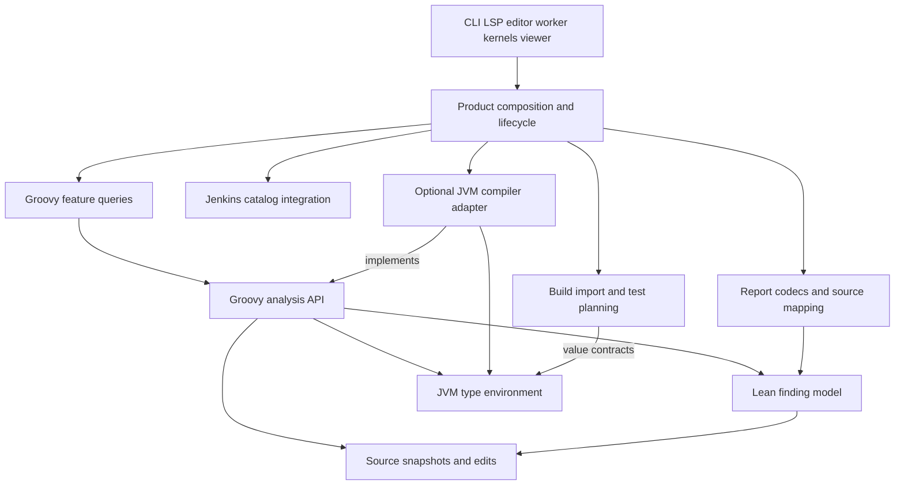

# Analysis SDK and infrastructure extraction delivery

Status: authorized implementation program. This is a delivery design, not evidence that the proposed libraries or native
implementations exist. Product priorities remain the [Quality Bar](../docs/quality-bar.md). Existing verification,
semantic-session, protocol, logging, profiling and distribution work keeps its current ownership and trackers.

## Outcome

Make gvy a product layer over an independently consumable Groovy analysis SDK and focused infrastructure libraries.
Preserve correct answers, source identity, uncertainty, safe edits and recovery while changing internal APIs. Breaking
changes are expected where existing contracts conceal compiler objects, failures, mutable global state or platform
assumptions.

The end state includes:

- One analysis identity and project environment for navigation, diagnostics, hover, CLI and index export.
- A Groovy analysis SDK consumed without the LSP server, editor, CLI parser or network/build-tool stack.
- Source/edit, finding/report, JVM metadata, build-import and Jenkins catalog boundaries with actual consumer proof.
- Optional compiler, CodeNarc, OpenRewrite, framework, worker and platform integrations behind owned contracts.
- A supervised JVM semantic worker and a useful Java-free native slice, followed by evidence-based Go/Rust decisions.
- Reproducible profiling and separate JVM-cache, Native Image and runtime-loading experiments with truthful outcomes.
- Small reviewed PRs, validated publication heads, verified squash landing, and task branch/worktree cleanup.

Language neutrality, JVM independence and production readiness are separate claims. A generic BSP or Jupyter library may
remain JVM-specific. A portable value schema may remain deliberately Groovy-specific.

## Audited baseline

The initial audit used gvy `ce45ade0bd665ad1970d74482f8ed28aec1c628d`; the delivery inventory was refreshed against
`583798140`. At that baseline, settings declares 41 modules. `gls` has 289 production Kotlin files and 22 direct
production project dependencies. The source inventory is architectural evidence, not a performance measurement.

These constraints describe the audited baseline. [Delivery evidence](#delivery-evidence) records subsequent changes and
their remaining limits.

Important constraints:

- `parser:api` includes Groovy compiler policy and AST helpers. `parser:core` also runs the Groovy compiler.
- `semantics:core` combines value models, AST extraction, Groovy policy, reflective access and storage.
- Compiler ASTs escape through parser results and feature contexts; the existing worker implementation is in-process.
- The engine abstractions, symbol stores and index-export producer do not yet share one authoritative fact boundary.
- `diagnostics:api` exports Groovy AST and LSP4J types. Reports and client payloads have competing hand-written schemas.
- `BuildTool` combines import, detection, watching, test planning and UI projections. Some failures look like empty
  successful resolutions. Maven BSP advertises operations whose implementation returns success without doing the work.
- REPL output capture changes process-global streams behind an instance lock. Jupyter core imports the Groovy executor.
- Placeholder/unconsumed modules and publicly exposed implementation types must not become public SDK guarantees.

Read the actual source and active PRs again before each slice. New fixes may retire an item or change its prerequisite;
update this delivery record instead of duplicating another contributor's work.

## Dependency and ownership design

Arrows are module dependencies, not process boundaries. Libraries never import product composition, LSP handlers, editor
APIs or CLI entry points. Optional adapters own filesystem, network, process, compiler and platform effects.

| Family                | Owns                                                                                                          | Does not own                                                                                |
| --------------------- | ------------------------------------------------------------------------------------------------------------- | ------------------------------------------------------------------------------------------- |
| Source contract       | Snapshot identity, explicit coordinate units, line indexes, span/edit preconditions                           | Groovy AST, LSP DTOs, filesystem discovery, global source cache                             |
| Finding/report model  | Rule identity, severity, provenance, locations/fixes; distinct diagnostic, coverage and observed-test records | Compiler provider context, document scheduler, discovered-test lifecycle, command execution |
| Groovy analysis SDK   | Groovy semantics, extraction/query contracts, uncertainty, reusable feature and edit planning                 | LSP transport, shell command parsing, editor state, arbitrary workspace effects             |
| JVM metadata SDK      | Ordered type environment, descriptors, generics/hierarchy, optional source attachments                        | Groovy coercion/dispatch, guessed project dependencies, mandatory network access            |
| Build-workspace SDK   | Target/source-set/dependency evidence, completeness, provenance, import/session capabilities and test plans   | Editor presentation, Jenkins augmentation, implicit task execution                          |
| Jenkins metadata SDK  | Versioned catalog model/merge, JSON, plugin metadata and optional acquisition/descriptor bridges              | Controller APIs, CPS execution, workspace/session orchestration                             |
| Jupyter SDK candidate | Protocol/channels/authentication and language-neutral executor lifecycle                                      | Groovy defaults, process-global output capture, placeholder execution                       |

The source model is the single owner of spans. The lean finding model is the single owner of findings; analysis APIs
consume it without importing XML/SARIF codecs. Provider requests and matching compiler-context views remain in the
Groovy SDK. Shared IDs connect discovered tests, test results and execution plans without merging their lifecycles.

Use existing `lsp4k`, `jsonrpc4k`, `bsp4k`, `lspeak`, `tackle` and the SCIP/coverage tooling repositories where their
contracts fit. Their presence is not proof of gvy integration readiness. Keep protocol parity, cancellation, reverse
requests, framing and lifecycle gates explicit. Do not create competing generic runtimes inside gvy.

Reusable libraries belong in library repositories; user-facing CLIs/apps consume them from separate repositories. An
isolated internal module can prove an unstable seam before extraction. Public artifacts must build for an independent
consumer with sibling substitutions disabled. Do not publish every helper as a separate artifact or repository.

## Current module disposition

| Modules                                                                                   | Destination                                                                                                   |
| ----------------------------------------------------------------------------------------- | ------------------------------------------------------------------------------------------------------------- |
| `gls`                                                                                     | Product services, composition, LSP/worker adapters and executable entry points                                |
| `common`, `markdown`                                                                      | Move source primitives, Groovy helpers and rendering to their owners; keep tiny helpers private               |
| `parser:api`, `parser:native`, `parser:core`                                              | Analysis contract/compiler adapter; Core transitional until real/public consumers migrate                     |
| `semantics:core`, `semantics-native`                                                      | Owned semantic values/queries plus typed compiler extraction; consolidate duplicate implementations           |
| `parser:rewrite`, `semantics-openrewrite`, `fmt`, `refactor:openrewrite:rewrite-codenarc` | Optional formatting/refactoring family; retire unconsumed semantic wrapper after verification                 |
| `semantics:dsl`, `dsl:dsld`                                                               | Park outside the default graph or implement only against a real consumer                                      |
| `indexer:core`, `indexer:scip`, `indexer:lsif`                                            | Authoritative fact projection plus format codecs; honest partial/failure results                              |
| `diagnostics:api`, `diagnostics:sarif`, `diagnostics:codenarc`                            | Shared findings, SARIF adapter, optional compiler-aware CodeNarc adapter                                      |
| `build-tool`                                                                              | Build import/model, test planning and explicit host watching/execution                                        |
| `bsp:bsp-core`, `bsp:maven-bsp`                                                           | Existing BSP SDK integration and separate truthful Maven BSP application                                      |
| `reports:api`, `reports:coverage`, `reports:results`, `schemas`                           | One consumed contract, pure codecs and explicit IO/source mapping; retire duplicate unused generation         |
| `jenkins`, `dsl:gdsl`, `tools:jenkins-extractor`                                          | Jenkins catalog SDK; GDSL reader stays Groovy-owned; optional catalog bridge and separate extractor CLI       |
| `ext:testing`, `ext:spock`, `ext:junit`                                                   | Neutral inventory, Groovy detector API and inward-dependent framework adapters; injected registry             |
| `repl`, `jupyter:kernel-core`, `jupyter:kernels:groovy`, `jupyter:kernels:jenkins`        | Isolated execution adapter, neutral kernel runtime and honest separate apps; park placeholder                 |
| `viz:ast-model`, `viz:desktop`                                                            | Pure tree model, parser converters and viewer product; general SDK publication requires a real consumer       |
| `tests`, `test-utils`                                                                     | Product regressions and owner-local fixtures; generic black-box capabilities converge toward existing harness |

## Delivery evidence

Updated 2026-11-12. These merged slices establish prerequisites; several parent units still need additional work.

| Delivered slice                                      | Merged evidence                                             | Remaining gate                                                                                                        |
| ---------------------------------------------------- | ----------------------------------------------------------- | --------------------------------------------------------------------------------------------------------------------- |
| S1: neutral UTF-16 line indexing                     | [#1774](https://github.com/albertocavalcante/gvy/pull/1774) | The GLS facade retains existing behavior. Snapshot identity and safe edit preconditions remain S2.                    |
| R1a: Boolean JaCoCo line coverage                    | [#1779](https://github.com/albertocavalcante/gvy/pull/1779) | Source attribution, partial parsing and aggregation remain R1/R2 work.                                                |
| SARIF UTF-16 column declaration                      | [#1784](https://github.com/albertocavalcante/gvy/pull/1784) | URI adapters and shared finding consumption remain F1/F2 work.                                                        |
| Buck bootstrap integrity and action runtime          | [#1798](https://github.com/albertocavalcante/gvy/pull/1798) | Build infrastructure validation does not establish SDK or native readiness.                                           |
| Coverage wire assertions use the project JSON reader | [#1821](https://github.com/albertocavalcante/gvy/pull/1821) | Production serialization stays on the existing runtime; protocol migration remains #1704.                             |
| B4a: truthful Maven BSP execution capabilities       | [#1855](https://github.com/albertocavalcante/gvy/pull/1855) | Unsupported operations fail explicitly. Target metadata, shutdown (#1838) and executable logging (#1839) remain open. |
| B1a: failed BSP connection and target discovery      | [#1862](https://github.com/albertocavalcante/gvy/pull/1862) | Genuine empty success stays distinct. Source/dependency completeness and consumer progress remain #1859.              |

F1's primitive findings and structural source locations remain in
[draft #1845](https://github.com/albertocavalcante/gvy/pull/1845). Its public dependency exports expose a producer
defect tracked in [#1861](https://github.com/albertocavalcante/gvy/issues/1861). The diagnostic suggests removing an
undeclared edge. A separate producer correction and fresh integrated validation are required. Keep the strict dependency
gate; the local reproduction and an unbuilt patch do not establish a deployed fix.

F1 still needs the later provenance and fix contracts. F2 must preserve diagnostic outcomes. CLI adoption also waits for
[#1731](https://github.com/albertocavalcante/gvy/pull/1731). The current application continues to use LSP4J/BSP4J;
protocol SDK improvements do not establish gvy integration readiness.

The analysis SDK, metadata backend, supervised JVM worker and Go/Rust stages retain their original acceptance gates. No
native implementation, AOT compatibility, measured performance gain or public SDK release follows from these
prerequisite slices.

## PR delivery DAG

Each unit is independently reviewable. Split a unit further when its final diff, failure modes or validation surface
would exceed a useful review. A listed dependency is an evidence prerequisite, not permission to merge an incomplete
stack. Status/evidence belongs in the linked tracker and PRs; entries below are pending unless a merged PR is recorded.

| Unit | Prerequisite                                                           | Outcome and completion gate                                                                                                                                              |
| ---- | ---------------------------------------------------------------------- | ------------------------------------------------------------------------------------------------------------------------------------------------------------------------ |
| S1   | None                                                                   | Extract active neutral UTF-16 line indexing, retain GLS facade/Groovy conversion, and prove mixed-ending/Unicode consumer behavior with direct build dependencies        |
| S2   | S1; session ownership agreement                                        | Source identity and versioned edit preconditions use existing document incarnation/configuration authority; stale, reopened and conflicting edits are rejected           |
| F1   | S1                                                                     | Introduce lean finding model with source/rule/provenance/fix values; independent consumer has no compiler/LSP/codec runtime dependency                                   |
| F2   | F1; current diagnostic outcomes                                        | CodeNarc/LSP/SARIF consume the same finding model without losing completion/failure and publication fencing; actual frames/output fixtures pass                          |
| A1   | Existing [#1713](https://github.com/albertocavalcante/gvy/issues/1713) | One current analysis session/environment serves features; buffer/config/classpath changes and failure retirement remain correct                                          |
| A2   | S2, F1, A1                                                             | Detached Groovy analysis API exposes capabilities and found/absent/unknown/ambiguous/unsupported/failed/stale outcomes; no AST/Class/LSP escape hatch                    |
| A3   | A2                                                                     | One real semantic feature and outline consume the SDK; independent batch/CLI consumer gets useful correct answers without an editor/server                               |
| A4   | A3                                                                     | Consolidate fact ownership and index export; references/hierarchy/exports derive from matching facts with explicit partial results and independently validated formats   |
| A5   | A3, A4; [#1276](https://github.com/albertocavalcante/gvy/issues/1276)  | Retire migrated Core/engine/symbol paths after production and published-consumer inventory; no hidden consumer or reflection-backed solver dependency remains            |
| A6   | A3; publication gates                                                  | Publish library from its own repository and pin product consumers; isolated artifact builds and source/semantic fixtures pass; old product release remains rollback      |
| J1   | S1, A2                                                                 | Value-only ordered JVM type environment replaces Class-returning public APIs while existing backend behavior remains covered                                             |
| J2   | J1                                                                     | Class-file metadata backend handles hierarchy/generics/annotations/overloads, target JDK and incomplete dependencies without loading project classes                     |
| J3   | J1                                                                     | Source attachments and Java inspection leave GLS; ambiguous/missing attachments and declaration locations are explicit; optional IO policies are injected                |
| B1   | None                                                                   | Build resolution failures remain failed/partial/unsupported rather than empty success; genuine empty complete workspaces stay distinguishable                            |
| B2   | B1, J1                                                                 | Split detection/import/session/test-plan contracts using ordered target evidence; cancellation/repository policy and multi-target fixtures pass                          |
| B3   | B2; BSP SDK readiness                                                  | Replace duplicate BSP stack with existing SDK integration; reverse requests, cancellation, initialization/shutdown, source ownership and thread/process cleanup pass     |
| B4   | B1, B2                                                                 | Maven BSP advertises only implemented operations; selected target and dependency-source results are truthful; assembled server round trips pass                          |
| R1   | None                                                                   | Correct report metrics, missing-source identity, partial parse and merge semantics; authentic JaCoCo/JUnit/Gradle/Maven fixtures prove outcomes                          |
| R2   | R1, S1, F1                                                             | Pure report parsing separates discovery/source mapping/aggregation; malformed/oversized inputs and module/path collisions are bounded and explicit                       |
| R3   | R2                                                                     | One consumed report contract replaces duplicate generated/hand-written models; optional codec closure and independent artifact consumer pass                             |
| K1   | None                                                                   | Jenkins catalog values/merge/JSON have one versioned schema, deterministic precedence/provenance and offline consumer fixtures                                           |
| K2   | K1                                                                     | Consolidate plugin bytecode extraction; acquisition and GDSL/Groovy bridges remain optional with explicit failures/input limits                                          |
| K3   | K2                                                                     | Independent catalog library and separate extractor app consume actual artifacts; no workspace/LSP/controller/execution dependency leaks                                  |
| E1   | A2                                                                     | Reverse testing-base-to-Spock dependency and inject per-workspace registries; discovery/result/run IDs stay distinct and actual CodeLens/tests remain correct            |
| E2   | F2, E1, R3                                                             | One versioned gvy custom protocol generates/validates both server and TS consumers; capability, numeric/range/error payload tests use actual frames                      |
| X1   | None; execution ownership agreement                                    | Groovy execution has per-session output, bounded results and timeout/cancel/reset/close; concurrent sessions cannot capture each other's output                          |
| X2   | X1                                                                     | Jupyter protocol runtime loses Groovy defaults/dependency; a non-Groovy executor proves channel liveness and interrupt/shutdown during long execution                    |
| X3   | X2                                                                     | Correct assembled launchers; retire placeholder Jenkins kernel or implement against its actual execution contract; no fake success capability                            |
| V1   | S1, A2                                                                 | Split tree schema from parser converters; viewer uses source identity/ranges honestly; independent non-Groovy consumer precedes generic publication                      |
| W1   | A2, A3                                                                 | Data-only worker protocol specifies versions/capabilities, source/project/worker epoch, bounded messages and cancellation/restart/replay                                 |
| W2   | W1                                                                     | Real JVM child serves semantic facts/coarse queries; stale responses, crash/restart, logs, classpath churn and total host+worker resource use pass                       |
| N1   | S2, A2                                                                 | Existing Go parser/formatter serves a Java-free editor syntax slice; incomplete input, Unicode, cancellation and lifecycle parity are measured                           |
| N2   | N1, J2, W2                                                             | Expand native editor semantics while making JVM-only capabilities optional; scope/import/member/DSL uncertainty remains honest                                           |
| N3   | N1; named decision question                                            | Compare a bounded Rust prototype on the same feature/workload contract; choose from correctness, ownership, maintenance and measured resources                           |
| P1   | Existing profiling program                                             | Packaged first-use, editing, warm-query and churn workloads produce source/runtime/corpus-bound evidence with correctness counters                                       |
| P2   | P1                                                                     | Compare HotSpot/Graal JVM and CDS/AOT caches on matching workloads; actual cache acceptance, fallback and runtime requirements are recorded                              |
| P3   | P1, J1                                                                 | Ordinary Native Image and Crema are separate gates: dependency JAR created after image construction, real features and reload churn; no tracing-only compatibility claim |

S1 does not establish snapshot identity, safe edits, a complete source SDK or a native implementation. It removes one
real coupling without making later contract decisions prematurely. Likewise, a small worker API can retain a large JVM
implementation until native features replace it; total process memory and useful independent capability decide its
value.

## Coordination and publication

- Existing [#1709](https://github.com/albertocavalcante/gvy/issues/1709) and
  [#1713](https://github.com/albertocavalcante/gvy/issues/1713) own verification/session authority. Reuse actual source,
  parse completion, workspace/configuration and document-incarnation contracts; do not invent competing generations.
- [#1704](https://github.com/albertocavalcante/gvy/issues/1704) owns LSP4K readiness and eventual Gson retirement.
  [#1741](https://github.com/albertocavalcante/gvy/issues/1741) owns CLI/runtime distribution. Reuse their concrete
  prerequisite findings and acceptance tests.
- [#1740](https://github.com/albertocavalcante/gvy/issues/1740) owns current CodeNarc failure boundaries; it can retire
  reflection setup without a parallel adapter rewrite. [#1712](https://github.com/albertocavalcante/gvy/issues/1712) is
  closed; reuse its landed lexical-declaration identity behavior. Coordinate against actual publication/merge heads
  before moving affected code.
- Keep test/framework/plugin registration explicit and injectable. Dynamic third-party loading is not a prerequisite for
  modularity. Preserve current bounded descriptor interpretation and non-execution policy.
- Keep Gradle, Bazel and Buck2 dependency edges aligned. Generic extraction must not drag compiler/LSP/IO stacks into
  leaf consumers. Use actual artifact dependency inspection and import checks, not directory names, to prove closure.
- Match checks to behavior, give build/test JVMs explicit bounded heaps, and run heavy jobs through the host build slot.
  Observe active handles rather than restarting a build after a polling timeout. Preserve unrelated processes/caches.
- Every PR gets independent final-diff review before merge. Fix actionable findings, re-review changed code, inspect all
  applicable final-head CI diagnostics, squash with a handcrafted Conventional Commit, verify target commit, then remove
  only the owned merged branch/checkout. Green CI does not replace review or runtime correctness evidence.

## Performance and release evidence

For every architectural slice, record what cost moves: parse count, transient compilation, retained source/AST/loader
state, allocations, queueing, classpath inspection, serialization and total processes. Preserve existing complexity
bounds; a new abstraction must not add repeated scans or copies on the request path. Use meaningful fixed-workload
comparisons where behavior or complexity changes, rather than unstable wall-clock assertions in ordinary unit tests.

Before library promotion, require explicit public API/dependency review, an independent artifact consumer, malformed and
partial-input checks, lifecycle/failure recovery, real downstream fixtures, and reproducible release/rollback evidence.
Optional dependencies stay optional. Public compatibility is a contract, not a copy of today's implementation details.

Each unresolved item retains its owning family, impact, reason, next unit and gate in this DAG or its existing tracker.
Moving it to a document does not resolve it. Update merged evidence and remaining limits without claiming the full
program complete after a subset of extractions.
