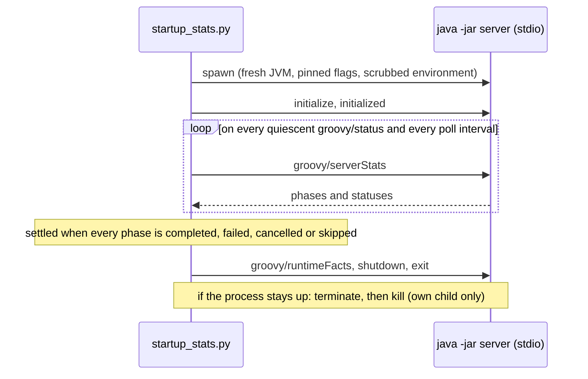

# Startup phase measurement

Startup timings were only reachable from an editor session. `startup_stats.py` starts the packaged server jar as a fresh
process, waits until every startup phase has ended, and writes the server's own
[`groovy/serverStats`](../../docs/lsp/server-stats.md) result for each run to one JSON file. It needs Python 3.11 or
newer and no packages.

This is a measurement tool. It records numbers; it does not compare them with a budget and does not fail on slow
startup. Issue [#1562](https://github.com/albertocavalcante/gvy/issues/1562) tracks the phase timings and
[#1564](https://github.com/albertocavalcante/gvy/issues/1564) the baseline work built on them.

## What a run does



- **Command line:** `java <editor default flags> -jar <jar>`. The flags copy `DEFAULT_SERVER_VM_ARGS` in
  [`launchArgs.ts`](../../editors/code/client/src/server/launchArgs.ts); a unit test fails when the copy drifts.
- **Environment:** `JAVA_TOOL_OPTIONS`, `JDK_JAVA_OPTIONS`, `_JAVA_OPTIONS` and `CLASSPATH` are removed from the child.
  The report records, for each name, whether it was set (not its value).
- **Server requests:** every request from the server gets an answer, an array of nulls for `workspace/configuration` and
  null for anything else.
- **Outcome per run:**

| Outcome             | Meaning                                                                                 |
| ------------------- | --------------------------------------------------------------------------------------- |
| `settled`           | Every phase reached a terminal status.                                                  |
| `timeout`           | Not settled within `--timeout-seconds`. The last snapshot is kept.                      |
| `server-exited`     | The server closed its output or exited first.                                           |
| `protocol-error`    | A malformed frame or response, or a `serverStats` result that failed the privacy check. |
| `stats-unavailable` | The server answered `groovy/serverStats` with MethodNotFound (an older server).         |

## Run it

From the repository root, with `java` 17 or newer on `PATH`:

```sh
python3 tools/perf/startup_stats.py \
  --jar path/to/gls-<version>-all.jar \
  --runs 5 \
  --label my-workspace \
  --output startup-stats.json \
  /path/to/workspace
```

| Option               | Default  | Meaning                                                                       |
| -------------------- | -------- | ----------------------------------------------------------------------------- |
| `--jar`              | required | The server jar (`gls-*-all.jar`).                                             |
| `--runs`             | 5        | Fresh server processes to start, one after another, 1 to 100.                 |
| `--label`            | required | A token for the workspace, matching `^[a-z0-9][a-z0-9._-]{0,63}$`.            |
| `--output`           | required | The JSON file to create. It must not exist; the tool never overwrites a file. |
| `--timeout-seconds`  | 600      | Per-run limit, up to 86400. Shutdown after a timeout can add up to 15 s.      |
| `--poll-interval-ms` | 1000     | Interval between `groovy/serverStats` polls.                                  |

Exit status: 0 when every run settled; 1 when a run did not settle (the file is still written), when the runs disagree
on build or runtime identity (no file is written), or when `java` cannot be started; 2 for a usage error.

There is no Gradle step. To get a jar without building, download the `groovy-lsp-jar-*` artifact of a CI run on the
commit you want to measure:

```sh
gh run download <run-id> --repo albertocavalcante/gvy --pattern 'groovy-lsp-jar-*' --dir <empty-directory>
```

Without a jar, the unit tests still run against a scripted stand-in server; see [Tests](#tests).

## Cold and warm

The tool cannot produce a truly cold start. Purging the operating system's file cache needs root, the Gradle daemons,
`~/.gls/cache` and `~/.groovy-lsp` are shared with other processes, and isolating `user.home` would force downloads. It
controls a fresh JVM for every run, the JVM flags, the environment and the run order.

Run 0 is therefore labelled `first`: the state before it is unknown, and it is never called cold. Later runs are
`repeat`. The summary pools `repeat` runs only. Run `--runs 1` for a `first` measurement alone.

## Output

One JSON object with `schema: "gvy-startup-stats"` and `schemaVersion: 1`. Values below are illustrative.

```json
{
  "workspaceLabel": "my-workspace",
  "identity": {
    "artifactSha256": "…",
    "build": { "versionState": "known", "version": "0.5.4-dev+g1234567" },
    "javaFeature": 17,
    "javaVersion": "17.0.13",
    "maxHeapBytes": 2147483648,
    "os": "linux",
    "arch": "x64",
    "cpuCount": 4,
    "jvmArgs": ["-XX:+ExitOnOutOfMemoryError", "…"],
    "removedEnvironment": { "JAVA_TOOL_OPTIONS": false, "…": false }
  },
  "plannedRuns": 5,
  "runs": [
    {
      "index": 0,
      "position": "first",
      "outcome": "settled",
      "spawnToInitializeResponseMs": 812,
      "spawnToSettledMs": 6400,
      "quiescentObserved": true,
      "statusFilesTotal": 1,
      "serverStats": { "schemaVersion": 1, "build": {}, "startup": {} },
      "shutdown": "clean"
    }
  ],
  "summary": {
    "pooledPosition": "repeat",
    "spawnToSettledMs": { "n": 4, "medianMs": 5900, "minMs": 5700, "maxMs": 6100 },
    "phases": [
      { "name": "workspace.compile", "completedRuns": 4, "otherRuns": 0, "medianMs": 90, "minMs": 80, "maxMs": 110 }
    ]
  }
}
```

The file also holds `recordedAt`, `toolSha256`, `timeoutMs` and `pollIntervalMs`. `shutdown` is `clean`, `terminated`,
`killed` or `exited`. `serverStats` is embedded exactly as the server sent it; `identity.build` is its `build` object,
and the Java and heap values come from `groovy/runtimeFacts`. A value the server does not report as known is `null`.

The summary holds, for each of the six phases in the schema, the number of repeat runs that `completed` it, the number
with any other status (`otherRuns`), and the median, minimum and maximum of their `durationMs`. Medians of an even count
are rounded down. `summary.spawnToSettledMs` covers the repeat runs that settled.

## Reading the numbers

- **Phase durations and offsets** in `serverStats` are measured by the server on its monotonic clock, in whole
  milliseconds. They are exact to the server's resolution.
- **`spawnToSettledMs`** is the time from starting the process until the response that showed every phase terminal
  arrived. It includes JVM start, which the server's offsets do not, and it is quantized by the poll interval: the tool
  asks on every quiescent status and every `--poll-interval-ms`, so a run can be seen as settled up to one interval
  after its last phase ended. Use phase offsets for precision and `spawnToSettledMs` for what a user waits.
- **A phase that never leaves `pending`** (a `workspace.setup` failure or a JVM `Error`) is not a failure the tool can
  see, so that run ends at the timeout.
- **FIXME(#2514):** after a build-file watcher failure the server can report `dependencies.resolve` as `failed` while
  resolution is still running, so a snapshot can look settled early. The tool cannot detect this; it is tracked in
  [#2514](https://github.com/albertocavalcante/gvy/issues/2514). The CI fixture is not affected.

## Privacy

The report holds the label, numbers, fixed words and the strings of `serverStats` that match `^[A-Za-z0-9._+-]{1,64}$`.
Before a result is embedded, its `schemaVersion` must be 1 and every string in it must match that pattern; otherwise the
run is a `protocol-error` and the result is dropped. The workspace path and name, the jar path, the host name, message
texts and the server's stderr are never recorded, and stderr is read and discarded. The report is an allowlist, not a
redaction of free text, in line with the [logging delivery plan](../../kb/LOGGING_DELIVERY_PLAN.md).

## Tests

```sh
uv run --offline --locked --project .reuse ruff format --check tools/perf/startup_stats.py tools/perf/fake_lsp_server.py tools/perf/test_startup_stats.py
uv run --offline --locked --project .reuse ruff check tools/perf/startup_stats.py tools/perf/fake_lsp_server.py tools/perf/test_startup_stats.py
uv run --offline --locked --project .reuse basedpyright tools/perf/startup_stats.py tools/perf/fake_lsp_server.py tools/perf/test_startup_stats.py
uv run --offline --locked --project .reuse ty check tools/perf/startup_stats.py tools/perf/fake_lsp_server.py tools/perf/test_startup_stats.py
python3 -m unittest tools.perf.test_startup_stats
```

The unit tests run the tool against `fake_lsp_server.py`, a scripted peer, and need no jar. `RealServerTest` runs only
when `GVY_STARTUP_STATS_JAR` names a server jar; it opens a copy of `tests/e2e/resources/workspaces/hover-basic` twice
and expects both runs to settle with all six phases completed. `GVY_REQUIRE_REAL_SERVER=1` turns that skip into a
failure. `GVY_STARTUP_STATS_OUTPUT` names the file the real run writes, so it can be kept.

## How CI exercises it

The `smoke-test` job's Ubuntu leg already downloads the built jar. It then runs the four static checks above and the
unit tests with `GVY_REQUIRE_REAL_SERVER=1` against that jar, and uploads the report as the `startup-stats` artifact for
7 days. This is a smoke run that shows the tool works against the packaged server, not a performance gate; a CI runner's
numbers are not a baseline.

## Not covered

No committed baseline, budget gate, memory figures, per-method latency or corpus of larger workspaces yet, and no macOS
or Windows run.
