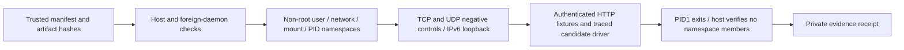

<!-- SPDX-FileCopyrightText: Alberto Cavalcante and the gvy contributors -->
<!-- SPDX-License-Identifier: Apache-2.0 -->

# Restricted Gradle qualification harness

This harness runs **trusted, explicitly selected candidate artifacts** under a non-root Linux network namespace. It
keeps loopback available, records child socket attempts separately from network prevention, and checks process cleanup
from outside the PID namespace. It does not download tools, build candidates, change system settings, or certify the
complete acceptance matrix from a command exit code.

> [!IMPORTANT]
> This is qualification infrastructure, not an adversarial-code sandbox. Full qualification refuses WSL and its
> interoperability path. A mechanism probe may run on WSL, but cannot establish native Linux or packaged-editor
> readiness. Successful `io_uring` activity remains an observer coverage failure. Do not remove it from traces to obtain
> a pass.



## Prerequisites and admission

- Run an explicitly selected **Linux ELF Node 20+** executable as a non-root user. The UID is preserved inside the user
  namespace; the harness never maps the user to UID 0. Node 24 is suitable only if the execution environment supplies an
  independently qualified observer boundary for its actual backend. `UV_USE_IO_URING=0` is not assumed to disable every
  use of `io_uring`.
- Preinstall `unshare`, `ip`, and `strace`; enable unprivileged user namespaces through the host's existing policy. No
  `sudo`, root container, sysctl, package installation, or system mutation is performed by this harness.
- Supply an independently built, reviewed `seccomp-launcher.c` binary and its exact SHA-256. This launcher supports only
  Linux x86_64 LP64 little-endian and requires kernel `close_range` and seccomp filter support. Other ABIs fail closed.
  The artifact runner never compiles or installs it automatically. Qualification requires a passing mechanism receipt
  from the intended native Linux runner.
- Reserve an exclusive Gradle lane on the host. The manifest acknowledges this reservation, and the harness rejects live
  or idle daemons of the target version found in `/proc`. It never stops foreign daemons. A process scan cannot prevent
  another actor starting a daemon immediately afterward; the exclusive lane is an operational prerequisite.
- Use frozen candidate JAR/VSIX bytes with explicit SHA-256 values, a provisioned Gradle directory, a selected JDK and
  disposable fixture workspaces. Do not point test commands at personal projects. The effective `GRADLE_USER_HOME`, or
  default `~/.gradle`, is retained. No isolated-home recovery is attempted.
- Run applicable host memory/disk/build-slot guards before admission. The harness bounds its logs and deadlines; trusted
  candidate code can still write caches/build outputs. It does not provide a filesystem quota.

## Run a mechanism probe

The output directory must not already exist. Its parent must exist. Receipts and logs are private (directory mode 0700,
files 0600).

```sh
/absolute/linux/node tools/qualification/run.mjs \
  --probe --output /private/receipts/mechanism-001 \
  --seccomp-helper /private/tools/seccomp-launcher \
  --seccomp-helper-sha256 EXACT_HELPER_SHA256
```

A complete probe requires both normal exit and forced termination of the namespace owner. Each case observes a detached
session-leader child, then checks from the host that the namespace has no remaining processes. It also checks the
preserved UID, distinct network/mount/PID namespaces, loopback-only interfaces/routes, intentional external TCP and UDP
failures, observed external attempts, IPv6 loopback and authenticated/unauthenticated HTTP controls. Unsupported steps
fail with evidence; a partial probe is not a pass.

Before network controls, a raw-syscall canary records baseline io_uring errors, an altered profile must be rejected
before its command executes, and a filtered exec/fork child must observe `ENOSYS` for all three io_uring calls with
`no_new_privs=1`, seccomp filter mode, zero ambient/effective/permitted/inheritable capabilities and no inherited extra
descriptors. Baseline syscall absence is recorded separately; it is not evidence that this filter changed an available
operation. The subsequent Node network control exercises the runtime's fallback. Original successful-io_uring traces
remain failing observer canaries.

The same probe then runs the observer-lifetime control in a fresh namespace. Its worker starts a detached child,
publishes a result marker, waits until the supervisor has observed that marker, and only then attempts a real TCP
connection to the unroutable test address. The receipt must retain that late attempt, prove the worker's natural exit,
record termination of the exact detached child identity, and observe natural tracer exit plus pipe EOF. A separate host
scan must confirm final namespace cleanup. The original non-root UID is preserved, including hosted runner UIDs other
than 1000. This is an intentional mechanism control, never a candidate observation.

The parent invokes
`unshare --keep-caps --user --map-current-user --net --mount --propagation private --pid --fork
--kill-child=KILL --mount-proc`.
The namespace's non-root Node PID1 owns its children. The cleanup claim depends on the actual probe and host-side
membership check, not on an assumption that process groups include detached Gradle daemons.

## Run real candidate scenarios

```sh
/absolute/linux/node tools/qualification/run.mjs \
  --manifest /private/fixtures/candidate.json \
  --output /private/receipts/candidate-001 \
  --seccomp-helper /private/tools/seccomp-launcher \
  --seccomp-helper-sha256 EXACT_HELPER_SHA256
```

Example manifest (replace both hash placeholders with the exact artifact hashes):

```json
{
  "schemaVersion": 1,
  "exclusiveGradleLane": true,
  "deadlineSeconds": 120,
  "artifacts": {
    "serverJar": { "path": "/artifacts/gls.jar", "sha256": "EXACT_JAR_SHA256" },
    "extensionVsix": { "path": "/artifacts/gvy.vsix", "sha256": "EXACT_VSIX_SHA256" }
  },
  "gradle": { "installation": "/tools/gradle-8.5", "version": "8.5" },
  "javaHome": "/tools/jdk-21",
  "scenarios": [
    {
      "id": "packaged-startup",
      "kind": "lsp",
      "cwd": "/fixtures/local-gradle",
      "initializationOptions": {
        "groovy.gradle.installationPath": "/tools/gradle-8.5",
        "groovy.network.policy": { "revision": 1, "policy": { "mode": "cache-only", "allowedOrigins": [] } }
      },
      "steps": []
    }
  ]
}
```

The LSP driver launches the supplied JAR with the supplied JDK and `-Xmx512m`, exchanges actual framed JSON-RPC, checks
`initialize` capabilities, then shuts down and waits for exit. Empty steps prove startup only. Add reviewed `request`,
`notify`, and `waitNotification` steps for real import/navigation/refresh behavior. Request and notification assertions
use a JSON pointer and exact JSON equality:

```json
{ "kind": "request", "method": "groovy/networkPolicy", "params": { "revision": 2, "policy": { "mode": "cache-only", "allowedOrigins": [] } }, "pointer": "/revision", "equals": 2 }
```

The initialization and request schema must match the frozen candidate. The example does not claim that an arbitrary
candidate implements these messages. Notification history is bounded; overflow fails rather than consuming unlimited
memory or silently losing observations.

For an existing editor/CLI/Maven test driver, use `kind: "command"`, an absolute `cwd` and a bounded `argv` array whose
first element is an absolute executable. Arguments are passed directly without a shell. The driver receives these
explicit fixture inputs:

| Environment variable                                      | Value                                            |
| --------------------------------------------------------- | ------------------------------------------------ |
| `GVY_QUALIFICATION_SERVER_JAR` / `GVY_QUALIFICATION_VSIX` | Verified candidate paths                         |
| `GVY_QUALIFICATION_GRADLE` / `JAVA_HOME`                  | Provisioned Gradle / selected JDK                |
| `GVY_QUALIFICATION_HTTP_ALLOWED` / `SECOND` / `DENIED`    | Three distinct loopback HTTP origins             |
| `GVY_QUALIFICATION_HTTP_AUTHORIZATION`                    | Ephemeral fixture-only Basic authorization value |

HTTP endpoints are `/auth`, `/health`, `/redirect/allowed`, and `/redirect/denied`. The request ledger records origin,
method, bounded path, and credential presence/match; it never records the authorization value. The denied origin is
reachable on loopback intentionally: zero requests there must result from candidate policy enforcement, not from a
blocked fixture. Candidate tests must assert this ledger and their own real semantic outcomes separately.

A generic command's success is labeled as requiring separately reviewed candidate assertions. It cannot, by itself,
prove that the VSIX was loaded, a local Maven artifact was republished, or an existing test launcher executed. No mocks
are counted as candidate qualification.

## Evidence and limits

Receipts include Node/tool binary identities and versions, harness file hashes, exact JAR/VSIX hashes, Gradle
installation file hashes, selected JDK executable/release/modules hashes and version output, namespace identities, route
state, negative controls, raw-trace classification, scenario outcomes and cleanup observations. Artifact hashes and user
Gradle/Maven configuration fingerprints are checked again afterward. Fingerprints contain hashes, not credential values.

The harness preserves repository order, credentials, init scripts and `mavenLocal()` by leaving existing configuration
and the effective Gradle home in place. It does not establish the candidate's actual precedence from environment alone;
the real scenario must assert the reported execution context and repository behavior. A `gradle.user.home` JVM-option
override is rejected until an effective-home resolver for that input is reviewed. Regular cache writes are not erased.

Raw strace output is captured from its existing stderr descriptor, independently of candidate stderr. Combined trace and
observer stdout have a 16 MiB cap; overflow, early exit without a result, ambiguous destinations, unfinished outbound
calls, raw sockets, successful/unknown `io_uring`, and host Unix-socket attempts fail closed. Only explicit `ENOSYS`
io_uring denials are recorded as denied calls rather than unknown coverage. TCP `connect`, UDP
`sendto`/`sendmsg`/`sendmmsg`, connected-socket endpoint annotations, IPv4 loopback and IPv6 loopback are classified.
Blocked external attempts are still attempts. The negative control has its own trace and is never subtracted from a
candidate trace by destination.

The worker's result file requests teardown; it does not end observation. PID1 waits for that worker's natural exit,
identified by PID and `/proc` start-time, then repeatedly signals remaining live owned descendants while strace remains
attached. Observer death, uncertain process state, a hanging worker or teardown deadline fails the run. Classification
requires the tracer's natural exit with code 0 and complete pipe EOF. Only then may the namespace write its receipt and
exit; the host independently confirms final namespace cleanup. Signal check/use races are not pidfd-proof: within this
trusted private namespace, a reused PID may designate another owned descendant. The receipt certifies aggregate drain,
not individual signal delivery to a particular historical PID. The actual lifetime control must pass on the intended
runner; deterministic unit tests alone cannot qualify this protocol.

The fixture-local launcher validates every profile byte against its header-derived fixed program, rejects wrong audit
architectures and x32, sets `no_new_privs`, and denies `io_uring_setup`, `io_uring_enter`, and `io_uring_register` with
`ENOSYS`. It checks stdio descriptor identities and closes all descriptors above 2 before exec. Exec has discarded
inherited mappings; this prevents ordinary inherited-ring reuse. The filter is inherited by the worker and its candidate
descendants. Acquiring host rings through Unix sockets or other privileged paths remains outside the trusted-workload
boundary; this is not a general sandbox.

After namespace mount/loopback setup, each filtered launcher sets `no_new_privs`, clears ambient capabilities and uses
`capset` to remove its effective/permitted/inheritable sets, then reads them back before installing the filter. The
exec/fork canary records all four sets independently. The supervisor and observer retain their setup/observation
permissions. Capability removal reduces retained privileges; it does not prevent same-UID signal/file tampering or prove
resistance to ptrace, newly created user namespaces, kernel bugs or malicious fixture code. Trusted commands must not
interfere with the observer or supervisor. See the Linux
[capability sets](https://man7.org/linux/man-pages/man7/capabilities.7.html) and
[ambient clear operation](https://man7.org/linux/man-pages/man2/PR_CAP_AMBIENT_CLEAR_ALL.2const.html).

The design follows the kernel's
[seccomp filter interface and architecture rules](https://www.kernel.org/doc/html/latest/userspace-api/seccomp_filter.html)
and [no_new_privs inheritance](https://www.kernel.org/doc/html/latest/userspace-api/no_new_privs.html). The syscall
numbers come from the
[Linux x86_64 table](https://github.com/torvalds/linux/blob/master/arch/x86/entry/syscalls/syscall_64.tbl). Installed
util-linux must be inspected: the probe host's `setpriv` 2.37.2 lacks the newer
[`--seccomp-filter` option](https://github.com/util-linux/util-linux/blob/master/sys-utils/setpriv.1.adoc), requiring
this small launcher. Exact Node 24.22.3's
[bundled libuv](https://github.com/nodejs/node/blob/v24.22.3/deps/uv/src/unix/linux.c) uses io_uring for non-SQPOLL work
regardless of `UV_USE_IO_URING=0`; that variable is not an enforcement substitute.

No guarantee covers privileged namespace escape, host Unix-socket proxies, WSL interoperability, arbitrary native
extensions or unobserved `io_uring` submissions. Network namespaces prevent ordinary direct IP egress; that is distinct
from observing every possible attempted operation. Full qualification is refused on WSL even if its mechanism probe
passes. A native Linux CI fixture with controlled, verified runtime behavior is the final target.

`completeAcceptanceMatrixQualified` remains false. Reviewed scenario recipes and actual artifact runs are still required
for disconnected import/navigation/test execution; custom local Maven order/new artifacts/same-path republish;
authenticated access/redirect denial/no credential leakage; authority; cancellation/live changes; alternate acquisition
paths; the Java/Gradle compatibility matrix; and refresh/deletion/recovery. Source/unit tests do not close those gates.

## Source checks and cleanup

The dedicated `qualification-mechanism.yml` workflow uses a hosted Ubuntu22.04 runner, read-only repository permissions,
and preinstalled Node20+, C compiler, unshare, ip and strace. It performs no package installation, sudo, root mapping or
sysctl change. Missing tools, insufficient memory/disk or unavailable unprivileged namespaces fail the job explicitly.
The runner label is fixed; exact runtime/tool versions and binary hashes are captured in each receipt. Published image
inventories do not guarantee strace availability, so the first actual CI run remains a capability gate.

The job runs source tests, compiles the helper with strict warnings, checks an intentionally inherited descriptor, then
runs the full mechanism probe including the lifetime control. Runs are sequential with bounded commands and a ten-minute
job deadline. Evidence is retained for seven days even on failure, then the job removes its owned temporary helper and
files. `candidateQualified` and complete-matrix qualification remain false; this workflow does not load a product JAR or
VSIX and does not replace the real scenario matrix.

```sh
node --test tools/qualification/*.test.mjs
```

After independent source review, build the launcher on the intended Linux x86_64 fixture with its native headers:

```sh
cc -std=c11 -O2 -Wall -Wextra -Werror -Wconversion \
  tools/qualification/seccomp-launcher.c -o /private/tools/seccomp-launcher
sha256sum /private/tools/seccomp-launcher
```

Record compiler/version, source hash and output hash in the private build receipt. Before qualification, native controls
must also prove an intentionally inherited descriptor is closed, wrong helper/profile bytes cannot execute, and the
fallback runtime completes under tracing. These are pending gates, not claims inferred from unit tests.

Unit fixtures validate parsers, bounds, argv handling and receipt logic. They are never execution evidence for a
candidate. No tool installation or Gradle build is needed for these tests. Keep raw execution evidence private:
candidate output can contain repository or credential details even when the harness's own request ledger is redacted.

The namespace owns process teardown; the host independently verifies it. Failed runs keep their receipts and raw traces.
Remove only owned disposable fixture workspaces, artifacts and task-local runtimes when their follow-up gates are
closed. Never delete user Gradle caches, credentials, Maven repositories, foreign processes or another task's worktree.
